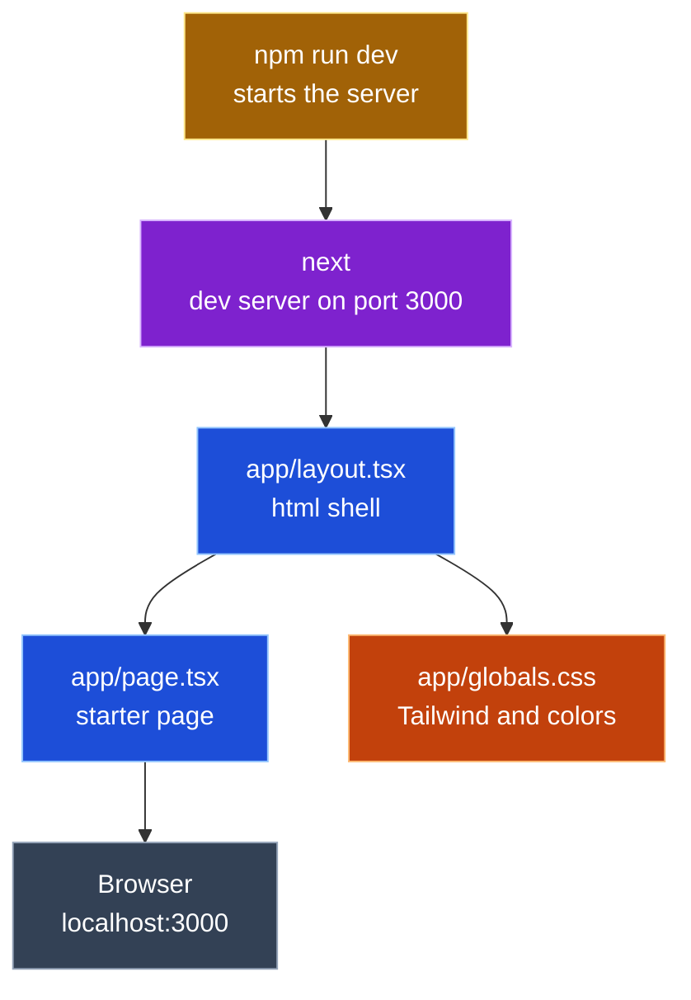

## Entry 1 · #1 Scaffold Next.js

*Oct 14 · 17:48 to 19:15 CT*

<table>
  <tr><th align="left">Field</th><th align="left">Details</th></tr>
  <tr><td><b>Tool</b></td><td>Claude Code · claude-opus-5-5</td></tr>
  <tr><td><b>Asked</b></td><td>Work issue #1, step 1 only: scaffold Next.js 16 with TypeScript, Tailwind 4, App Router, no <code>src/</code>. Show the result and stop</td></tr>
  <tr><td><b>Context</b></td><td>
    <ul>
      <li><code>CLAUDE.md</code></li>
      <li>issue #1 (acceptance criteria)</li>
      <li><code>docs/spec/design.md</code> (File layout)</li>
      <li><code>SOT_documents/UI.md</code> Part 1</li>
      <li><code>SOT_documents/PROMPT_LOG_FORMAT.md</code></li>
    </ul>
  </td></tr>
  <tr><td><b>Changed</b></td><td>
    All new, generated by <code>create-next-app@16</code> in the scratchpad and moved in; only the package name was edited
    <ul>
      <li>🟦 <code>app/layout.tsx</code> (new)</li>
      <li>🟦 <code>app/page.tsx</code> (new)</li>
      <li>🟧 <code>app/globals.css</code> (new)</li>
      <li>🟪 <code>next.config.ts</code>, <code>tsconfig.json</code>, <code>eslint.config.mjs</code>, <code>next-env.d.ts</code> (new)</li>
      <li>🟨 <code>package.json</code>, <code>package-lock.json</code> (new) · <code>next</code> 16.4.1, <code>react</code> 19.3.0, <code>tailwindcss</code> 4</li>
      <li><code>.gitignore</code>, <code>AGENTS.md</code>, <code>README.md</code>, <code>public/*.svg</code>, <code>app/favicon.ico</code> (new)</li>
    </ul>
  </td></tr>
  <tr><td><b>Decision</b></td><td>accepted</td></tr>
  <tr><td><b>Verified</b></td><td>
    <ul>
      <li>~17:56 CT · <code>next dev</code> on port 3123 returned 200, title "Create Next App"</li>
      <li>~17:56 CT · <code>npm run lint</code> passed</li>
      <li>~19:10 CT · Joseph ran <code>npm run dev</code>, saw the starter page at <code>localhost:3000</code> (screenshot)</li>
    </ul>
  </td></tr>
  <tr><td><b>Commit</b></td><td>none yet (git is set up after step 2)</td></tr>
  <tr><td><b>PIOF and what differed</b></td><td>
    <ul>
      <li>Purpose: a running Next.js app that every later step builds on</li>
      <li>Input: none (scaffold defaults)</li>
      <li>Output: the Next.js starter page at <code>localhost:3000</code></li>
      <li>Flow: <code>npm run dev</code> → <code>next</code> → 🟦 <code>app/layout.tsx</code> → 🟦 <code>app/page.tsx</code> → 🟧 <code>app/globals.css</code> → Browser</li>
    </ul>
  </td></tr>
  <tr><td><b>Reflection</b></td><td>
    <ul>
      <li>So my understanding and reflection of this is That the main purpose was to get Next.js app up and running because this is one step that's sequential and every other step builds on.</li>
      <li>there were no inputs on this particular ticket, the goal was just to establish the project shell with the same look from week four.</li>
      <li>The output was essentially the Next.js starter page, which was tested at localhost 3000.</li>
      <li>The actions that were taken were pretty much running <code>npm run dev</code>. and making sure that the Next.js starter page was showing with the message to edit the file, which was a statement that was indicating whether or not it was working.</li>
      <li>Everything rendered and And We didn't edit the <code>page.tsx</code> starter page, but moving on for step two, we will commence with the git ignore additions, the dot env and example and then we'll initiate and connect to the repo and establish our first commit.</li>
    </ul>
  </td></tr>
  <tr><td><b>Explained</b></td><td>
    <b>Entry 1 · #1 Scaffold Next.js</b>
    <ul>
      <li>What it is: an empty but working Next.js house: walls, plumbing and wiring, no furniture yet</li>
      <li>Why: <code>create-next-app</code> refuses a folder that already has files, so the app was built in a scratch folder and moved in; its flags picked TypeScript, Tailwind, App Router and no git</li>
      <li>Files:
        <ul>
          <li>🟦 <code>app/layout.tsx</code>: the frame every page sits in</li>
          <li>🟦 <code>app/page.tsx</code>: what <code>/</code> shows</li>
          <li>🟧 <code>app/globals.css</code>: Tailwind and page colors</li>
          <li>🟨 <code>package.json</code>: the shopping list and the <code>dev</code>, <code>build</code>, <code>lint</code> scripts</li>
        </ul>
      </li>
      <li>Its role in the project: every later ticket adds rooms to this house</li>
    </ul>
  </td></tr>
</table>

### Entry 1 call graph

