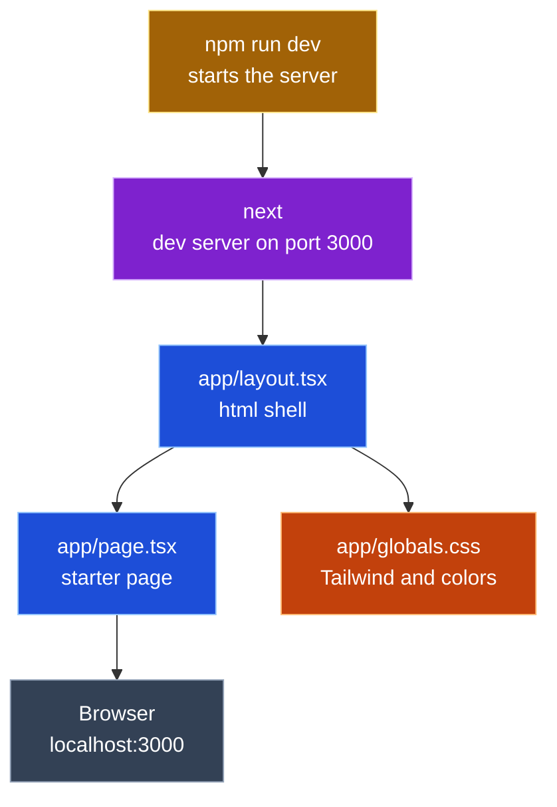
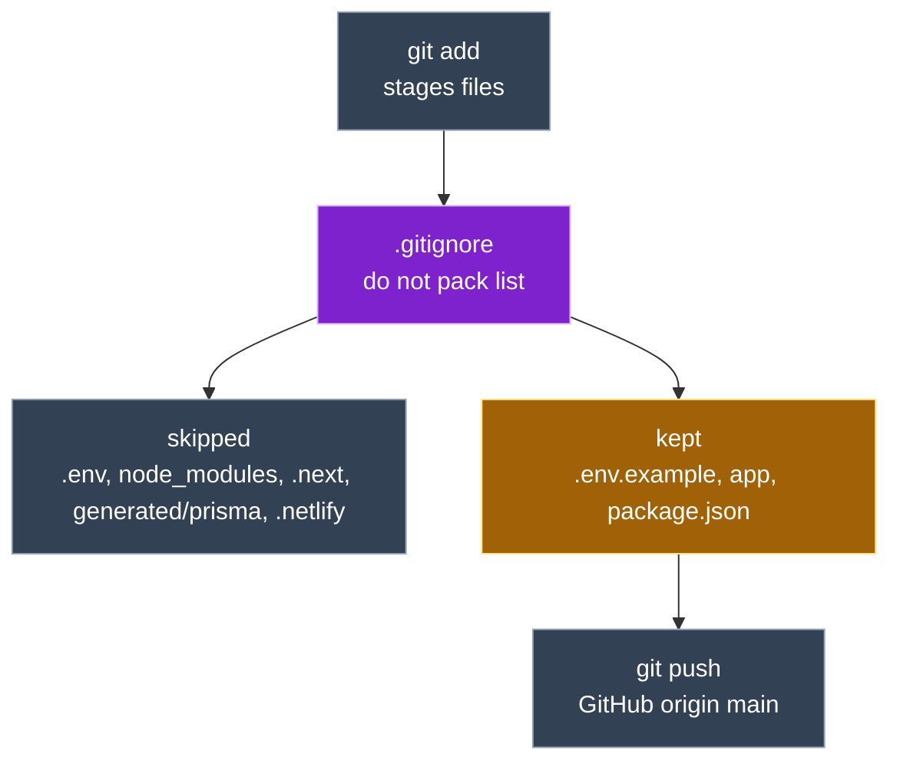
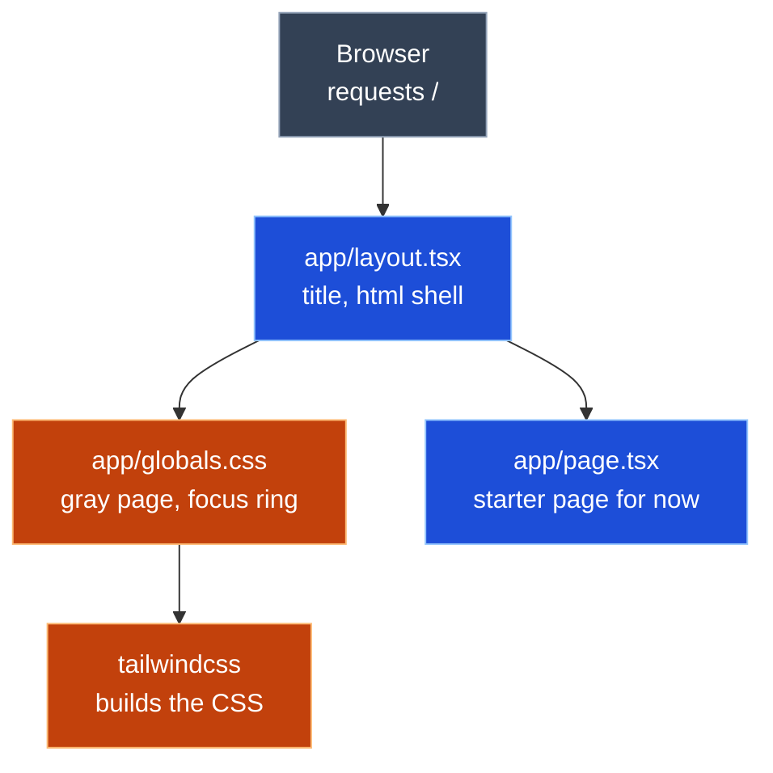
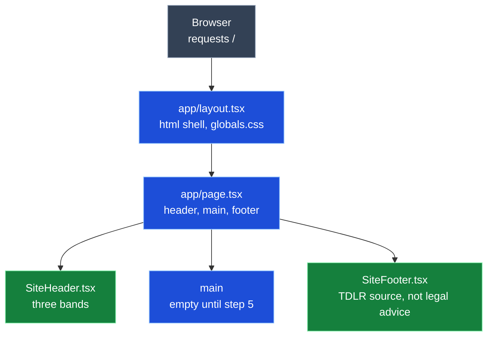
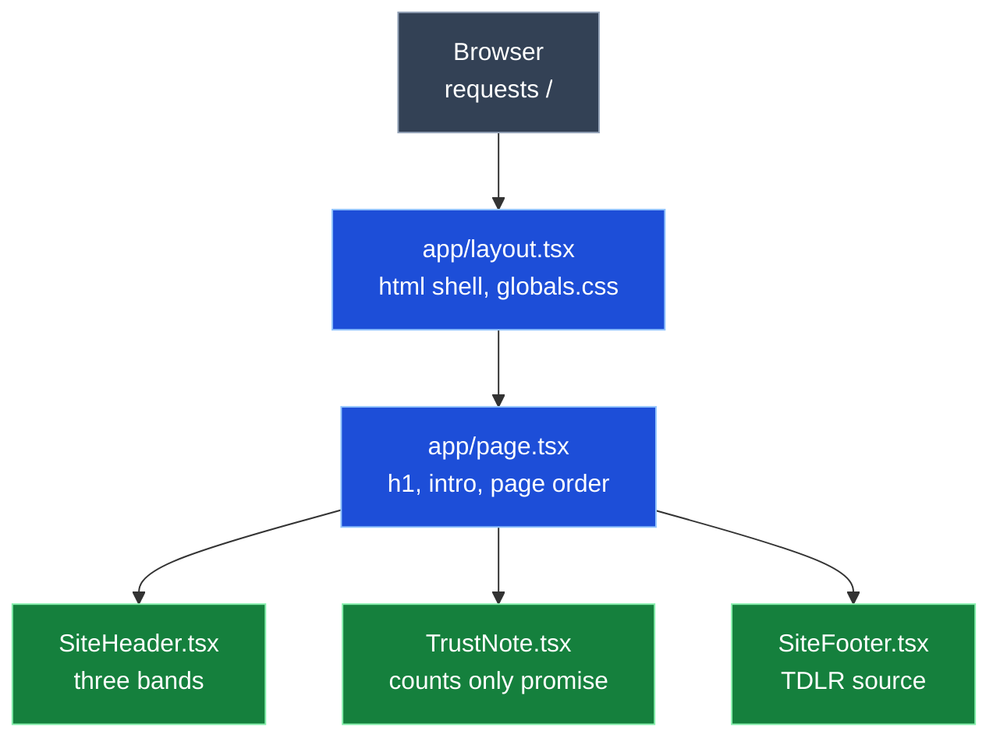
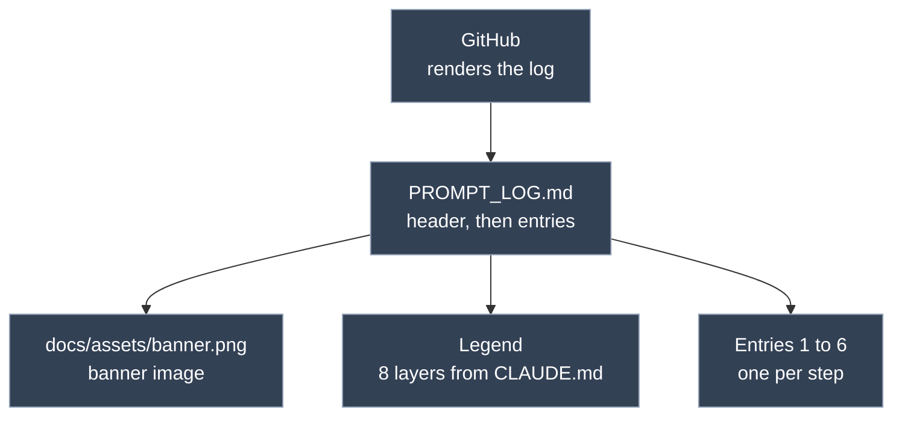
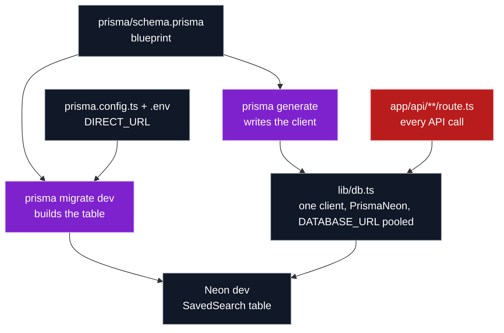
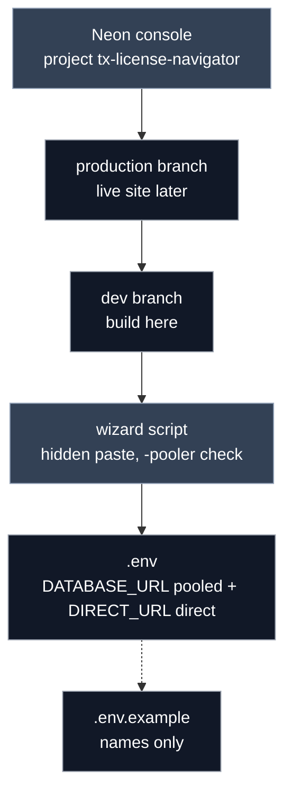
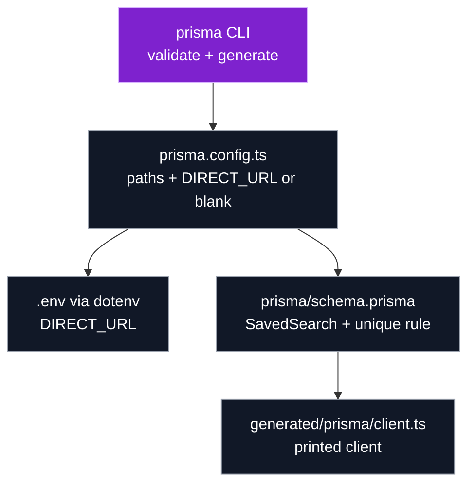

<p align="center"></p>
<h1 align="center">Prompt Log</h1>
<p align="center"><b>TX License Navigator</b> · Week 5 · Claude Code · claude-opus-5-5</p>

---

## Legend

🟦 Entry (<code>app/layout.tsx</code>, <code>app/page.tsx</code>)<br>
🟩 UI (<code>components/*.tsx</code>, <code>lib/counties.ts</code>)<br>
🟥 Server (<code>app/api/**/route.ts</code>)<br>
🟫 TDLR (<code>lib/tdlr.ts</code>)<br>
⬛ Database (<code>prisma/schema.prisma</code>, <code>prisma.config.ts</code>, <code>lib/db.ts</code>, Neon)<br>
🟧 Style (<code>app/globals.css</code>, <code>tailwindcss</code>)<br>
🟪 Tools (<code>next.config.ts</code>, <code>tsconfig.json</code>, <code>next</code>, <code>prisma</code> CLI)<br>
🟨 Dependencies (<code>package.json</code>, <code>package-lock.json</code>)

---

## Project info

<table>
  <tr><th align="left">Field</th><th align="left">Details</th></tr>
  <tr><td><b>One liner</b></td><td>Second Chance License Navigator shows how many people hold a license in any Texas county, using live TDLR data, and keeps a watchlist of saved searches so job seekers can track local demand before they train.</td></tr>
  <tr><td><b>Privacy</b></td><td>counts only, never a personal license row; the watchlist stores only license type, county, label and note</td></tr>
  <tr><td><b>Tools</b></td><td>Claude Code · claude-opus-5-5</td></tr>
</table>

---

## Entry 1 · #1 Scaffold Next.js

*Oct 14 · 17:48 to 19:15 CT*

<table>
  <tr><th align="left">Field</th><th align="left">Details</th></tr>
  <tr><td><b>Tool</b></td><td>Claude Code · claude-opus-5-5</td></tr>
  <tr><td><b>Asked</b></td><td>Work issue #1, step 1 only: scaffold Next.js 16 with TypeScript, Tailwind 4, App Router, no <code>src/</code>. Show the result and stop</td></tr>
  <tr><td><b>Context</b></td><td>
    <ul>
      <li><code>CLAUDE.md</code></li>
      <li>issue #1 (acceptance criteria)</li>
      <li><code>docs/spec/design.md</code> (File layout)</li>
      <li><code>SOT_documents/UI.md</code> Part 1</li>
      <li><code>SOT_documents/PROMPT_LOG_FORMAT.md</code></li>
    </ul>
  </td></tr>
  <tr><td><b>Changed</b></td><td>
    All new, generated by <code>create-next-app@16</code> in the scratchpad and moved in; only the package name was edited
    <ul>
      <li>🟦 <code>app/layout.tsx</code> (new)</li>
      <li>🟦 <code>app/page.tsx</code> (new)</li>
      <li>🟧 <code>app/globals.css</code> (new)</li>
      <li>🟪 <code>next.config.ts</code>, <code>tsconfig.json</code>, <code>eslint.config.mjs</code>, <code>next-env.d.ts</code> (new)</li>
      <li>🟨 <code>package.json</code>, <code>package-lock.json</code> (new) · <code>next</code> 16.4.1, <code>react</code> 19.3.0, <code>tailwindcss</code> 4</li>
      <li><code>.gitignore</code>, <code>AGENTS.md</code>, <code>README.md</code>, <code>public/*.svg</code>, <code>app/favicon.ico</code> (new)</li>
    </ul>
  </td></tr>
  <tr><td><b>Decision</b></td><td>accepted</td></tr>
  <tr><td><b>Verified</b></td><td>
    <ul>
      <li>~17:56 CT · <code>next dev</code> on port 3123 returned 200, title "Create Next App"</li>
      <li>~17:56 CT · <code>npm run lint</code> passed</li>
      <li>~19:10 CT · Joseph ran <code>npm run dev</code>, saw the starter page at <code>localhost:3000</code> (screenshot)</li>
    </ul>
  </td></tr>
  <tr><td><b>Commit</b></td><td><code>d5beecf</code> chore: scaffold next.js 16, ignore env and generated files</td></tr>
  <tr><td><b>PIOF and what differed</b></td><td>
    <ul>
      <li>Purpose: a running Next.js app that every later step builds on</li>
      <li>Input: none (scaffold defaults)</li>
      <li>Output: the Next.js starter page at <code>localhost:3000</code></li>
      <li>Flow: <code>npm run dev</code> → <code>next</code> → 🟦 <code>app/layout.tsx</code> → 🟦 <code>app/page.tsx</code> → 🟧 <code>app/globals.css</code> → Browser</li>
    </ul>
  </td></tr>
  <tr><td><b>Reflection</b></td><td>
    <ul>
      <li>My understanding is that the main purpose was to get the Next.js app up and running, because this step comes first and every other step builds on it.</li>
      <li>There were no inputs on this ticket; the goal was just to establish the project shell with the same look as Week 4.</li>
      <li>The output was the Next.js starter page, which I tested at <code>localhost:3000</code>.</li>
      <li>The main action was running <code>npm run dev</code> and making sure the starter page showed the "edit the file" message, which told me it was working.</li>
      <li>Everything rendered. We didn't edit the <code>page.tsx</code> starter page yet. In step two we'll add the <code>.gitignore</code> rules and <code>.env.example</code>, then connect the folder to the repo and make our first commit.</li>
    </ul>
  </td></tr>
  <tr><td><b>Explained</b></td><td>
    <b>Entry 1 · #1 Scaffold Next.js</b>
    <ul>
      <li>What it is: an empty but working Next.js house: walls, plumbing and wiring, no furniture yet</li>
      <li>Why: <code>create-next-app</code> refuses a folder that already has files, so the app was built in a scratch folder and moved in; its flags picked TypeScript, Tailwind, App Router and no git</li>
      <li>Files:
        <ul>
          <li>🟦 <code>app/layout.tsx</code>: the frame every page sits in</li>
          <li>🟦 <code>app/page.tsx</code>: what <code>/</code> shows</li>
          <li>🟧 <code>app/globals.css</code>: Tailwind and page colors</li>
          <li>🟨 <code>package.json</code>: the shopping list and the <code>dev</code>, <code>build</code>, <code>lint</code> scripts</li>
        </ul>
      </li>
      <li>Its role in the project: every later ticket adds rooms to this house</li>
    </ul>
  </td></tr>
</table>

### Entry 1 call graph



---

## Entry 2 · #1 .gitignore and .env.example

*Oct 14 · 19:15 to 19:45 CT*

<table>
  <tr><th align="left">Field</th><th align="left">Details</th></tr>
  <tr><td><b>Tool</b></td><td>Claude Code · claude-opus-5-5</td></tr>
  <tr><td><b>Asked</b></td><td>Step 2 only: add <code>.env.example</code> and generated Prisma rules to <code>.gitignore</code>, create <code>.env.example</code>. Then Joseph asked to check that every file that needs ignoring is covered</td></tr>
  <tr><td><b>Context</b></td><td>same as Entry 1</td></tr>
  <tr><td><b>Changed</b></td><td>
    1 new file, 1 edited
    <ul>
      <li><code>.gitignore</code> (modified) · <code>!.env.example</code>, <code>/generated/prisma</code>, <code>.netlify</code></li>
      <li><code>.env.example</code> (new) · <code>DATABASE_URL</code> and <code>DIRECT_URL</code>, no values</li>
    </ul>
  </td></tr>
  <tr><td><b>Decision</b></td><td>accepted</td></tr>
  <tr><td><b>Verified</b></td><td>
    <ul>
      <li>~19:30 CT · Joseph ran <code>git init -b main</code>, <code>git remote add origin</code>, <code>git status</code>: <code>.env.example</code> listed, <code>node_modules/</code>, <code>.next/</code>, <code>next-env.d.ts</code> not listed (screenshot)</li>
      <li>~19:40 CT · <code>git commit</code>: 34 files, no <code>node_modules/</code> or <code>.env</code> (screenshot)</li>
      <li>~19:42 CT · <code>git push -u origin main</code>: <code>[new branch] main -> main</code> (screenshot)</li>
    </ul>
  </td></tr>
  <tr><td><b>Commit</b></td><td><code>d5beecf</code> chore: scaffold next.js 16, ignore env and generated files (steps 1 and 2 together)</td></tr>
  <tr><td><b>PIOF and what differed</b></td><td>
    <ul>
      <li>Purpose: keep secrets and generated code out of git; show anyone cloning which variables to set</li>
      <li>Input: none</li>
      <li>Output: ignore rules, and a template listing <code>DATABASE_URL</code> and <code>DIRECT_URL</code></li>
      <li>Flow: <code>git add</code> → reads <code>.gitignore</code> → skips <code>.env</code>, <code>node_modules/</code>, <code>.next/</code>, <code>generated/prisma/</code>, <code>.netlify/</code> → keeps <code>.env.example</code></li>
    </ul>
  </td></tr>
  <tr><td><b>Reflection</b></td><td>
    <ul>
      <li>In step two, we took the steps to make the project safe to share.</li>
      <li>The <code>.gitignore</code> file already blocked <code>node_modules</code>, build output, and every <code>.env</code> file, which I was able to catch.</li>
      <li>We added an exception so <code>.env.example</code> gets committed as a template, plus rules for the generated Prisma client and Netlify's local folder, because anything that can be rebuilt or that holds a secret doesn't belong in git.</li>
      <li>From there, the folder became a git repo connected to GitHub.</li>
      <li>We ran <code>git status</code>, which showed the ignore rules working before anything was staged, then made the first commit and push to put the project online.</li>
    </ul>
  </td></tr>
  <tr><td><b>Explained</b></td><td>
    <b>Entry 2 · #1 .gitignore and .env.example</b>
    <ul>
      <li>What it is: a "do not pack" list for the moving truck; git leaves behind anything on it</li>
      <li>Why: secrets (<code>.env</code>) must never reach GitHub, and anything rebuildable (<code>node_modules/</code>, <code>.next/</code>, the Prisma client) only bloats the repo</li>
      <li>Files:
        <ul>
          <li><code>.gitignore</code>: the list; <code>!</code> marks an exception</li>
          <li><code>.env.example</code>: an empty form showing which secrets to fill in</li>
        </ul>
      </li>
      <li>Its role in the project: makes the first push safe, and keeps the Neon URLs from #2 off GitHub</li>
    </ul>
  </td></tr>
</table>

### Entry 2 call graph



---

## Entry 3 · #1 Global style and focus ring

*Oct 14 · ~20:40 to 20:55 CT*

<table>
  <tr><th align="left">Field</th><th align="left">Details</th></tr>
  <tr><td><b>Tool</b></td><td>Claude Code · claude-opus-5-5</td></tr>
  <tr><td><b>Asked</b></td><td>Step 3 only: Week 4 page background, text color, yellow focus ring and tabular numbers in 🟧 <code>app/globals.css</code>; page title in 🟦 <code>app/layout.tsx</code></td></tr>
  <tr><td><b>Context</b></td><td>
    <ul>
      <li>same as Entry 1</li>
      <li>Week 4 <code>src/index.css</code>, <code>src/App.jsx</code>, <code>index.html</code> (via <code>gh api</code>)</li>
    </ul>
  </td></tr>
  <tr><td><b>Changed</b></td><td>
    2 edited
    <ul>
      <li>🟧 <code>app/globals.css</code> (modified) · <code>#F3F5F8</code> background, <code>#1B2733</code> text, <code>:focus-visible</code> 3px <code>#F2B807</code> ring, <code>.tabular</code>; dark mode removed</li>
      <li>🟦 <code>app/layout.tsx</code> (modified) · title "Texas Second Chance License Navigator"; Geist fonts removed</li>
    </ul>
  </td></tr>
  <tr><td><b>Decision</b></td><td>accepted</td></tr>
  <tr><td><b>Verified</b></td><td>
    <ul>
      <li>~20:45 CT · <code>npm run lint</code> passed</li>
      <li>~20:45 CT · <code>npx tsc --noEmit</code> passed</li>
      <li>~20:50 CT · Joseph pressed Tab at <code>localhost:3000</code>: yellow ring on "Documentation", gray background below the starter box (screenshot)</li>
    </ul>
  </td></tr>
  <tr><td><b>Commit</b></td><td><code>56b7a88</code> style: week 4 background, text color and focus ring</td></tr>
  <tr><td><b>PIOF and what differed</b></td><td>
    <ul>
      <li>Purpose: every page gets the Week 4 background, text color and keyboard focus ring</li>
      <li>Input: none</li>
      <li>Output: global CSS rules and the page title</li>
      <li>Flow: browser loads <code>/</code> → 🟦 <code>app/layout.tsx</code> imports 🟧 <code>app/globals.css</code> → Tailwind builds CSS → <code>body</code> gray, <code>:focus-visible</code> ring on Tab</li>
    </ul>
  </td></tr>
  <tr><td><b>Reflection</b></td><td>
    <ul>
      <li>In step three, we brought over Week 4 look features that apply to the whole site.</li>
      <li>The changes in <code>globals.css</code> give every page a light gray background, dark text, and a yellow ring that appears only when you move around with the keyboard.</li>
      <li><code>layout.tsx</code> sets the browser tab title to match Week 4, and drops the default Next.js font and dark mode because the previous build didn't use them.</li>
      <li>When you press Tab, a yellow ring highlights whatever is selected.</li>
      <li>The rest of the formatting is still being worked on.</li>
    </ul>
  </td></tr>
  <tr><td><b>Explained</b></td><td>
    <b>Entry 3 · #1 Global style and focus ring</b>
    <ul>
      <li>What it is: painting the walls and putting up the house's signs before any furniture goes in</li>
      <li>Why: one CSS file sets the look for every page, so later components do not each repeat the background and focus ring</li>
      <li>Files:
        <ul>
          <li>🟧 <code>app/globals.css</code>: the paint (colors) and the yellow keyboard ring</li>
          <li>🟦 <code>app/layout.tsx</code>: the frame; loads the CSS and names the browser tab</li>
        </ul>
      </li>
      <li>Its role in the project: every component in steps 4 and 5 inherits this look and the accessible focus ring</li>
    </ul>
  </td></tr>
</table>

### Entry 3 call graph



---

## Entry 4 · #1 SiteHeader and SiteFooter

*Oct 15 · by 05:44 CT*

<table>
  <tr><th align="left">Field</th><th align="left">Details</th></tr>
  <tr><td><b>Tool</b></td><td>Claude Code · claude-opus-5-5</td></tr>
  <tr><td><b>Asked</b></td><td>Step 4 only: port the Week 4 header bands and footer to 🟩 <code>components/SiteHeader.tsx</code> and 🟩 <code>components/SiteFooter.tsx</code>, show them on the page</td></tr>
  <tr><td><b>Context</b></td><td>
    <ul>
      <li>same as Entry 1</li>
      <li>Week 4 <code>src/components/SiteHeader.jsx</code> and <code>src/components/SourceNote.jsx</code> (via <code>gh api</code>)</li>
    </ul>
  </td></tr>
  <tr><td><b>Changed</b></td><td>
    2 new files, 1 edited
    <ul>
      <li>🟩 <code>components/SiteHeader.tsx</code> (new) · navy strip, blue title band, red stripe</li>
      <li>🟩 <code>components/SiteFooter.tsx</code> (new) · Week 4 <code>SourceNote</code>; per-link focus classes dropped, the global ring covers them</li>
      <li>🟦 <code>app/page.tsx</code> (modified) · starter page replaced by header, empty <code>main</code>, footer</li>
    </ul>
  </td></tr>
  <tr><td><b>Decision</b></td><td>accepted</td></tr>
  <tr><td><b>Verified</b></td><td>
    <ul>
      <li><code>npm run lint</code> passed</li>
      <li><code>npx tsc --noEmit</code> passed</li>
      <li>by 05:44 CT · Joseph reloaded <code>localhost:3000</code>: three header bands and navy footer with the <code>data.texas.gov</code> link (screenshot)</li>
    </ul>
  </td></tr>
  <tr><td><b>Commit</b></td><td><code>e77383f</code> feat: week 4 header bands and footer</td></tr>
  <tr><td><b>PIOF and what differed</b></td><td>
    <ul>
      <li>Purpose: the page shows the Week 4 header bands and footer</li>
      <li>Input: none; both components are static</li>
      <li>Output: a <code>&lt;header&gt;</code> with three bands and a <code>&lt;footer&gt;</code> with the TDLR source link</li>
      <li>Flow: browser requests <code>/</code> → 🟦 <code>app/layout.tsx</code> → 🟦 <code>app/page.tsx</code> → 🟩 <code>SiteHeader</code>, empty <code>&lt;main&gt;</code>, 🟩 <code>SiteFooter</code> → HTML</li>
    </ul>
  </td></tr>
  <tr><td><b>Reflection</b></td><td>
    <ul>
      <li>In step four, we added the header and footer bands to the page.</li>
      <li>They match the theme and setup from Week 4.</li>
      <li>We reloaded <code>localhost:3000</code> to check them, then I accepted step four and gave my reflection.</li>
    </ul>
  </td></tr>
  <tr><td><b>Explained</b></td><td>
    <b>Entry 4 · #1 SiteHeader and SiteFooter</b>
    <ul>
      <li>What it is: the sign over the front door and the plaque by the exit, moved from the Week 4 house</li>
      <li>Why: each band is its own component, so <code>page.tsx</code> stays short and the look matches Week 4 exactly</li>
      <li>Files:
        <ul>
          <li>🟩 <code>components/SiteHeader.tsx</code>: the three bands at the top</li>
          <li>🟩 <code>components/SiteFooter.tsx</code>: where the numbers come from, not legal advice</li>
          <li>🟦 <code>app/page.tsx</code>: places header, main, footer in order</li>
        </ul>
      </li>
      <li>Its role in the project: frames every later piece (search form, saved list) between the same header and footer</li>
    </ul>
  </td></tr>
</table>

### Entry 4 call graph



---

## Entry 5 · #1 TrustNote, h1 and intro

*Oct 15 · ~05:50 to 06:01 CT*

<table>
  <tr><th align="left">Field</th><th align="left">Details</th></tr>
  <tr><td><b>Tool</b></td><td>Claude Code · claude-opus-5-5</td></tr>
  <tr><td><b>Asked</b></td><td>Step 5 only: port the Week 4 trust note to 🟩 <code>components/TrustNote.tsx</code>, add the Week 4 h1 and intro to 🟦 <code>app/page.tsx</code></td></tr>
  <tr><td><b>Context</b></td><td>
    <ul>
      <li>same as Entry 1</li>
      <li>Week 4 <code>src/components/TrustNote.jsx</code> and <code>src/App.jsx</code> (via <code>gh api</code>)</li>
    </ul>
  </td></tr>
  <tr><td><b>Changed</b></td><td>
    1 new file, 1 edited
    <ul>
      <li>🟩 <code>components/TrustNote.tsx</code> (new) · green counts only note, copied from Week 4</li>
      <li>🟦 <code>app/page.tsx</code> (modified) · h1 "Look up HVAC license demand by county", intro line, <code>&lt;TrustNote /&gt;</code></li>
    </ul>
  </td></tr>
  <tr><td><b>Decision</b></td><td>accepted</td></tr>
  <tr><td><b>Verified</b></td><td>
    <ul>
      <li><code>npm run lint</code> passed</li>
      <li><code>npx tsc --noEmit</code> passed</li>
      <li>06:01 CT · Joseph accepted the step</li>
    </ul>
  </td></tr>
  <tr><td><b>Commit</b></td><td><code>1834dd2</code> docs: prompt log header and entries 5-6 · Closes #1 (steps 5 and 6 together)</td></tr>
  <tr><td><b>PIOF and what differed</b></td><td>
    <ul>
      <li>Purpose: the top of the page reads exactly like Week 4, including the counts only promise</li>
      <li>Input: none; all static</li>
      <li>Output: h1, intro line and green trust note inside <code>&lt;main&gt;</code></li>
      <li>Flow: browser requests <code>/</code> → 🟦 <code>app/layout.tsx</code> → 🟦 <code>app/page.tsx</code> → 🟩 <code>SiteHeader</code> → h1, intro, 🟩 <code>TrustNote</code> → 🟩 <code>SiteFooter</code> → HTML</li>
    </ul>
  </td></tr>
  <tr><td><b>Reflection</b></td><td>
    <ul>
      <li>We added a new component, the trust note. It's very simple but very important, and something we adopted from Week 4.</li>
      <li>It's a green box that promises counts only: never names, addresses, or license records.</li>
      <li><code>page.tsx</code> now has the Week 4 heading, "Look up HVAC license demand by county," and the intro line, with the same colors and sizes, and the header, footer, and trust note in place.</li>
      <li>The page can be checked side by side against Week 4, which was the original plan for picking up where we left off.</li>
    </ul>
  </td></tr>
  <tr><td><b>Explained</b></td><td>
    <b>Entry 5 · #1 TrustNote, h1 and intro</b>
    <ul>
      <li>What it is: the welcome sign inside the front door, plus a promise posted on the wall</li>
      <li>Why: the counts only rule is the project's privacy promise, so the visitor reads it before searching</li>
      <li>Files:
        <ul>
          <li>🟩 <code>components/TrustNote.tsx</code>: the green promise box</li>
          <li>🟦 <code>app/page.tsx</code>: heading, intro, and the order of everything on the page</li>
        </ul>
      </li>
      <li>Its role in the project: completes the Week 4 look above the form; #6 adds the search form under it</li>
    </ul>
  </td></tr>
</table>

### Entry 5 call graph



---

## Entry 6 · #1 PROMPT_LOG header

*Oct 15 · ~06:02 to 06:08 CT*

<table>
  <tr><th align="left">Field</th><th align="left">Details</th></tr>
  <tr><td><b>Tool</b></td><td>Claude Code · claude-opus-5-5</td></tr>
  <tr><td><b>Asked</b></td><td>Step 6 only: add the banner, title, 8-layer legend and Project info table to the top of <code>PROMPT_LOG.md</code></td></tr>
  <tr><td><b>Context</b></td><td>
    <ul>
      <li>same as Entry 1</li>
      <li>Week 4 <code>PROMPT_LOG.md</code> header and <code>docs/assets/banner.png</code> (via <code>gh api</code>)</li>
    </ul>
  </td></tr>
  <tr><td><b>Changed</b></td><td>
    1 new file, 1 edited
    <ul>
      <li><code>docs/assets/banner.png</code> (new) · copied from the Week 4 repo, 1280 × 720</li>
      <li><code>PROMPT_LOG.md</code> (modified) · banner, title, legend from <code>CLAUDE.md</code>, Project info (One liner, Privacy, Tools)</li>
    </ul>
  </td></tr>
  <tr><td><b>Decision</b></td><td>accepted</td></tr>
  <tr><td><b>Verified</b></td><td>
    <ul>
      <li><code>file docs/assets/banner.png</code>: PNG image data, 1280 x 720</li>
      <li>06:08 CT · Joseph accepted the step</li>
    </ul>
  </td></tr>
  <tr><td><b>Commit</b></td><td><code>1834dd2</code> docs: prompt log header and entries 5-6 · Closes #1</td></tr>
  <tr><td><b>PIOF and what differed</b></td><td>
    <ul>
      <li>Purpose: the log opens like Week 4, so a grader sees the layers and the project at a glance</li>
      <li>Input: Week 4 header layout, <code>CLAUDE.md</code> legend, banner image</li>
      <li>Output: banner, title, 8-layer legend and Project info table above Entry 1</li>
      <li>Flow: GitHub renders <code>PROMPT_LOG.md</code> → <code>&lt;img&gt;</code> loads <code>docs/assets/banner.png</code> → legend and table → Entries 1 to 6</li>
    </ul>
  </td></tr>
  <tr><td><b>Reflection</b></td><td>
    <ul>
      <li>Step six was pretty simple: we added the banner from Week 4, so the prompt log now matches the Week 4 layout.</li>
      <li>It has the title with the tool and model. The legend is the eight color-coded layers we use to break down the different parts, components, and functionality in the call graphs, along with the notes for each part we work on in the prompt log.</li>
      <li>The banner image is copied from the Week 4 repo into an assets folder, and this step closes issue #1.</li>
      <li>We're going to check this on GitHub, then update the log and check GitHub for the next issues.</li>
    </ul>
  </td></tr>
  <tr><td><b>Explained</b></td><td>
    <b>Entry 6 · #1 PROMPT_LOG header</b>
    <ul>
      <li>What it is: the cover page and table of contents for the build diary</li>
      <li>Why: the legend's color squares are the same ones used in every entry and call graph, so a reader learns them once at the top</li>
      <li>Files:
        <ul>
          <li><code>PROMPT_LOG.md</code>: banner, title, legend, Project info, then the entries</li>
          <li><code>docs/assets/banner.png</code>: the picture at the top</li>
        </ul>
      </li>
      <li>Its role in the project: the graded evidence that Joseph steered each step; every later entry goes under this header</li>
    </ul>
  </td></tr>
</table>

### Entry 6 call graph



---

## Entry 7 · #2 Research Prisma 7 + Neon setup

*Oct 15 · ~06:20 to 15:00 CT (includes breaks)*

<table>
  <tr><th align="left">Field</th><th align="left">Details</th></tr>
  <tr><td><b>Tool</b></td><td>Claude Code · claude-opus-5-5 · skill <code>research</code> (background agent)</td></tr>
  <tr><td><b>Asked</b></td><td>Work issue #2: post <code>Started</code>, split into 8 steps; then step B2.1 only: <code>/research</code> Prisma 7.10 <code>prisma-client</code> generator, <code>prisma.config.ts</code> with <code>DIRECT_URL</code> and dotenv, <code>PrismaNeon</code> with pooled <code>DATABASE_URL</code> in Next.js 16. Then: restructure the notes so they are digestible (plain words, examples, diagrams) without losing context; rename the reference images in <code>docs/assets</code></td></tr>
  <tr><td><b>Context</b></td><td>
    <ul>
      <li>issue #2 (acceptance criteria) and <code>docs/agents/issue-tracker.md</code></li>
      <li><code>docs/spec/design.md</code> (Database, Validation) and <code>docs/spec/tasks.md</code></li>
      <li><code>CLAUDE.md</code> (Stack)</li>
      <li>Prisma v7 docs, Prisma 7.0.0 and 7.10.0 release notes and source, Neon docs, Next.js docs, <code>npm view</code></li>
    </ul>
  </td></tr>
  <tr><td><b>Changed</b></td><td>
    1 new file, 1 edited, 3 images moved
    <ul>
      <li><code>docs/research/prisma-7-neon.md</code> (new) · findings with sources, glossary, examples, call graphs</li>
      <li><code>docs/spec/design.md</code> (modified) · Database: <code>dotenv</code>, <code>process.env.DIRECT_URL ?? ""</code>, Node 22+, link to the research</li>
      <li><code>docs/assets/reference/</code> (new folder) · <code>prisma-neon-request-flow.png</code>, <code>zod-decision-architecture.png</code>, <code>issue-2-step-plan.png</code> (renamed from <code>image.png</code>, <code>image copy.png</code>, the screenshot)</li>
    </ul>
  </td></tr>
  <tr><td><b>Decision</b></td><td>accepted · gap 1 option (a) <code>process.env.DIRECT_URL ?? ""</code>, gap 2 Node 22+, gap 3 add <code>dotenv</code></td></tr>
  <tr><td><b>Verified</b></td><td>
    <ul>
      <li>06:20 CT · <code>Started</code> comment posted on #2 (blocker #1 closed)</li>
      <li><code>npm view</code>: <code>prisma</code>, <code>@prisma/client</code>, <code>@prisma/adapter-neon</code> all exist at 7.10.0</li>
      <li><code>node --version</code>: v26.7.0 (Node 22+, no <code>ws</code> needed locally)</li>
      <li>research found no outright conflict with <code>design.md</code>; 3 gaps recorded and decided</li>
      <li><code>ls -R docs/assets</code>: <code>banner.png</code> kept (used by this log), 3 images in <code>reference/</code></li>
      <li>15:00 CT · Joseph accepted the step</li>
    </ul>
  </td></tr>
  <tr><td><b>Commit</b></td><td><code>955338d</code> docs+chore: prisma 7 research, neon dev setup, monday checkpoints, prisma 7.10.0 packages; prompt log entries 7-9</td></tr>
  <tr><td><b>PIOF and what differed</b></td><td>
    <ul>
      <li>Purpose: confirm the Prisma 7 + Neon setup against primary sources before any code, and fix the spec where it had gaps</li>
      <li>Input: Prisma v7, Neon, Next.js and npm sources; Joseph's choices for the 3 gaps</li>
      <li>Output: <code>docs/research/prisma-7-neon.md</code> with sources; 3 decisions in <code>design.md</code></li>
      <li>Flow: <code>/research</code> → background agent reads the sources → notes file → restructured for learning → gaps → Joseph decides → <code>design.md</code> updated</li>
    </ul>
  </td></tr>
  <tr><td><b>Reflection</b></td><td>
    <ul>
      <li>In this step we researched Prisma 7 and the Neon setup. In plain words, Prisma shows up in three spots: setup (creating the tables), which I'll do on my laptop; the build, which runs on Netlify; and requests, when people click around the site.</li>
      <li>The setup command is <code>prisma migrate dev</code>. It reads the schema and the Prisma config file, and uses the direct URL.</li>
      <li>The build runs on Netlify with <code>npm run build</code>. It runs <code>prisma generate</code>, then <code>next build</code>. It reads the schema and the config file, but needs no URL to connect.</li>
      <li>Then the request: who runs that? Every API call. It goes from <code>route.ts</code> to <code>lib/db.ts</code>, which uses the generated Prisma client and the pooled database URL to connect.</li>
    </ul>
  </td></tr>
  <tr><td><b>Explained</b></td><td>
    <b>Entry 7 · #2 Research Prisma 7 + Neon setup</b>
    <ul>
      <li>What it is: reading the instructions before building. Prisma 7 changed a lot (no <code>url</code> in the schema, no built-in engine, no automatic <code>.env</code>), so memory or old tutorials would be wrong</li>
      <li>Why: the Netlify build would have failed. <code>prisma generate</code> opens <code>prisma.config.ts</code>, and <code>env("DIRECT_URL")</code> throws when Netlify has no <code>DIRECT_URL</code>; <code>process.env.DIRECT_URL ?? ""</code> does not</li>
      <li>Files:
        <ul>
          <li><code>docs/research/prisma-7-neon.md</code>: the notes, in order setup → build → request</li>
          <li><code>docs/spec/design.md</code>: the 3 decisions</li>
        </ul>
      </li>
      <li>Its role in the project: steps B2.2 to B2.8 follow these notes, so each config line has a source</li>
    </ul>
  </td></tr>
</table>

### Entry 7 call graph



---

## Entry 8 · #2 Neon dev branch and .env

*Oct 15 · ~15:00 to 16:51 CT (includes breaks)*

<table>
  <tr><th align="left">Field</th><th align="left">Details</th></tr>
  <tr><td><b>Tool</b></td><td>Claude Code · claude-opus-5-5 · skill <code>wizard</code></td></tr>
  <tr><td><b>Asked</b></td><td>Step B2.2 only: <code>/wizard</code> Neon dev branch, get pooled <code>DATABASE_URL</code> and direct <code>DIRECT_URL</code> into <code>.env</code>. Then: rename Neon <code>main</code> to <code>production</code> in <code>design.md</code>, <code>CLAUDE.md</code> and the research notes; clean up reflections in Entries 1–7</td></tr>
  <tr><td><b>Context</b></td><td>
    <ul>
      <li><code>.env.example</code>, <code>.gitignore</code> (no <code>.github/</code>, so no CI secrets)</li>
      <li>wizard skill <code>template.sh</code></li>
      <li>Neon console screenshots from Joseph (org setup, Create new branch, branch list)</li>
    </ul>
  </td></tr>
  <tr><td><b>Changed</b></td><td>
    1 new file (git-ignored), 4 edited
    <ul>
      <li>⬛ <code>.env</code> (new, git-ignored) · <code>DATABASE_URL</code> (pooled), <code>DIRECT_URL</code> (direct)</li>
      <li><code>docs/spec/design.md</code> (modified) · Neon <code>main</code> → <code>production</code></li>
      <li><code>CLAUDE.md</code> (modified) · Neon <code>main</code> → <code>production</code></li>
      <li><code>docs/research/prisma-7-neon.md</code> (modified) · 3 mentions of Neon <code>main</code> → <code>production</code></li>
      <li><code>PROMPT_LOG.md</code> (modified) · Reflections in Entries 1–7 cleaned up for grammar and dictation errors (Joseph's permission), plus this entry</li>
      <li>Neon (outside the repo): project <code>tx-license-navigator</code> on AWS US East (Ohio), branches <code>production</code> and <code>dev</code> (auto-delete: never)</li>
    </ul>
  </td></tr>
  <tr><td><b>Decision</b></td><td>accepted · region Ohio · <code>dev</code> branch never auto-deletes · default branch name <code>production</code></td></tr>
  <tr><td><b>Verified</b></td><td>
    <ul>
      <li><code>bash -n</code> on the wizard script: no syntax errors</li>
      <li>wizard checked each paste: pooled string has <code>-pooler</code>, direct string does not</li>
      <li><code>awk</code> check on <code>.env</code> (values never printed): <code>DATABASE_URL set pooler</code> · <code>DIRECT_URL set direct</code></li>
      <li>Joseph's Neon branch list shows <code>production</code> and <code>dev</code></li>
      <li>16:51 CT · Joseph accepted the step</li>
    </ul>
  </td></tr>
  <tr><td><b>Commit</b></td><td><code>955338d</code> docs+chore: prisma 7 research, neon dev setup, monday checkpoints, prisma 7.10.0 packages; prompt log entries 7-9</td></tr>
  <tr><td><b>PIOF and what differed</b></td><td>
    <ul>
      <li>Purpose: the app and Prisma know where the database is</li>
      <li>Input: the <code>dev</code> branch's pooled and direct connection strings from the Neon console, pasted hidden into the wizard</li>
      <li>Output: <code>.env</code> with <code>DATABASE_URL</code> and <code>DIRECT_URL</code>; Neon project with <code>production</code> and <code>dev</code></li>
      <li>Flow: Neon console → new project → new branch <code>dev</code> → Connect (pooling on) → wizard → <code>.env</code>; pooling off → wizard → <code>.env</code></li>
      <li>What differed: Neon names its default branch <code>production</code>, not <code>main</code> as the spec said; the spec now says <code>production</code></li>
    </ul>
  </td></tr>
  <tr><td><b>Reflection</b></td><td>
    <ul>
      <li>We created a Neon account and organization; this was my first login. We created the project <code>tx-license-navigator</code>, the database this app will use once Netlify runs it.</li>
      <li>We created a <code>dev</code> branch from <code>production</code>. <code>dev</code> is the branch we'll build on, and <code>production</code> will serve the live site. So <code>production</code> is like <code>main</code>, and <code>dev</code> is like working on a separate branch in GitHub.</li>
      <li>We got the two URLs: the direct URL for Prisma migrations, and the pooled database URL for the app.</li>
      <li>We made sure both URLs were placed correctly in <code>.env</code>, and the wizard verified they weren't swapped.</li>
      <li>Right now the direct and pooled URLs are in the right places, and <code>.env</code> is covered by <code>.gitignore</code>, so acceptance criterion 2 will close after this.</li>
    </ul>
  </td></tr>
  <tr><td><b>Explained</b></td><td>
    <b>Entry 8 · #2 Neon dev branch and .env</b>
    <ul>
      <li>What it is: getting the database's two phone numbers into a private address book. <code>DATABASE_URL</code> is the switchboard (pooled) the app calls; <code>DIRECT_URL</code> is the private line Prisma uses to build tables</li>
      <li>Why: nothing can reach Neon without them, and swapping them breaks migrations, so the wizard checked for <code>-pooler</code></li>
      <li>Files:
        <ul>
          <li><code>.env</code>: the two secrets, never committed</li>
          <li><code>.env.example</code>: the same names with no values, for anyone setting up the project</li>
        </ul>
      </li>
      <li>Its role in the project: B2.5 (migration) uses <code>DIRECT_URL</code>; B2.6 (<code>lib/db.ts</code>) uses <code>DATABASE_URL</code></li>
    </ul>
  </td></tr>
</table>

### Entry 8 call graph



---

## Entry 9 · #2 Prisma packages and build script

*Oct 15 · ~16:55 to 18:26 CT (includes breaks)*

<table>
  <tr><th align="left">Field</th><th align="left">Details</th></tr>
  <tr><td><b>Tool</b></td><td>Claude Code · claude-opus-5-5</td></tr>
  <tr><td><b>Asked</b></td><td>Step B2.3 only: install <code>prisma</code>, <code>@prisma/client</code>, <code>@prisma/adapter-neon</code> at exactly 7.10.0, plus <code>zod</code>, <code>dotenv</code>, <code>server-only</code>; build script <code>prisma generate &amp;&amp; next build</code>. Then: fix the skipped Prisma install scripts, review the 9 <code>npm audit</code> findings before going on, and a step-through visual of the step</td></tr>
  <tr><td><b>Context</b></td><td>
    <ul>
      <li><code>docs/research/prisma-7-neon.md</code> (packages table)</li>
      <li><code>package.json</code></li>
      <li>Prisma's install scripts: <code>prisma/scripts/preinstall-entry.js</code>, <code>@prisma/engines/scripts/postinstall.js</code></li>
      <li><code>npm audit</code> report and <code>npm view</code> release dates for 7.10.x</li>
    </ul>
  </td></tr>
  <tr><td><b>Changed</b></td><td>
    0 new files, 3 edited
    <ul>
      <li>🟨 <code>package.json</code> (modified) · <code>@prisma/client</code> 7.10.0, <code>@prisma/adapter-neon</code> 7.10.0, <code>zod</code> 4.6.7, <code>server-only</code> 0.0.1; dev: <code>prisma</code> 7.10.0, <code>dotenv</code> 18.0.8 (all exact); <code>build</code> runs <code>prisma generate</code> first; <code>allowScripts</code> for <code>prisma@7.10.0</code> and <code>@prisma/engines@7.10.0</code></li>
      <li>🟨 <code>package-lock.json</code> (modified)</li>
      <li><code>docs/research/prisma-7-neon.md</code> (modified) · note to recheck Prisma 7.10.1 before deploy (#11)</li>
      <li>Outside the repo: step-through page <a href="https://claude.ai/artifact/7p8jDC39uEZnF6oheMA594">B2.3 Package Flow</a> (private)</li>
    </ul>
  </td></tr>
  <tr><td><b>Decision</b></td><td>accepted · approve only the two Prisma install scripts (leave ESLint's <code>unrs-resolver</code>) · audit option A: stay on 7.10.0, recheck 7.10.1 before #11, never <code>npm audit fix --force</code></td></tr>
  <tr><td><b>Verified</b></td><td>
    <ul>
      <li><code>npx prisma --version</code>: <code>prisma</code> 7.10.0, <code>@prisma/client</code> 7.10.0, Node v26.7.0</li>
      <li><code>ls</code>: <code>schema-engine-darwin-arm64</code> on disk (25 MB)</li>
      <li><code>npm install-scripts approve</code> then <code>npm rebuild</code>: "rebuilt dependencies successfully"; <code>npm install-scripts ls</code> lists only <code>unrs-resolver</code></li>
      <li><code>npm audit</code>: 9 high, all dev-only (5 in the <code>eslint-config-next</code> chain, 4 in the <code>prisma</code> CLI); fix 7.10.1 published 2026-10-15 19:25 UTC</li>
      <li><code>npm run build</code> not run: <code>prisma generate</code> needs <code>schema.prisma</code> (B2.4)</li>
      <li>18:26 CT · Joseph accepted the step</li>
    </ul>
  </td></tr>
  <tr><td><b>Commit</b></td><td><code>955338d</code> docs+chore: prisma 7 research, neon dev setup, monday checkpoints, prisma 7.10.0 packages; prompt log entries 7-9</td></tr>
  <tr><td><b>PIOF and what differed</b></td><td>
    <ul>
      <li>Purpose: the project has Prisma, the Neon adapter, Zod and dotenv at pinned versions, and the build prints the Prisma client before building the app</li>
      <li>Input: npm registry packages at exact versions</li>
      <li>Output: updated <code>package.json</code> and lockfile, packages and the migration engine in <code>node_modules</code></li>
      <li>Flow: <code>npm install</code> → <code>npm install -D</code> → npm skips Prisma's scripts → read them → approve → <code>npm rebuild</code> → <code>prisma --version</code> OK → <code>npm audit</code> → stay on 7.10.0</li>
      <li>What differed: npm blocked Prisma's install scripts by default, and the audit flagged 9 dev-only findings; both were handled before moving on</li>
    </ul>
  </td></tr>
  <tr><td><b>Reflection</b></td><td>
    <ul>
      <li>The <code>.env</code> file holds our secrets: two URLs, one pooled and one direct. <code>dotenv</code> loads them so <code>prisma.config.ts</code> can pass the direct URL to the Prisma CLI.</li>
      <li>The CLI uses the migration engine, which runs the SQL. Its setup scripts were blocked, so we approved them, and now that whole process is set up properly.</li>
      <li>From there the migration goes to Neon <code>dev</code>, using the direct URL and the <code>dev</code> branch.</li>
      <li>Then <code>npm run build</code> on Netlify: <code>prisma generate</code> reads the schema and prints the Prisma client, the code our routes will use, mapped against the schema.</li>
      <li>Next.js can't build until that "remote control" exists. Then it builds the app, and <code>server-only</code> checks that nothing leaks.</li>
      <li>On every click, the browser fetches <code>/api/searches</code> and goes through the route. Zod checks what the browser sent: if it passes, it continues; if not, 400.</li>
      <li><code>server-only</code> is our key: it keeps <code>lib/db.ts</code>, and the database password, away from the browser.</li>
      <li>The Prisma client takes our TypeScript call, checks it against the schema and turns it into a query. The adapter carries it to Neon over the pooled <code>DATABASE_URL</code>, through the Neon pooler into Postgres.</li>
      <li>In one sentence: <code>dotenv</code> and Prisma set up the database on the laptop, the build script prints the client before Netlify builds the app, and on every click Zod checks the input, <code>server-only</code> guards the door, and the client plus the adapter carry the query to Neon.</li>
    </ul>
  </td></tr>
  <tr><td><b>Explained</b></td><td>
    <b>Entry 9 · #2 Prisma packages and build script</b>
    <ul>
      <li>What it is: stocking the toolbox. Two tools for the laptop and build (<code>prisma</code>, <code>dotenv</code>), four packages that ship with the app (<code>@prisma/client</code>, <code>@prisma/adapter-neon</code>, <code>zod</code>, <code>server-only</code>)</li>
      <li>Why: exact versions mean nothing changes under us before the demo; the build order means Netlify prints the client before Next.js needs it</li>
      <li>Files:
        <ul>
          <li><code>package.json</code>: the shopping list, the build order, and which install scripts may run</li>
          <li><code>package-lock.json</code>: the exact versions npm actually installed</li>
        </ul>
      </li>
      <li>Its role in the project: B2.4 writes the schema <code>generate</code> reads; B2.5 runs <code>migrate</code>; B2.6 builds <code>lib/db.ts</code> on the client and adapter; B2.8 writes the Zod rules</li>
    </ul>
  </td></tr>
</table>

### Entry 9 call graph

```mermaid
flowchart TD
  PJ[package.json<br/>pins + build order + allowScripts]:::deps
  DE[dotenv<br/>loads .env]:::deps
  CLI[prisma CLI<br/>generate + migrate]:::tool
  EN[migration engine<br/>setup script approved]:::tool
  NB[next build<br/>runs after generate]:::tool
  CL[@prisma/client<br/>base of the client]:::db
  AD[@prisma/adapter-neon<br/>phone line to Neon]:::db
  Z[zod<br/>checks input]:::server
  SO[server-only<br/>keeps db.ts off the browser]:::deps
  N[Neon<br/>pooler + Postgres]:::db
  PJ --> DE
  PJ --> CLI
  PJ --> NB
  DE --> CLI
  CLI --> EN
  EN --> N
  CLI --> CL
  NB --> SO
  Z --> CL
  CL --> AD
  AD --> N
  classDef server fill:#b91c1c,color:#fff,stroke:#fca5a5
  classDef db fill:#111827,color:#fff,stroke:#9ca3af
  classDef tool fill:#7e22ce,color:#fff,stroke:#d8b4fe
  classDef deps fill:#a16207,color:#fff,stroke:#fde68a
```

---

## Entry 10 · #2 Prisma schema and config

*Oct 15 · ~18:40 to 19:34 CT (includes breaks)*

<table>
  <tr><th align="left">Field</th><th align="left">Details</th></tr>
  <tr><td><b>Tool</b></td><td>Claude Code · claude-opus-5-5</td></tr>
  <tr><td><b>Asked</b></td><td>Step B2.4 only: write <code>prisma/schema.prisma</code> and <code>prisma.config.ts</code> from <code>design.md</code>, then <code>npx prisma validate</code></td></tr>
  <tr><td><b>Context</b></td><td>
    <ul>
      <li><code>docs/spec/design.md</code> (Database)</li>
      <li><code>docs/research/prisma-7-neon.md</code> (§4.1 config, §4.2 schema, §5 build)</li>
    </ul>
  </td></tr>
  <tr><td><b>Changed</b></td><td>
    2 new files
    <ul>
      <li>⬛ <code>prisma/schema.prisma</code> (new) · <code>prisma-client</code> generator to <code>../generated/prisma</code>, <code>postgresql</code> datasource with no <code>url</code>, <code>SavedSearch</code> with <code>@@unique([licenseType, county])</code></li>
      <li>⬛ <code>prisma.config.ts</code> (new) · <code>import "dotenv/config"</code>, schema and migrations paths, <code>url: process.env.DIRECT_URL ?? ""</code></li>
    </ul>
  </td></tr>
  <tr><td><b>Decision</b></td><td>accepted</td></tr>
  <tr><td><b>Verified</b></td><td>
    <ul>
      <li><code>npx prisma validate</code>: "The schema at prisma/schema.prisma is valid"</li>
      <li><code>DIRECT_URL= npx prisma generate</code>: "Generated Prisma Client (7.10.0) to ./generated/prisma" (no <code>DIRECT_URL</code>, as on Netlify)</li>
      <li>19:34 CT · Joseph accepted the step</li>
    </ul>
  </td></tr>
  <tr><td><b>Commit</b></td><td>none yet</td></tr>
  <tr><td><b>PIOF and what differed</b></td><td>
    <ul>
      <li>Purpose: Prisma has a blueprint and settings, so it can print the client and build the table</li>
      <li>Input: <code>schema.prisma</code>, <code>prisma.config.ts</code>, <code>DIRECT_URL</code> from <code>.env</code> via dotenv</li>
      <li>Output: <code>prisma validate</code> passes; client printed to <code>generated/prisma/</code> (git-ignored)</li>
      <li>Flow: <code>prisma</code> CLI → <code>prisma.config.ts</code> → dotenv loads <code>.env</code> → <code>schema.prisma</code> → validate ✓ → generate → <code>generated/prisma/client.ts</code></li>
    </ul>
  </td></tr>
  <tr><td><b>Reflection</b></td><td>
    <ul>
      <li><code>npx prisma validate</code> is the inspector: it catches blueprint mistakes before they reach the real database.</li>
      <li><code>prisma.config.ts</code> is a configuration file that imports dotenv, which loads <code>.env</code> so the config can pass the direct URL to the CLI. It also points at the schema, and Prisma knows what a valid schema looks like.</li>
      <li>We simulated the Netlify build by leaving <code>DIRECT_URL</code> blank, because Netlify won't have it, and ran <code>prisma generate</code>. <code>?? ""</code> means "use empty if it's missing", and the generate worked without crashing.</li>
      <li>Once the schema exists, the client can be created. Later, <code>lib/db.ts</code> locks it to the server and plugs it into the adapter, which uses the pooled URL.</li>
      <li>In one sentence: the config tells Prisma where things are, the schema says what the table looks like and forbids duplicates, <code>validate</code> confirmed both are correct, and a blank-URL <code>generate</code> proved the Netlify build will work.</li>
    </ul>
  </td></tr>
  <tr><td><b>Explained</b></td><td>
    <b>Entry 10 · #2 Prisma schema and config</b>
    <ul>
      <li>What it is: the blueprint (<code>schema.prisma</code>) and the address book for the builder (<code>prisma.config.ts</code>)</li>
      <li>Why: <code>generate</code> and <code>migrate</code> both read the blueprint; the config tells them where it is and which database line to use</li>
      <li>Files:
        <ul>
          <li><code>prisma/schema.prisma</code>: <code>SavedSearch</code>, 7 columns, one saved search per license type + county</li>
          <li><code>prisma.config.ts</code>: loads <code>.env</code>, gives the CLI <code>DIRECT_URL</code>, blank-safe for Netlify</li>
        </ul>
      </li>
      <li>Its role in the project: B2.5 turns the blueprint into a real table on Neon <code>dev</code>; B2.6 imports the printed client in <code>lib/db.ts</code></li>
    </ul>
  </td></tr>
</table>

### Entry 10 call graph


