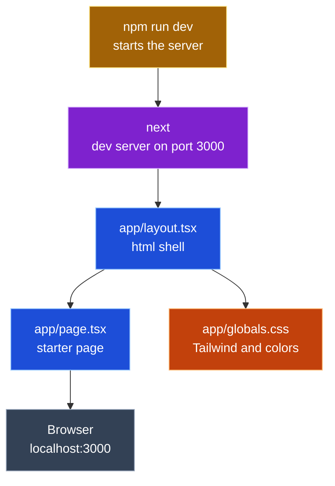
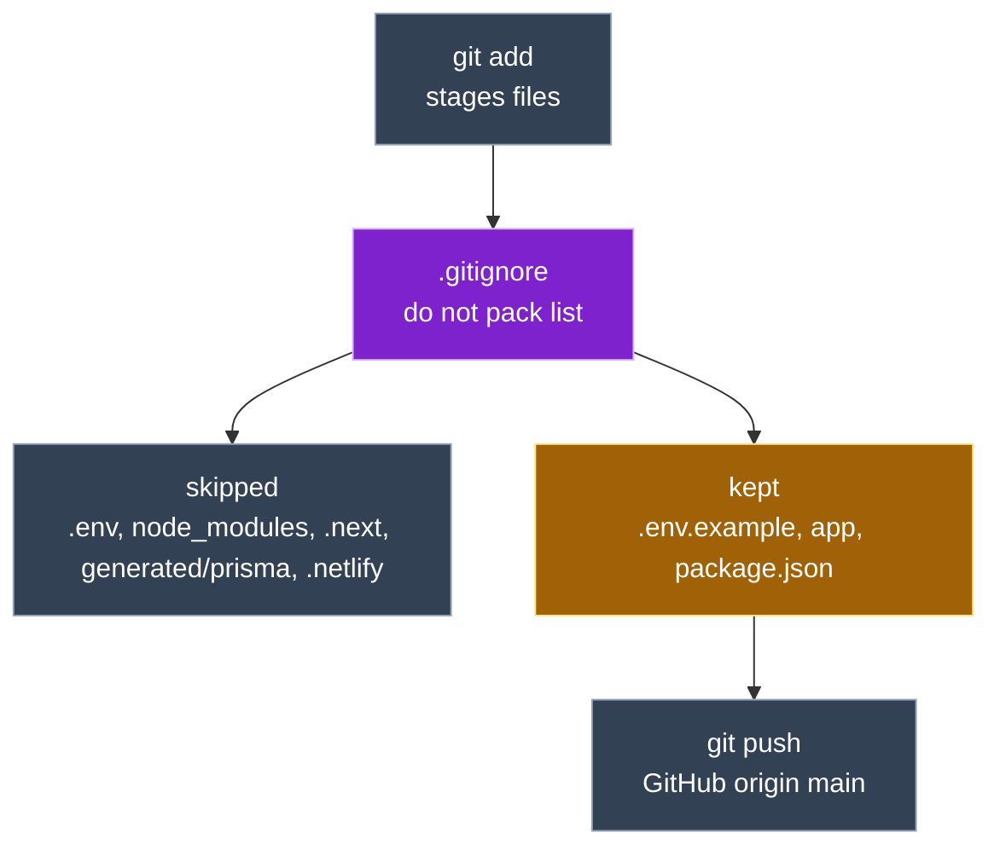
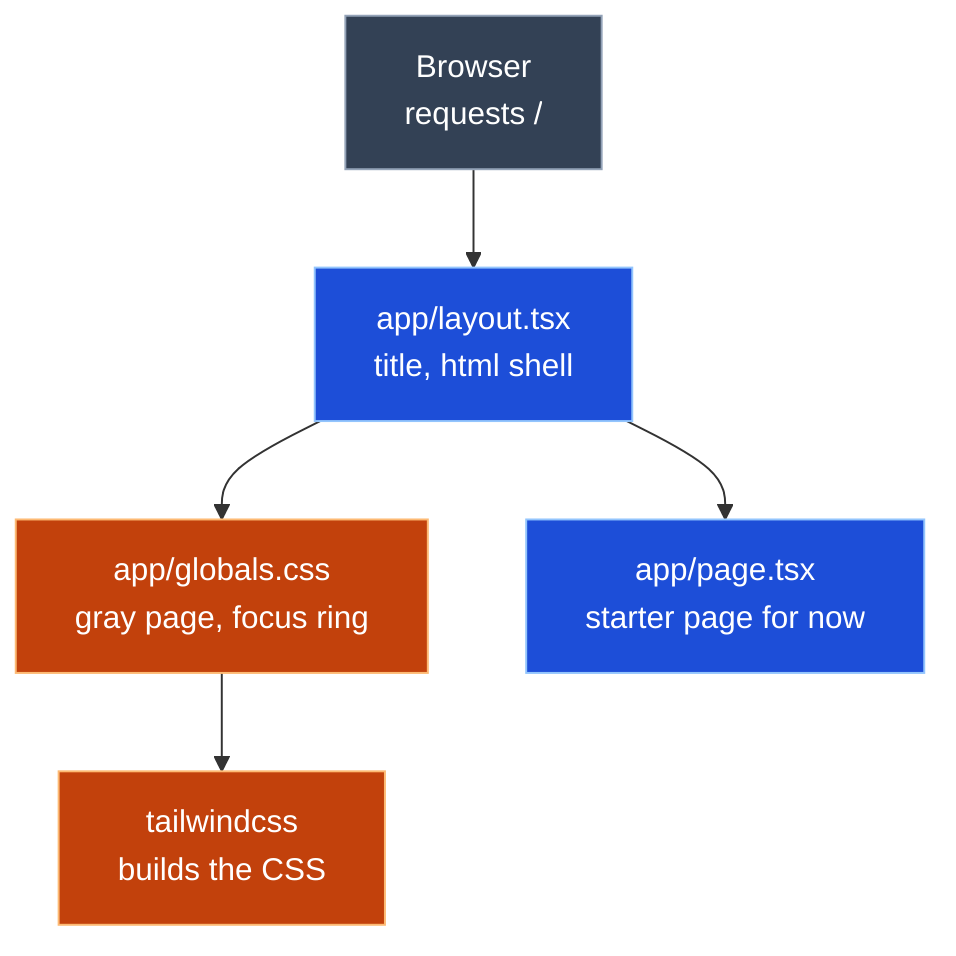
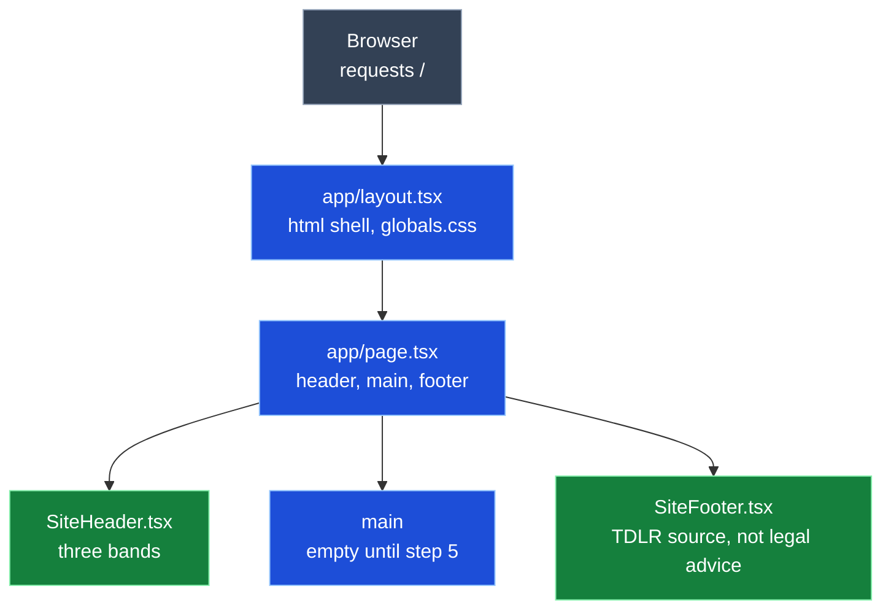
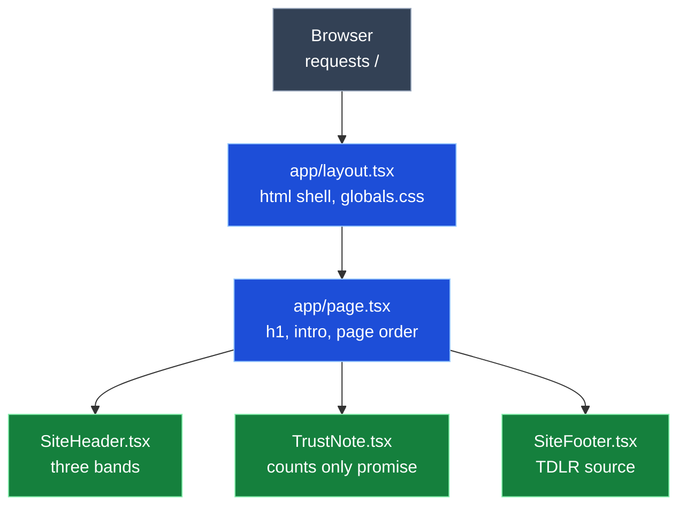
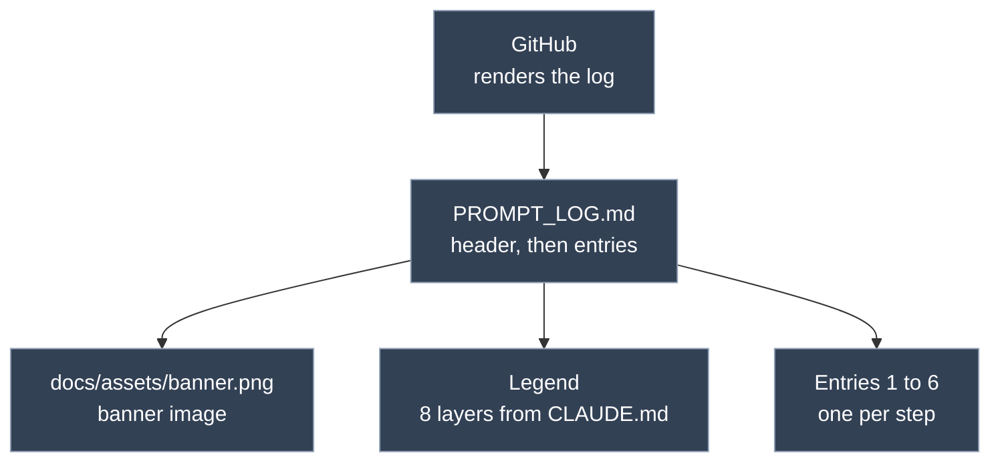

<h1 align="center">Prompt Log</h1>

<b>TX License Navigator</b> · Week 5 · Claude Code · claude-opus-5-5

---

## Legend

🟦 Entry (<code>app/layout.tsx</code>, <code>app/page.tsx</code>) 
🟩 UI (<code>components/*.tsx</code>, <code>lib/counties.ts</code>) 
🟥 Server (<code>app/api/**/route.ts</code>) 
🟫 TDLR (<code>lib/tdlr.ts</code>) 
⬛ Database (<code>prisma/schema.prisma</code>, <code>prisma.config.ts</code>, <code>lib/db.ts</code>, Neon) 
🟧 Style (<code>app/globals.css</code>, <code>tailwindcss</code>) 
🟪 Tools (<code>next.config.ts</code>, <code>tsconfig.json</code>, <code>next</code>, <code>prisma</code> CLI) 
🟨 Dependencies (<code>package.json</code>, <code>package-lock.json</code>)

---

## Project info

<table>
  <tr><th align="left">Field</th><th align="left">Details</th></tr>
  <tr><td><b>One liner</b></td><td>Second Chance License Navigator shows how many people hold a license in any Texas county, using live TDLR data, and keeps a watchlist of saved searches so job seekers can track local demand before they train.</td></tr>
  <tr><td><b>Privacy</b></td><td>counts only, never a personal license row; the watchlist stores only license type, county, label and note</td></tr>
  <tr><td><b>Tools</b></td><td>Claude Code · claude-opus-5-5</td></tr>
</table>

---

## Entry 1 · #1 Scaffold Next.js

*Oct 14 · 17:48 to 19:15 CT*

<table>
  <tr><th align="left">Field</th><th align="left">Details</th></tr>
  <tr><td><b>Tool</b></td><td>Claude Code · claude-opus-5-5</td></tr>
  <tr><td><b>Asked</b></td><td>Work issue #1, step 1 only: scaffold Next.js 16 with TypeScript, Tailwind 4, App Router, no <code>src/</code>. Show the result and stop</td></tr>
  <tr><td><b>Context</b></td><td>
    <ul>
      <li><code>CLAUDE.md</code></li>
      <li>issue #1 (acceptance criteria)</li>
      <li><code>docs/spec/design.md</code> (File layout)</li>
      <li><code>SOT_documents/UI.md</code> Part 1</li>
      <li><code>SOT_documents/PROMPT_LOG_FORMAT.md</code></li>
    </ul>
  </td></tr>
  <tr><td><b>Changed</b></td><td>
    All new, generated by <code>create-next-app@16</code> in the scratchpad and moved in; only the package name was edited
    <ul>
      <li>🟦 <code>app/layout.tsx</code> (new)</li>
      <li>🟦 <code>app/page.tsx</code> (new)</li>
      <li>🟧 <code>app/globals.css</code> (new)</li>
      <li>🟪 <code>next.config.ts</code>, <code>tsconfig.json</code>, <code>eslint.config.mjs</code>, <code>next-env.d.ts</code> (new)</li>
      <li>🟨 <code>package.json</code>, <code>package-lock.json</code> (new) · <code>next</code> 16.4.1, <code>react</code> 19.3.0, <code>tailwindcss</code> 4</li>
      <li><code>.gitignore</code>, <code>AGENTS.md</code>, <code>README.md</code>, <code>public/*.svg</code>, <code>app/favicon.ico</code> (new)</li>
    </ul>
  </td></tr>
  <tr><td><b>Decision</b></td><td>accepted</td></tr>
  <tr><td><b>Verified</b></td><td>
    <ul>
      <li>~17:56 CT · <code>next dev</code> on port 3123 returned 200, title "Create Next App"</li>
      <li>~17:56 CT · <code>npm run lint</code> passed</li>
      <li>~19:10 CT · Joseph ran <code>npm run dev</code>, saw the starter page at <code>localhost:3000</code> (screenshot)</li>
    </ul>
  </td></tr>
  <tr><td><b>Commit</b></td><td><code>d5beecf</code> chore: scaffold next.js 16, ignore env and generated files</td></tr>
  <tr><td><b>PIOF and what differed</b></td><td>
    <ul>
      <li>Purpose: a running Next.js app that every later step builds on</li>
      <li>Input: none (scaffold defaults)</li>
      <li>Output: the Next.js starter page at <code>localhost:3000</code></li>
      <li>Flow: <code>npm run dev</code> → <code>next</code> → 🟦 <code>app/layout.tsx</code> → 🟦 <code>app/page.tsx</code> → 🟧 <code>app/globals.css</code> → Browser</li>
    </ul>
  </td></tr>
  <tr><td><b>Reflection</b></td><td>
    <ul>
      <li>So my understanding and reflection of this is That the main purpose was to get Next.js app up and running because this is one step that's sequential and every other step builds on.</li>
      <li>there were no inputs on this particular ticket, the goal was just to establish the project shell with the same look from week four.</li>
      <li>The output was essentially the Next.js starter page, which was tested at localhost 3000.</li>
      <li>The actions that were taken were pretty much running <code>npm run dev</code>. and making sure that the Next.js starter page was showing with the message to edit the file, which was a statement that was indicating whether or not it was working.</li>
      <li>Everything rendered and And We didn't edit the <code>page.tsx</code> starter page, but moving on for step two, we will commence with the git ignore additions, the dot env and example and then we'll initiate and connect to the repo and establish our first commit.</li>
    </ul>
  </td></tr>
  <tr><td><b>Explained</b></td><td>
    <b>Entry 1 · #1 Scaffold Next.js</b>
    <ul>
      <li>What it is: an empty but working Next.js house: walls, plumbing and wiring, no furniture yet</li>
      <li>Why: <code>create-next-app</code> refuses a folder that already has files, so the app was built in a scratch folder and moved in; its flags picked TypeScript, Tailwind, App Router and no git</li>
      <li>Files:
        <ul>
          <li>🟦 <code>app/layout.tsx</code>: the frame every page sits in</li>
          <li>🟦 <code>app/page.tsx</code>: what <code>/</code> shows</li>
          <li>🟧 <code>app/globals.css</code>: Tailwind and page colors</li>
          <li>🟨 <code>package.json</code>: the shopping list and the <code>dev</code>, <code>build</code>, <code>lint</code> scripts</li>
        </ul>
      </li>
      <li>Its role in the project: every later ticket adds rooms to this house</li>
    </ul>
  </td></tr>
</table>

### Entry 1 call graph

---

## Entry 2 · #1 .gitignore and .env.example

*Oct 14 · 19:15 to 19:45 CT*

<table>
  <tr><th align="left">Field</th><th align="left">Details</th></tr>
  <tr><td><b>Tool</b></td><td>Claude Code · claude-opus-5-5</td></tr>
  <tr><td><b>Asked</b></td><td>Step 2 only: add <code>.env.example</code> and generated Prisma rules to <code>.gitignore</code>, create <code>.env.example</code>. Then Joseph asked to check that every file that needs ignoring is covered</td></tr>
  <tr><td><b>Context</b></td><td>same as Entry 1</td></tr>
  <tr><td><b>Changed</b></td><td>
    1 new file, 1 edited
    <ul>
      <li><code>.gitignore</code> (modified) · <code>!.env.example</code>, <code>/generated/prisma</code>, <code>.netlify</code></li>
      <li><code>.env.example</code> (new) · <code>DATABASE_URL</code> and <code>DIRECT_URL</code>, no values</li>
    </ul>
  </td></tr>
  <tr><td><b>Decision</b></td><td>accepted</td></tr>
  <tr><td><b>Verified</b></td><td>
    <ul>
      <li>~19:30 CT · Joseph ran <code>git init -b main</code>, <code>git remote add origin</code>, <code>git status</code>: <code>.env.example</code> listed, <code>node_modules/</code>, <code>.next/</code>, <code>next-env.d.ts</code> not listed (screenshot)</li>
      <li>~19:40 CT · <code>git commit</code>: 34 files, no <code>node_modules/</code> or <code>.env</code> (screenshot)</li>
      <li>~19:42 CT · <code>git push -u origin main</code>: <code>[new branch] main -> main</code> (screenshot)</li>
    </ul>
  </td></tr>
  <tr><td><b>Commit</b></td><td><code>d5beecf</code> chore: scaffold next.js 16, ignore env and generated files (steps 1 and 2 together)</td></tr>
  <tr><td><b>PIOF and what differed</b></td><td>
    <ul>
      <li>Purpose: keep secrets and generated code out of git; show anyone cloning which variables to set</li>
      <li>Input: none</li>
      <li>Output: ignore rules, and a template listing <code>DATABASE_URL</code> and <code>DIRECT_URL</code></li>
      <li>Flow: <code>git add</code> → reads <code>.gitignore</code> → skips <code>.env</code>, <code>node_modules/</code>, <code>.next/</code>, <code>generated/prisma/</code>, <code>.netlify/</code> → keeps <code>.env.example</code></li>
    </ul>
  </td></tr>
  <tr><td><b>Reflection</b></td><td>
    <ul>
      <li>In step two, we pretty much took the steps to make the project shape to share.</li>
      <li>the dot gitignore file already blocked the node modules, which I was able to catch Build output in every.env file.</li>
      <li>There was an exception that was added so that the.env. example gets committed as a template plus rules for Prisma were generated for the client and Netlify's local folder because anything that can be rebuilt or that holds a secret doesn't belong in get.</li>
      <li>From there, we connected the folder to the get repo to GitHub. Or the folder became a get repo connected to GitHub.</li>
      <li>We ran this shell command get status that showed the ignore rules working before anything was staged and initiated the first commit and push to put the project online.</li>
    </ul>
  </td></tr>
  <tr><td><b>Explained</b></td><td>
    <b>Entry 2 · #1 .gitignore and .env.example</b>
    <ul>
      <li>What it is: a "do not pack" list for the moving truck; git leaves behind anything on it</li>
      <li>Why: secrets (<code>.env</code>) must never reach GitHub, and anything rebuildable (<code>node_modules/</code>, <code>.next/</code>, the Prisma client) only bloats the repo</li>
      <li>Files:
        <ul>
          <li><code>.gitignore</code>: the list; <code>!</code> marks an exception</li>
          <li><code>.env.example</code>: an empty form showing which secrets to fill in</li>
        </ul>
      </li>
      <li>Its role in the project: makes the first push safe, and keeps the Neon URLs from #2 off GitHub</li>
    </ul>
  </td></tr>
</table>

### Entry 2 call graph

---

## Entry 3 · #1 Global style and focus ring

*Oct 14 · ~20:40 to 20:55 CT*

<table>
  <tr><th align="left">Field</th><th align="left">Details</th></tr>
  <tr><td><b>Tool</b></td><td>Claude Code · claude-opus-5-5</td></tr>
  <tr><td><b>Asked</b></td><td>Step 3 only: Week 4 page background, text color, yellow focus ring and tabular numbers in 🟧 <code>app/globals.css</code>; page title in 🟦 <code>app/layout.tsx</code></td></tr>
  <tr><td><b>Context</b></td><td>
    <ul>
      <li>same as Entry 1</li>
      <li>Week 4 <code>src/index.css</code>, <code>src/App.jsx</code>, <code>index.html</code> (via <code>gh api</code>)</li>
    </ul>
  </td></tr>
  <tr><td><b>Changed</b></td><td>
    2 edited
    <ul>
      <li>🟧 <code>app/globals.css</code> (modified) · <code>#F3F5F8</code> background, <code>#1B2733</code> text, <code>:focus-visible</code> 3px <code>#F2B807</code> ring, <code>.tabular</code>; dark mode removed</li>
      <li>🟦 <code>app/layout.tsx</code> (modified) · title "Texas Second Chance License Navigator"; Geist fonts removed</li>
    </ul>
  </td></tr>
  <tr><td><b>Decision</b></td><td>accepted</td></tr>
  <tr><td><b>Verified</b></td><td>
    <ul>
      <li>~20:45 CT · <code>npm run lint</code> passed</li>
      <li>~20:45 CT · <code>npx tsc --noEmit</code> passed</li>
      <li>~20:50 CT · Joseph pressed Tab at <code>localhost:3000</code>: yellow ring on "Documentation", gray background below the starter box (screenshot)</li>
    </ul>
  </td></tr>
  <tr><td><b>Commit</b></td><td><code>56b7a88</code> style: week 4 background, text color and focus ring</td></tr>
  <tr><td><b>PIOF and what differed</b></td><td>
    <ul>
      <li>Purpose: every page gets the Week 4 background, text color and keyboard focus ring</li>
      <li>Input: none</li>
      <li>Output: global CSS rules and the page title</li>
      <li>Flow: browser loads <code>/</code> → 🟦 <code>app/layout.tsx</code> imports 🟧 <code>app/globals.css</code> → Tailwind builds CSS → <code>body</code> gray, <code>:focus-visible</code> ring on Tab</li>
    </ul>
  </td></tr>
  <tr><td><b>Reflection</b></td><td>
    <ul>
      <li>So in conducting step three, we got some similar features from the week four look that would be applied to the whole site.</li>
      <li>The changes in global CSS give every page kind of a light gray background and a dark text, and this kind of yellow ring that appears. I guess only when you're moving around with keyboard functionality,</li>
      <li><code>Layout.tsx</code> sets the browser tab title, which is similar to the week four and drops the default Next.js font and dark mode because those weren't used in the previous build.</li>
      <li>Also, by pressing tab, there's a yellow ring that's kind of highlighted around your tab selections.</li>
      <li>The rest of the formatting is still being worked on</li>
    </ul>
  </td></tr>
  <tr><td><b>Explained</b></td><td>
    <b>Entry 3 · #1 Global style and focus ring</b>
    <ul>
      <li>What it is: painting the walls and putting up the house's signs before any furniture goes in</li>
      <li>Why: one CSS file sets the look for every page, so later components do not each repeat the background and focus ring</li>
      <li>Files:
        <ul>
          <li>🟧 <code>app/globals.css</code>: the paint (colors) and the yellow keyboard ring</li>
          <li>🟦 <code>app/layout.tsx</code>: the frame; loads the CSS and names the browser tab</li>
        </ul>
      </li>
      <li>Its role in the project: every component in steps 4 and 5 inherits this look and the accessible focus ring</li>
    </ul>
  </td></tr>
</table>

### Entry 3 call graph

---

## Entry 4 · #1 SiteHeader and SiteFooter

*Oct 15 · by 05:44 CT*

<table>
  <tr><th align="left">Field</th><th align="left">Details</th></tr>
  <tr><td><b>Tool</b></td><td>Claude Code · claude-opus-5-5</td></tr>
  <tr><td><b>Asked</b></td><td>Step 4 only: port the Week 4 header bands and footer to 🟩 <code>components/SiteHeader.tsx</code> and 🟩 <code>components/SiteFooter.tsx</code>, show them on the page</td></tr>
  <tr><td><b>Context</b></td><td>
    <ul>
      <li>same as Entry 1</li>
      <li>Week 4 <code>src/components/SiteHeader.jsx</code> and <code>src/components/SourceNote.jsx</code> (via <code>gh api</code>)</li>
    </ul>
  </td></tr>
  <tr><td><b>Changed</b></td><td>
    2 new files, 1 edited
    <ul>
      <li>🟩 <code>components/SiteHeader.tsx</code> (new) · navy strip, blue title band, red stripe</li>
      <li>🟩 <code>components/SiteFooter.tsx</code> (new) · Week 4 <code>SourceNote</code>; per-link focus classes dropped, the global ring covers them</li>
      <li>🟦 <code>app/page.tsx</code> (modified) · starter page replaced by header, empty <code>main</code>, footer</li>
    </ul>
  </td></tr>
  <tr><td><b>Decision</b></td><td>accepted</td></tr>
  <tr><td><b>Verified</b></td><td>
    <ul>
      <li><code>npm run lint</code> passed</li>
      <li><code>npx tsc --noEmit</code> passed</li>
      <li>by 05:44 CT · Joseph reloaded <code>localhost:3000</code>: three header bands and navy footer with the <code>data.texas.gov</code> link (screenshot)</li>
    </ul>
  </td></tr>
  <tr><td><b>Commit</b></td><td><code>e77383f</code> feat: week 4 header bands and footer</td></tr>
  <tr><td><b>PIOF and what differed</b></td><td>
    <ul>
      <li>Purpose: the page shows the Week 4 header bands and footer</li>
      <li>Input: none; both components are static</li>
      <li>Output: a <code>&lt;header&gt;</code> with three bands and a <code>&lt;footer&gt;</code> with the TDLR source link</li>
      <li>Flow: browser requests <code>/</code> → 🟦 <code>app/layout.tsx</code> → 🟦 <code>app/page.tsx</code> → 🟩 <code>SiteHeader</code>, empty <code>&lt;main&gt;</code>, 🟩 <code>SiteFooter</code> → HTML</li>
    </ul>
  </td></tr>
  <tr><td><b>Reflection</b></td><td>
    <ul>
      <li>So for step four we added the header and the footer bands to the page.</li>
      <li>These are similar to the theme and the setup in week four.</li>
      <li>We reloaded the local host 3000 to check them and then accepted step four and provided a reflection upon it.</li>
    </ul>
  </td></tr>
  <tr><td><b>Explained</b></td><td>
    <b>Entry 4 · #1 SiteHeader and SiteFooter</b>
    <ul>
      <li>What it is: the sign over the front door and the plaque by the exit, moved from the Week 4 house</li>
      <li>Why: each band is its own component, so <code>page.tsx</code> stays short and the look matches Week 4 exactly</li>
      <li>Files:
        <ul>
          <li>🟩 <code>components/SiteHeader.tsx</code>: the three bands at the top</li>
          <li>🟩 <code>components/SiteFooter.tsx</code>: where the numbers come from, not legal advice</li>
          <li>🟦 <code>app/page.tsx</code>: places header, main, footer in order</li>
        </ul>
      </li>
      <li>Its role in the project: frames every later piece (search form, saved list) between the same header and footer</li>
    </ul>
  </td></tr>
</table>

### Entry 4 call graph

---

## Entry 5 · #1 TrustNote, h1 and intro

*Oct 15 · ~05:50 to 06:01 CT*

<table>
  <tr><th align="left">Field</th><th align="left">Details</th></tr>
  <tr><td><b>Tool</b></td><td>Claude Code · claude-opus-5-5</td></tr>
  <tr><td><b>Asked</b></td><td>Step 5 only: port the Week 4 trust note to 🟩 <code>components/TrustNote.tsx</code>, add the Week 4 h1 and intro to 🟦 <code>app/page.tsx</code></td></tr>
  <tr><td><b>Context</b></td><td>
    <ul>
      <li>same as Entry 1</li>
      <li>Week 4 <code>src/components/TrustNote.jsx</code> and <code>src/App.jsx</code> (via <code>gh api</code>)</li>
    </ul>
  </td></tr>
  <tr><td><b>Changed</b></td><td>
    1 new file, 1 edited
    <ul>
      <li>🟩 <code>components/TrustNote.tsx</code> (new) · green counts only note, copied from Week 4</li>
      <li>🟦 <code>app/page.tsx</code> (modified) · h1 "Look up HVAC license demand by county", intro line, <code>&lt;TrustNote /&gt;</code></li>
    </ul>
  </td></tr>
  <tr><td><b>Decision</b></td><td>accepted</td></tr>
  <tr><td><b>Verified</b></td><td>
    <ul>
      <li><code>npm run lint</code> passed</li>
      <li><code>npx tsc --noEmit</code> passed</li>
      <li>06:01 CT · Joseph accepted the step</li>
    </ul>
  </td></tr>
  <tr><td><b>Commit</b></td><td>none yet</td></tr>
  <tr><td><b>PIOF and what differed</b></td><td>
    <ul>
      <li>Purpose: the top of the page reads exactly like Week 4, including the counts only promise</li>
      <li>Input: none; all static</li>
      <li>Output: h1, intro line and green trust note inside <code>&lt;main&gt;</code></li>
      <li>Flow: browser requests <code>/</code> → 🟦 <code>app/layout.tsx</code> → 🟦 <code>app/page.tsx</code> → 🟩 <code>SiteHeader</code> → h1, intro, 🟩 <code>TrustNote</code> → 🟩 <code>SiteFooter</code> → HTML</li>
    </ul>
  </td></tr>
  <tr><td><b>Reflection</b></td><td>
    <ul>
      <li>we added a new component which was the trust note. it's very simple but very important something that we adopted in week four.</li>
      <li>There's a green box that promises counts only, never names, addresses or license records</li>
      <li><code>page.tsx</code> now has the week foreheading Look up license by demand by county and the intro line above it with the same color and sizes with the header, footer, and trust note in place.</li>
      <li>The page can be check side by side against week 4, and that was the planned to originally pick up where we left off.</li>
    </ul>
  </td></tr>
  <tr><td><b>Explained</b></td><td>
    <b>Entry 5 · #1 TrustNote, h1 and intro</b>
    <ul>
      <li>What it is: the welcome sign inside the front door, plus a promise posted on the wall</li>
      <li>Why: the counts only rule is the project's privacy promise, so the visitor reads it before searching</li>
      <li>Files:
        <ul>
          <li>🟩 <code>components/TrustNote.tsx</code>: the green promise box</li>
          <li>🟦 <code>app/page.tsx</code>: heading, intro, and the order of everything on the page</li>
        </ul>
      </li>
      <li>Its role in the project: completes the Week 4 look above the form; #6 adds the search form under it</li>
    </ul>
  </td></tr>
</table>

### Entry 5 call graph

---

## Entry 6 · #1 PROMPT_LOG header

*Oct 15 · ~06:02 to 06:08 CT*

<table>
  <tr><th align="left">Field</th><th align="left">Details</th></tr>
  <tr><td><b>Tool</b></td><td>Claude Code · claude-opus-5-5</td></tr>
  <tr><td><b>Asked</b></td><td>Step 6 only: add the banner, title, 8-layer legend and Project info table to the top of <code>PROMPT_LOG.md</code></td></tr>
  <tr><td><b>Context</b></td><td>
    <ul>
      <li>same as Entry 1</li>
      <li>Week 4 <code>PROMPT_LOG.md</code> header and <code>docs/assets/banner.png</code> (via <code>gh api</code>)</li>
    </ul>
  </td></tr>
  <tr><td><b>Changed</b></td><td>
    1 new file, 1 edited
    <ul>
      <li><code>docs/assets/banner.png</code> (new) · copied from the Week 4 repo, 1280 × 720</li>
      <li><code>PROMPT_LOG.md</code> (modified) · banner, title, legend from <code>CLAUDE.md</code>, Project info (One liner, Privacy, Tools)</li>
    </ul>
  </td></tr>
  <tr><td><b>Decision</b></td><td>accepted</td></tr>
  <tr><td><b>Verified</b></td><td>
    <ul>
      <li><code>file docs/assets/banner.png</code>: PNG image data, 1280 x 720</li>
      <li>06:08 CT · Joseph accepted the step</li>
    </ul>
  </td></tr>
  <tr><td><b>Commit</b></td><td>none yet</td></tr>
  <tr><td><b>PIOF and what differed</b></td><td>
    <ul>
      <li>Purpose: the log opens like Week 4, so a grader sees the layers and the project at a glance</li>
      <li>Input: Week 4 header layout, <code>CLAUDE.md</code> legend, banner image</li>
      <li>Output: banner, title, 8-layer legend and Project info table above Entry 1</li>
      <li>Flow: GitHub renders <code>PROMPT_LOG.md</code> → <code>&lt;img&gt;</code> loads <code>docs/assets/banner.png</code> → legend and table → Entries 1 to 6</li>
    </ul>
  </td></tr>
  <tr><td><b>Reflection</b></td><td>
    <ul>
      <li>So in step six it was pretty simple. we just added the banner from week four. so now that the prompt log has that banner it matches the week four layout.</li>
      <li>it has the title with tool and model the legend is the eight color code layers that we're using to kind of break down Down all the different parts, components, and functionality in the call graph, and also notes that are associated with With each part that we're working on within that particular area of the prompt log.</li>
      <li>the banner image is copied from the week four repo. we have an assets folder that it was placed in and this pretty much closes the issue number one.</li>
      <li>We're going to check this in GitHub and then proceed to updating the log and checking GitHub for next steps Regarding the issues</li>
    </ul>
  </td></tr>
  <tr><td><b>Explained</b></td><td>
    <b>Entry 6 · #1 PROMPT_LOG header</b>
    <ul>
      <li>What it is: the cover page and table of contents for the build diary</li>
      <li>Why: the legend's color squares are the same ones used in every entry and call graph, so a reader learns them once at the top</li>
      <li>Files:
        <ul>
          <li><code>PROMPT_LOG.md</code>: banner, title, legend, Project info, then the entries</li>
          <li><code>docs/assets/banner.png</code>: the picture at the top</li>
        </ul>
      </li>
      <li>Its role in the project: the graded evidence that Joseph steered each step; every later entry goes under this header</li>
    </ul>
  </td></tr>
</table>

### Entry 6 call graph

