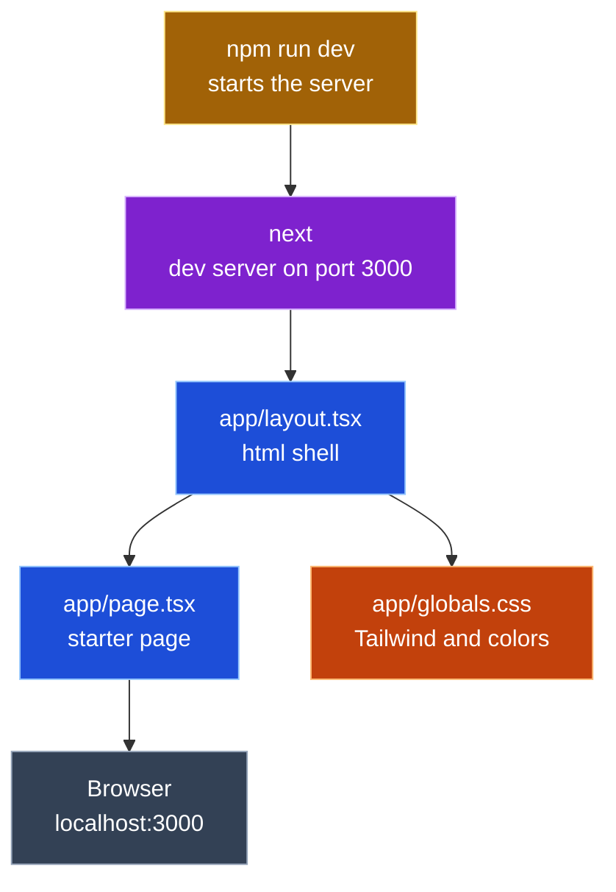
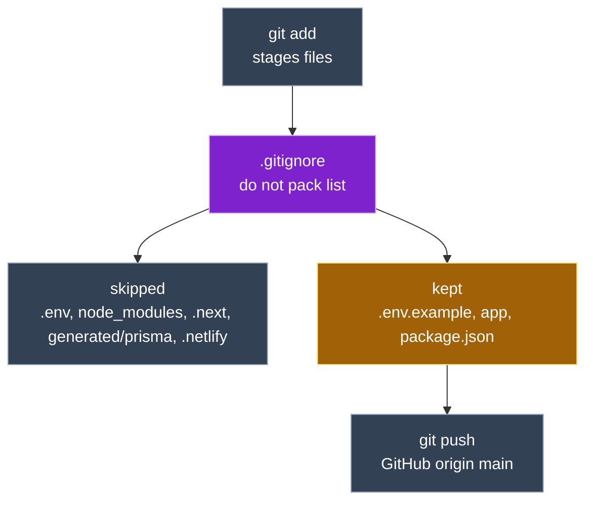
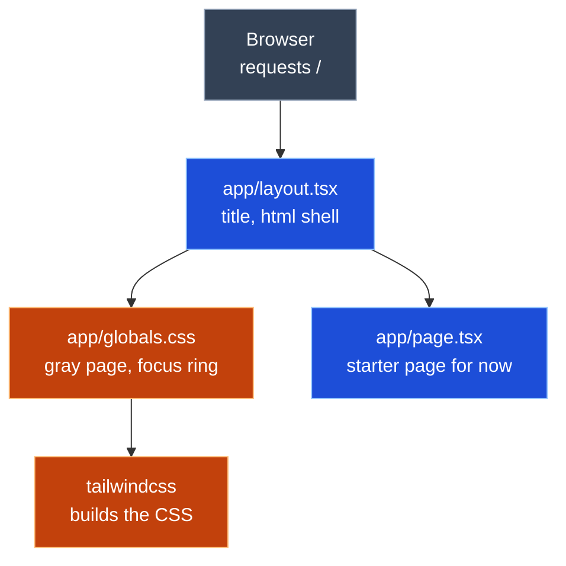

## Entry 1 · #1 Scaffold Next.js

*Oct 14 · 17:48 to 19:15 CT*

<table>
  <tr><th align="left">Field</th><th align="left">Details</th></tr>
  <tr><td><b>Tool</b></td><td>Claude Code · claude-opus-5-5</td></tr>
  <tr><td><b>Asked</b></td><td>Work issue #1, step 1 only: scaffold Next.js 16 with TypeScript, Tailwind 4, App Router, no <code>src/</code>. Show the result and stop</td></tr>
  <tr><td><b>Context</b></td><td>
    <ul>
      <li><code>CLAUDE.md</code></li>
      <li>issue #1 (acceptance criteria)</li>
      <li><code>docs/spec/design.md</code> (File layout)</li>
      <li><code>SOT_documents/UI.md</code> Part 1</li>
      <li><code>SOT_documents/PROMPT_LOG_FORMAT.md</code></li>
    </ul>
  </td></tr>
  <tr><td><b>Changed</b></td><td>
    All new, generated by <code>create-next-app@16</code> in the scratchpad and moved in; only the package name was edited
    <ul>
      <li>🟦 <code>app/layout.tsx</code> (new)</li>
      <li>🟦 <code>app/page.tsx</code> (new)</li>
      <li>🟧 <code>app/globals.css</code> (new)</li>
      <li>🟪 <code>next.config.ts</code>, <code>tsconfig.json</code>, <code>eslint.config.mjs</code>, <code>next-env.d.ts</code> (new)</li>
      <li>🟨 <code>package.json</code>, <code>package-lock.json</code> (new) · <code>next</code> 16.4.1, <code>react</code> 19.3.0, <code>tailwindcss</code> 4</li>
      <li><code>.gitignore</code>, <code>AGENTS.md</code>, <code>README.md</code>, <code>public/*.svg</code>, <code>app/favicon.ico</code> (new)</li>
    </ul>
  </td></tr>
  <tr><td><b>Decision</b></td><td>accepted</td></tr>
  <tr><td><b>Verified</b></td><td>
    <ul>
      <li>~17:56 CT · <code>next dev</code> on port 3123 returned 200, title "Create Next App"</li>
      <li>~17:56 CT · <code>npm run lint</code> passed</li>
      <li>~19:10 CT · Joseph ran <code>npm run dev</code>, saw the starter page at <code>localhost:3000</code> (screenshot)</li>
    </ul>
  </td></tr>
  <tr><td><b>Commit</b></td><td><code>d5beecf</code> chore: scaffold next.js 16, ignore env and generated files</td></tr>
  <tr><td><b>PIOF and what differed</b></td><td>
    <ul>
      <li>Purpose: a running Next.js app that every later step builds on</li>
      <li>Input: none (scaffold defaults)</li>
      <li>Output: the Next.js starter page at <code>localhost:3000</code></li>
      <li>Flow: <code>npm run dev</code> → <code>next</code> → 🟦 <code>app/layout.tsx</code> → 🟦 <code>app/page.tsx</code> → 🟧 <code>app/globals.css</code> → Browser</li>
    </ul>
  </td></tr>
  <tr><td><b>Reflection</b></td><td>
    <ul>
      <li>So my understanding and reflection of this is That the main purpose was to get Next.js app up and running because this is one step that's sequential and every other step builds on.</li>
      <li>there were no inputs on this particular ticket, the goal was just to establish the project shell with the same look from week four.</li>
      <li>The output was essentially the Next.js starter page, which was tested at localhost 3000.</li>
      <li>The actions that were taken were pretty much running <code>npm run dev</code>. and making sure that the Next.js starter page was showing with the message to edit the file, which was a statement that was indicating whether or not it was working.</li>
      <li>Everything rendered and And We didn't edit the <code>page.tsx</code> starter page, but moving on for step two, we will commence with the git ignore additions, the dot env and example and then we'll initiate and connect to the repo and establish our first commit.</li>
    </ul>
  </td></tr>
  <tr><td><b>Explained</b></td><td>
    <b>Entry 1 · #1 Scaffold Next.js</b>
    <ul>
      <li>What it is: an empty but working Next.js house: walls, plumbing and wiring, no furniture yet</li>
      <li>Why: <code>create-next-app</code> refuses a folder that already has files, so the app was built in a scratch folder and moved in; its flags picked TypeScript, Tailwind, App Router and no git</li>
      <li>Files:
        <ul>
          <li>🟦 <code>app/layout.tsx</code>: the frame every page sits in</li>
          <li>🟦 <code>app/page.tsx</code>: what <code>/</code> shows</li>
          <li>🟧 <code>app/globals.css</code>: Tailwind and page colors</li>
          <li>🟨 <code>package.json</code>: the shopping list and the <code>dev</code>, <code>build</code>, <code>lint</code> scripts</li>
        </ul>
      </li>
      <li>Its role in the project: every later ticket adds rooms to this house</li>
    </ul>
  </td></tr>
</table>

### Entry 1 call graph

---

## Entry 2 · #1 .gitignore and .env.example

*Oct 14 · 19:15 to 19:45 CT*

<table>
  <tr><th align="left">Field</th><th align="left">Details</th></tr>
  <tr><td><b>Tool</b></td><td>Claude Code · claude-opus-5-5</td></tr>
  <tr><td><b>Asked</b></td><td>Step 2 only: add <code>.env.example</code> and generated Prisma rules to <code>.gitignore</code>, create <code>.env.example</code>. Then Joseph asked to check that every file that needs ignoring is covered</td></tr>
  <tr><td><b>Context</b></td><td>same as Entry 1</td></tr>
  <tr><td><b>Changed</b></td><td>
    1 new file, 1 edited
    <ul>
      <li><code>.gitignore</code> (modified) · <code>!.env.example</code>, <code>/generated/prisma</code>, <code>.netlify</code></li>
      <li><code>.env.example</code> (new) · <code>DATABASE_URL</code> and <code>DIRECT_URL</code>, no values</li>
    </ul>
  </td></tr>
  <tr><td><b>Decision</b></td><td>accepted</td></tr>
  <tr><td><b>Verified</b></td><td>
    <ul>
      <li>~19:30 CT · Joseph ran <code>git init -b main</code>, <code>git remote add origin</code>, <code>git status</code>: <code>.env.example</code> listed, <code>node_modules/</code>, <code>.next/</code>, <code>next-env.d.ts</code> not listed (screenshot)</li>
      <li>~19:40 CT · <code>git commit</code>: 34 files, no <code>node_modules/</code> or <code>.env</code> (screenshot)</li>
      <li>~19:42 CT · <code>git push -u origin main</code>: <code>[new branch] main -> main</code> (screenshot)</li>
    </ul>
  </td></tr>
  <tr><td><b>Commit</b></td><td><code>d5beecf</code> chore: scaffold next.js 16, ignore env and generated files (steps 1 and 2 together)</td></tr>
  <tr><td><b>PIOF and what differed</b></td><td>
    <ul>
      <li>Purpose: keep secrets and generated code out of git; show anyone cloning which variables to set</li>
      <li>Input: none</li>
      <li>Output: ignore rules, and a template listing <code>DATABASE_URL</code> and <code>DIRECT_URL</code></li>
      <li>Flow: <code>git add</code> → reads <code>.gitignore</code> → skips <code>.env</code>, <code>node_modules/</code>, <code>.next/</code>, <code>generated/prisma/</code>, <code>.netlify/</code> → keeps <code>.env.example</code></li>
    </ul>
  </td></tr>
  <tr><td><b>Reflection</b></td><td>
    <ul>
      <li>In step two, we pretty much took the steps to make the project shape to share.</li>
      <li>the dot gitignore file already blocked the node modules, which I was able to catch Build output in every.env file.</li>
      <li>There was an exception that was added so that the.env. example gets committed as a template plus rules for Prisma were generated for the client and Netlify's local folder because anything that can be rebuilt or that holds a secret doesn't belong in get.</li>
      <li>From there, we connected the folder to the get repo to GitHub. Or the folder became a get repo connected to GitHub.</li>
      <li>We ran this shell command get status that showed the ignore rules working before anything was staged and initiated the first commit and push to put the project online.</li>
    </ul>
  </td></tr>
  <tr><td><b>Explained</b></td><td>
    <b>Entry 2 · #1 .gitignore and .env.example</b>
    <ul>
      <li>What it is: a "do not pack" list for the moving truck; git leaves behind anything on it</li>
      <li>Why: secrets (<code>.env</code>) must never reach GitHub, and anything rebuildable (<code>node_modules/</code>, <code>.next/</code>, the Prisma client) only bloats the repo</li>
      <li>Files:
        <ul>
          <li><code>.gitignore</code>: the list; <code>!</code> marks an exception</li>
          <li><code>.env.example</code>: an empty form showing which secrets to fill in</li>
        </ul>
      </li>
      <li>Its role in the project: makes the first push safe, and keeps the Neon URLs from #2 off GitHub</li>
    </ul>
  </td></tr>
</table>

### Entry 2 call graph

---

## Entry 3 · #1 Global style and focus ring

*Oct 14 · ~20:40 to 20:55 CT*

<table>
  <tr><th align="left">Field</th><th align="left">Details</th></tr>
  <tr><td><b>Tool</b></td><td>Claude Code · claude-opus-5-5</td></tr>
  <tr><td><b>Asked</b></td><td>Step 3 only: Week 4 page background, text color, yellow focus ring and tabular numbers in 🟧 <code>app/globals.css</code>; page title in 🟦 <code>app/layout.tsx</code></td></tr>
  <tr><td><b>Context</b></td><td>
    <ul>
      <li>same as Entry 1</li>
      <li>Week 4 <code>src/index.css</code>, <code>src/App.jsx</code>, <code>index.html</code> (via <code>gh api</code>)</li>
    </ul>
  </td></tr>
  <tr><td><b>Changed</b></td><td>
    2 edited
    <ul>
      <li>🟧 <code>app/globals.css</code> (modified) · <code>#F3F5F8</code> background, <code>#1B2733</code> text, <code>:focus-visible</code> 3px <code>#F2B807</code> ring, <code>.tabular</code>; dark mode removed</li>
      <li>🟦 <code>app/layout.tsx</code> (modified) · title "Texas Second Chance License Navigator"; Geist fonts removed</li>
    </ul>
  </td></tr>
  <tr><td><b>Decision</b></td><td>accepted</td></tr>
  <tr><td><b>Verified</b></td><td>
    <ul>
      <li>~20:45 CT · <code>npm run lint</code> passed</li>
      <li>~20:45 CT · <code>npx tsc --noEmit</code> passed</li>
      <li>~20:50 CT · Joseph pressed Tab at <code>localhost:3000</code>: yellow ring on "Documentation", gray background below the starter box (screenshot)</li>
    </ul>
  </td></tr>
  <tr><td><b>Commit</b></td><td>none yet</td></tr>
  <tr><td><b>PIOF and what differed</b></td><td>
    <ul>
      <li>Purpose: every page gets the Week 4 background, text color and keyboard focus ring</li>
      <li>Input: none</li>
      <li>Output: global CSS rules and the page title</li>
      <li>Flow: browser loads <code>/</code> → 🟦 <code>app/layout.tsx</code> imports 🟧 <code>app/globals.css</code> → Tailwind builds CSS → <code>body</code> gray, <code>:focus-visible</code> ring on Tab</li>
    </ul>
  </td></tr>
  <tr><td><b>Reflection</b></td><td>
    <ul>
      <li>So in conducting step three, we got some similar features from the week four look that would be applied to the whole site.</li>
      <li>The changes in global CSS give every page kind of a light gray background and a dark text, and this kind of yellow ring that appears. I guess only when you're moving around with keyboard functionality,</li>
      <li><code>Layout.tsx</code> sets the browser tab title, which is similar to the week four and drops the default Next.js font and dark mode because those weren't used in the previous build.</li>
      <li>Also, by pressing tab, there's a yellow ring that's kind of highlighted around your tab selections.</li>
      <li>The rest of the formatting is still being worked on</li>
    </ul>
  </td></tr>
  <tr><td><b>Explained</b></td><td>
    <b>Entry 3 · #1 Global style and focus ring</b>
    <ul>
      <li>What it is: painting the walls and putting up the house's signs before any furniture goes in</li>
      <li>Why: one CSS file sets the look for every page, so later components do not each repeat the background and focus ring</li>
      <li>Files:
        <ul>
          <li>🟧 <code>app/globals.css</code>: the paint (colors) and the yellow keyboard ring</li>
          <li>🟦 <code>app/layout.tsx</code>: the frame; loads the CSS and names the browser tab</li>
        </ul>
      </li>
      <li>Its role in the project: every component in steps 4 and 5 inherits this look and the accessible focus ring</li>
    </ul>
  </td></tr>
</table>

### Entry 3 call graph

