<p align="center"></p>
<h1 align="center">Prompt Log</h1>
<p align="center"><b>TX License Navigator</b> · Week 5 · Claude Code · claude-opus-5-5</p>

---

## Legend

🟦 Entry (<code>app/layout.tsx</code>, <code>app/page.tsx</code>)<br>
🟩 UI (<code>components/*.tsx</code>, <code>lib/counties.ts</code>)<br>
🟥 Server (<code>app/api/**/route.ts</code>, <code>lib/validation.ts</code>)<br>
🟫 TDLR (<code>lib/tdlr.ts</code>)<br>
⬛ Database (<code>prisma/schema.prisma</code>, <code>prisma.config.ts</code>, <code>lib/db.ts</code>, Neon)<br>
🟧 Style (<code>app/globals.css</code>, <code>tailwindcss</code>)<br>
🟪 Tools (<code>next.config.ts</code>, <code>tsconfig.json</code>, <code>next</code>, <code>prisma</code> CLI)<br>
🟨 Dependencies (<code>package.json</code>, <code>package-lock.json</code>)

---

## Project info

<table>
  <tr><th align="left">Field</th><th align="left">Details</th></tr>
  <tr><td><b>One liner</b></td><td>Second Chance License Navigator shows how many people hold a license in any Texas county, using live TDLR data, and keeps a watchlist of saved searches so job seekers can track local demand before they train.</td></tr>
  <tr><td><b>Privacy</b></td><td>counts only, never a personal license row; the watchlist stores only license type, county, label and note</td></tr>
  <tr><td><b>Tools</b></td><td>Claude Code · claude-opus-5-5</td></tr>
</table>

---

## Entry 1 · #1 Scaffold Next.js

*Oct 14 · 17:48 to 19:15 CT*

<table>
  <tr><th align="left">Field</th><th align="left">Details</th></tr>
  <tr><td><b>Tool</b></td><td>Claude Code · claude-opus-5-5</td></tr>
  <tr><td><b>Asked</b></td><td>Work issue #1, step 1 only: scaffold Next.js 16 with TypeScript, Tailwind 4, App Router, no <code>src/</code>. Show the result and stop</td></tr>
  <tr><td><b>Context</b></td><td>
    <ul>
      <li><code>CLAUDE.md</code></li>
      <li>issue #1 (acceptance criteria)</li>
      <li><code>docs/spec/design.md</code> (File layout)</li>
      <li><code>SOT_documents/UI.md</code> Part 1</li>
      <li><code>SOT_documents/PROMPT_LOG_FORMAT.md</code></li>
    </ul>
  </td></tr>
  <tr><td><b>Changed</b></td><td>
    All new, generated by <code>create-next-app@16</code> in the scratchpad and moved in; only the package name was edited
    <ul>
      <li>🟦 <code>app/layout.tsx</code> (new)</li>
      <li>🟦 <code>app/page.tsx</code> (new)</li>
      <li>🟧 <code>app/globals.css</code> (new)</li>
      <li>🟪 <code>next.config.ts</code>, <code>tsconfig.json</code>, <code>eslint.config.mjs</code>, <code>next-env.d.ts</code> (new)</li>
      <li>🟨 <code>package.json</code>, <code>package-lock.json</code> (new) · <code>next</code> 16.4.1, <code>react</code> 19.3.0, <code>tailwindcss</code> 4</li>
      <li><code>.gitignore</code>, <code>AGENTS.md</code>, <code>README.md</code>, <code>public/*.svg</code>, <code>app/favicon.ico</code> (new)</li>
    </ul>
  </td></tr>
  <tr><td><b>Decision</b></td><td>accepted</td></tr>
  <tr><td><b>Verified</b></td><td>
    <ul>
      <li>~17:56 CT · <code>next dev</code> on port 3123 returned 200, title "Create Next App"</li>
      <li>~17:56 CT · <code>npm run lint</code> passed</li>
      <li>~19:10 CT · Joseph ran <code>npm run dev</code>, saw the starter page at <code>localhost:3000</code> (screenshot)</li>
    </ul>
  </td></tr>
  <tr><td><b>Commit</b></td><td><code>d5beecf</code> chore: scaffold next.js 16, ignore env and generated files</td></tr>
  <tr><td><b>PIOF and what differed</b></td><td>
    <ul>
      <li>Purpose: a running Next.js app that every later step builds on</li>
      <li>Input: none (scaffold defaults)</li>
      <li>Output: the Next.js starter page at <code>localhost:3000</code></li>
      <li>Flow: <code>npm run dev</code> → <code>next</code> → 🟦 <code>app/layout.tsx</code> → 🟦 <code>app/page.tsx</code> → 🟧 <code>app/globals.css</code> → Browser</li>
    </ul>
  </td></tr>
  <tr><td><b>Reflection</b></td><td>
    <ul>
      <li>My understanding is that the main purpose was to get the Next.js app up and running, because this step comes first and every other step builds on it.</li>
      <li>There were no inputs on this ticket; the goal was just to establish the project shell with the same look as Week 4.</li>
      <li>The output was the Next.js starter page, which I tested at <code>localhost:3000</code>.</li>
      <li>The main action was running <code>npm run dev</code> and making sure the starter page showed the "edit the file" message, which told me it was working.</li>
      <li>Everything rendered. We didn't edit the <code>page.tsx</code> starter page yet. In step two we'll add the <code>.gitignore</code> rules and <code>.env.example</code>, then connect the folder to the repo and make our first commit.</li>
    </ul>
  </td></tr>
  <tr><td><b>Explained</b></td><td>
    <b>Entry 1 · #1 Scaffold Next.js</b>
    <ul>
      <li>What it is: an empty but working Next.js house: walls, plumbing and wiring, no furniture yet</li>
      <li>Why: <code>create-next-app</code> refuses a folder that already has files, so the app was built in a scratch folder and moved in; its flags picked TypeScript, Tailwind, App Router and no git</li>
      <li>Files:
        <ul>
          <li>🟦 <code>app/layout.tsx</code>: the frame every page sits in</li>
          <li>🟦 <code>app/page.tsx</code>: what <code>/</code> shows</li>
          <li>🟧 <code>app/globals.css</code>: Tailwind and page colors</li>
          <li>🟨 <code>package.json</code>: the shopping list and the <code>dev</code>, <code>build</code>, <code>lint</code> scripts</li>
        </ul>
      </li>
      <li>Its role in the project: every later ticket adds rooms to this house</li>
    </ul>
  </td></tr>
</table>

### Entry 1 call graph

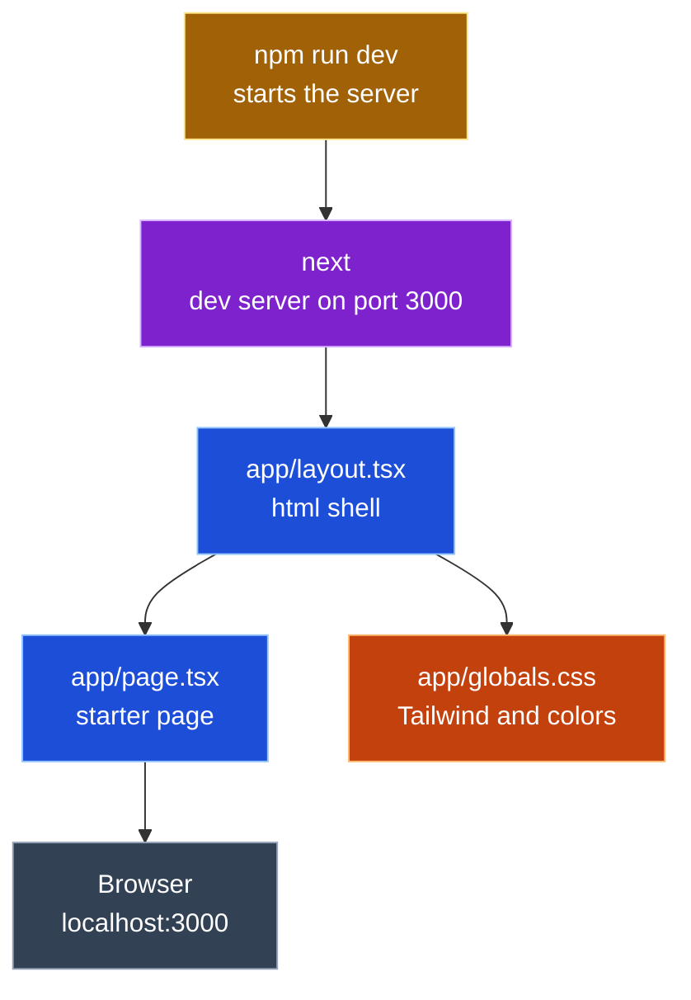

---

## Entry 2 · #1 .gitignore and .env.example

*Oct 14 · 19:15 to 19:45 CT*

<table>
  <tr><th align="left">Field</th><th align="left">Details</th></tr>
  <tr><td><b>Tool</b></td><td>Claude Code · claude-opus-5-5</td></tr>
  <tr><td><b>Asked</b></td><td>Step 2 only: add <code>.env.example</code> and generated Prisma rules to <code>.gitignore</code>, create <code>.env.example</code>. Then Joseph asked to check that every file that needs ignoring is covered</td></tr>
  <tr><td><b>Context</b></td><td>same as Entry 1</td></tr>
  <tr><td><b>Changed</b></td><td>
    1 new file, 1 edited
    <ul>
      <li><code>.gitignore</code> (modified) · <code>!.env.example</code>, <code>/generated/prisma</code>, <code>.netlify</code></li>
      <li><code>.env.example</code> (new) · <code>DATABASE_URL</code> and <code>DIRECT_URL</code>, no values</li>
    </ul>
  </td></tr>
  <tr><td><b>Decision</b></td><td>accepted</td></tr>
  <tr><td><b>Verified</b></td><td>
    <ul>
      <li>~19:30 CT · Joseph ran <code>git init -b main</code>, <code>git remote add origin</code>, <code>git status</code>: <code>.env.example</code> listed, <code>node_modules/</code>, <code>.next/</code>, <code>next-env.d.ts</code> not listed (screenshot)</li>
      <li>~19:40 CT · <code>git commit</code>: 34 files, no <code>node_modules/</code> or <code>.env</code> (screenshot)</li>
      <li>~19:42 CT · <code>git push -u origin main</code>: <code>[new branch] main -> main</code> (screenshot)</li>
    </ul>
  </td></tr>
  <tr><td><b>Commit</b></td><td><code>d5beecf</code> chore: scaffold next.js 16, ignore env and generated files (steps 1 and 2 together)</td></tr>
  <tr><td><b>PIOF and what differed</b></td><td>
    <ul>
      <li>Purpose: keep secrets and generated code out of git; show anyone cloning which variables to set</li>
      <li>Input: none</li>
      <li>Output: ignore rules, and a template listing <code>DATABASE_URL</code> and <code>DIRECT_URL</code></li>
      <li>Flow: <code>git add</code> → reads <code>.gitignore</code> → skips <code>.env</code>, <code>node_modules/</code>, <code>.next/</code>, <code>generated/prisma/</code>, <code>.netlify/</code> → keeps <code>.env.example</code></li>
    </ul>
  </td></tr>
  <tr><td><b>Reflection</b></td><td>
    <ul>
      <li>In step two, we took the steps to make the project safe to share.</li>
      <li>The <code>.gitignore</code> file already blocked <code>node_modules</code>, build output, and every <code>.env</code> file, which I was able to catch.</li>
      <li>We added an exception so <code>.env.example</code> gets committed as a template, plus rules for the generated Prisma client and Netlify's local folder, because anything that can be rebuilt or that holds a secret doesn't belong in git.</li>
      <li>From there, the folder became a git repo connected to GitHub.</li>
      <li>We ran <code>git status</code>, which showed the ignore rules working before anything was staged, then made the first commit and push to put the project online.</li>
    </ul>
  </td></tr>
  <tr><td><b>Explained</b></td><td>
    <b>Entry 2 · #1 .gitignore and .env.example</b>
    <ul>
      <li>What it is: a "do not pack" list for the moving truck; git leaves behind anything on it</li>
      <li>Why: secrets (<code>.env</code>) must never reach GitHub, and anything rebuildable (<code>node_modules/</code>, <code>.next/</code>, the Prisma client) only bloats the repo</li>
      <li>Files:
        <ul>
          <li><code>.gitignore</code>: the list; <code>!</code> marks an exception</li>
          <li><code>.env.example</code>: an empty form showing which secrets to fill in</li>
        </ul>
      </li>
      <li>Its role in the project: makes the first push safe, and keeps the Neon URLs from #2 off GitHub</li>
    </ul>
  </td></tr>
</table>

### Entry 2 call graph

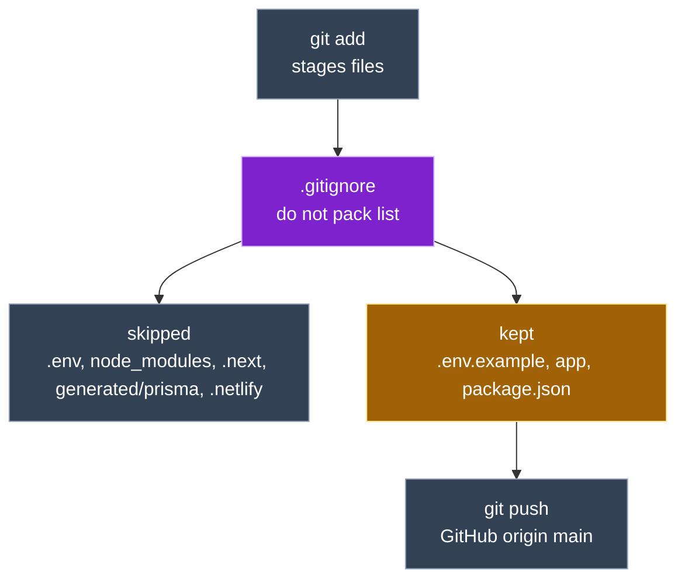

---

## Entry 3 · #1 Global style and focus ring

*Oct 14 · ~20:40 to 20:55 CT*

<table>
  <tr><th align="left">Field</th><th align="left">Details</th></tr>
  <tr><td><b>Tool</b></td><td>Claude Code · claude-opus-5-5</td></tr>
  <tr><td><b>Asked</b></td><td>Step 3 only: Week 4 page background, text color, yellow focus ring and tabular numbers in 🟧 <code>app/globals.css</code>; page title in 🟦 <code>app/layout.tsx</code></td></tr>
  <tr><td><b>Context</b></td><td>
    <ul>
      <li>same as Entry 1</li>
      <li>Week 4 <code>src/index.css</code>, <code>src/App.jsx</code>, <code>index.html</code> (via <code>gh api</code>)</li>
    </ul>
  </td></tr>
  <tr><td><b>Changed</b></td><td>
    2 edited
    <ul>
      <li>🟧 <code>app/globals.css</code> (modified) · <code>#F3F5F8</code> background, <code>#1B2733</code> text, <code>:focus-visible</code> 3px <code>#F2B807</code> ring, <code>.tabular</code>; dark mode removed</li>
      <li>🟦 <code>app/layout.tsx</code> (modified) · title "Texas Second Chance License Navigator"; Geist fonts removed</li>
    </ul>
  </td></tr>
  <tr><td><b>Decision</b></td><td>accepted</td></tr>
  <tr><td><b>Verified</b></td><td>
    <ul>
      <li>~20:45 CT · <code>npm run lint</code> passed</li>
      <li>~20:45 CT · <code>npx tsc --noEmit</code> passed</li>
      <li>~20:50 CT · Joseph pressed Tab at <code>localhost:3000</code>: yellow ring on "Documentation", gray background below the starter box (screenshot)</li>
    </ul>
  </td></tr>
  <tr><td><b>Commit</b></td><td><code>56b7a88</code> style: week 4 background, text color and focus ring</td></tr>
  <tr><td><b>PIOF and what differed</b></td><td>
    <ul>
      <li>Purpose: every page gets the Week 4 background, text color and keyboard focus ring</li>
      <li>Input: none</li>
      <li>Output: global CSS rules and the page title</li>
      <li>Flow: browser loads <code>/</code> → 🟦 <code>app/layout.tsx</code> imports 🟧 <code>app/globals.css</code> → Tailwind builds CSS → <code>body</code> gray, <code>:focus-visible</code> ring on Tab</li>
    </ul>
  </td></tr>
  <tr><td><b>Reflection</b></td><td>
    <ul>
      <li>In step three, we brought over Week 4 look features that apply to the whole site.</li>
      <li>The changes in <code>globals.css</code> give every page a light gray background, dark text, and a yellow ring that appears only when you move around with the keyboard.</li>
      <li><code>layout.tsx</code> sets the browser tab title to match Week 4, and drops the default Next.js font and dark mode because the previous build didn't use them.</li>
      <li>When you press Tab, a yellow ring highlights whatever is selected.</li>
      <li>The rest of the formatting is still being worked on.</li>
    </ul>
  </td></tr>
  <tr><td><b>Explained</b></td><td>
    <b>Entry 3 · #1 Global style and focus ring</b>
    <ul>
      <li>What it is: painting the walls and putting up the house's signs before any furniture goes in</li>
      <li>Why: one CSS file sets the look for every page, so later components do not each repeat the background and focus ring</li>
      <li>Files:
        <ul>
          <li>🟧 <code>app/globals.css</code>: the paint (colors) and the yellow keyboard ring</li>
          <li>🟦 <code>app/layout.tsx</code>: the frame; loads the CSS and names the browser tab</li>
        </ul>
      </li>
      <li>Its role in the project: every component in steps 4 and 5 inherits this look and the accessible focus ring</li>
    </ul>
  </td></tr>
</table>

### Entry 3 call graph

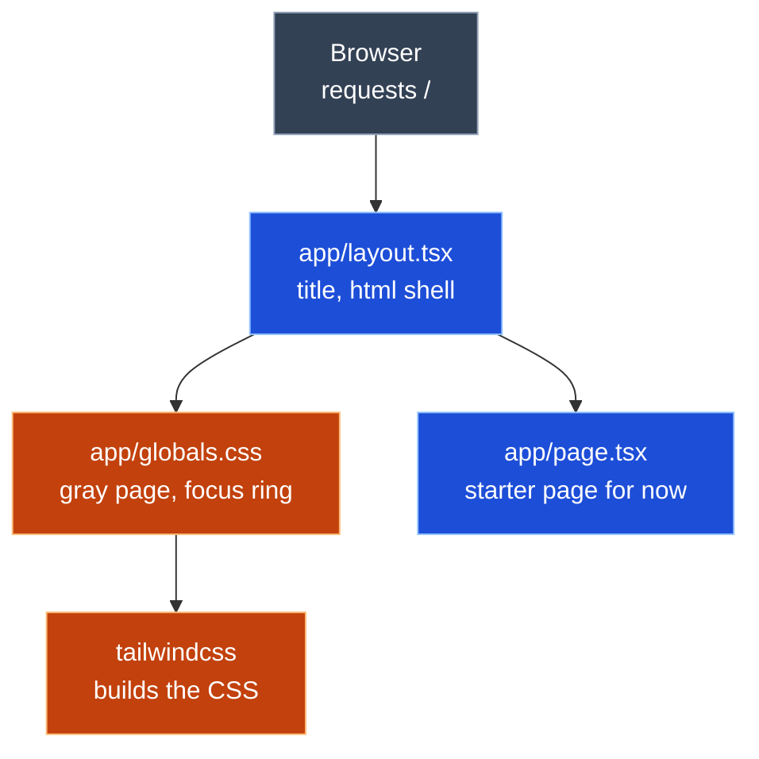

---

## Entry 4 · #1 SiteHeader and SiteFooter

*Oct 15 · by 05:44 CT*

<table>
  <tr><th align="left">Field</th><th align="left">Details</th></tr>
  <tr><td><b>Tool</b></td><td>Claude Code · claude-opus-5-5</td></tr>
  <tr><td><b>Asked</b></td><td>Step 4 only: port the Week 4 header bands and footer to 🟩 <code>components/SiteHeader.tsx</code> and 🟩 <code>components/SiteFooter.tsx</code>, show them on the page</td></tr>
  <tr><td><b>Context</b></td><td>
    <ul>
      <li>same as Entry 1</li>
      <li>Week 4 <code>src/components/SiteHeader.jsx</code> and <code>src/components/SourceNote.jsx</code> (via <code>gh api</code>)</li>
    </ul>
  </td></tr>
  <tr><td><b>Changed</b></td><td>
    2 new files, 1 edited
    <ul>
      <li>🟩 <code>components/SiteHeader.tsx</code> (new) · navy strip, blue title band, red stripe</li>
      <li>🟩 <code>components/SiteFooter.tsx</code> (new) · Week 4 <code>SourceNote</code>; per-link focus classes dropped, the global ring covers them</li>
      <li>🟦 <code>app/page.tsx</code> (modified) · starter page replaced by header, empty <code>main</code>, footer</li>
    </ul>
  </td></tr>
  <tr><td><b>Decision</b></td><td>accepted</td></tr>
  <tr><td><b>Verified</b></td><td>
    <ul>
      <li><code>npm run lint</code> passed</li>
      <li><code>npx tsc --noEmit</code> passed</li>
      <li>by 05:44 CT · Joseph reloaded <code>localhost:3000</code>: three header bands and navy footer with the <code>data.texas.gov</code> link (screenshot)</li>
    </ul>
  </td></tr>
  <tr><td><b>Commit</b></td><td><code>e77383f</code> feat: week 4 header bands and footer</td></tr>
  <tr><td><b>PIOF and what differed</b></td><td>
    <ul>
      <li>Purpose: the page shows the Week 4 header bands and footer</li>
      <li>Input: none; both components are static</li>
      <li>Output: a <code>&lt;header&gt;</code> with three bands and a <code>&lt;footer&gt;</code> with the TDLR source link</li>
      <li>Flow: browser requests <code>/</code> → 🟦 <code>app/layout.tsx</code> → 🟦 <code>app/page.tsx</code> → 🟩 <code>SiteHeader</code>, empty <code>&lt;main&gt;</code>, 🟩 <code>SiteFooter</code> → HTML</li>
    </ul>
  </td></tr>
  <tr><td><b>Reflection</b></td><td>
    <ul>
      <li>In step four, we added the header and footer bands to the page.</li>
      <li>They match the theme and setup from Week 4.</li>
      <li>We reloaded <code>localhost:3000</code> to check them, then I accepted step four and gave my reflection.</li>
    </ul>
  </td></tr>
  <tr><td><b>Explained</b></td><td>
    <b>Entry 4 · #1 SiteHeader and SiteFooter</b>
    <ul>
      <li>What it is: the sign over the front door and the plaque by the exit, moved from the Week 4 house</li>
      <li>Why: each band is its own component, so <code>page.tsx</code> stays short and the look matches Week 4 exactly</li>
      <li>Files:
        <ul>
          <li>🟩 <code>components/SiteHeader.tsx</code>: the three bands at the top</li>
          <li>🟩 <code>components/SiteFooter.tsx</code>: where the numbers come from, not legal advice</li>
          <li>🟦 <code>app/page.tsx</code>: places header, main, footer in order</li>
        </ul>
      </li>
      <li>Its role in the project: frames every later piece (search form, saved list) between the same header and footer</li>
    </ul>
  </td></tr>
</table>

### Entry 4 call graph

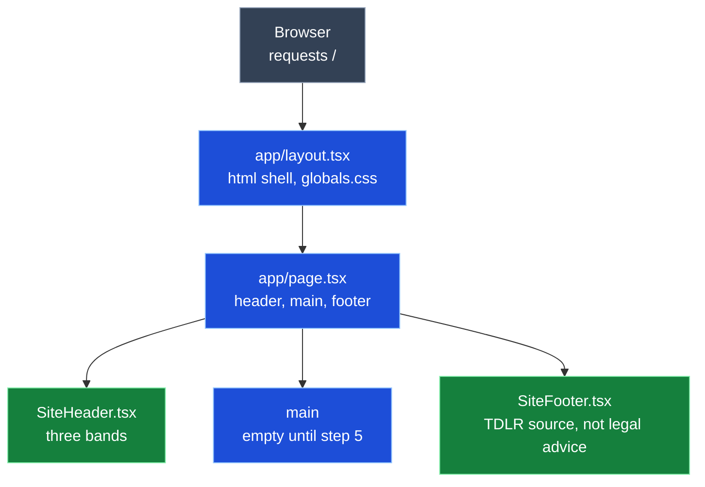

---

## Entry 5 · #1 TrustNote, h1 and intro

*Oct 15 · ~05:50 to 06:01 CT*

<table>
  <tr><th align="left">Field</th><th align="left">Details</th></tr>
  <tr><td><b>Tool</b></td><td>Claude Code · claude-opus-5-5</td></tr>
  <tr><td><b>Asked</b></td><td>Step 5 only: port the Week 4 trust note to 🟩 <code>components/TrustNote.tsx</code>, add the Week 4 h1 and intro to 🟦 <code>app/page.tsx</code></td></tr>
  <tr><td><b>Context</b></td><td>
    <ul>
      <li>same as Entry 1</li>
      <li>Week 4 <code>src/components/TrustNote.jsx</code> and <code>src/App.jsx</code> (via <code>gh api</code>)</li>
    </ul>
  </td></tr>
  <tr><td><b>Changed</b></td><td>
    1 new file, 1 edited
    <ul>
      <li>🟩 <code>components/TrustNote.tsx</code> (new) · green counts only note, copied from Week 4</li>
      <li>🟦 <code>app/page.tsx</code> (modified) · h1 "Look up HVAC license demand by county", intro line, <code>&lt;TrustNote /&gt;</code></li>
    </ul>
  </td></tr>
  <tr><td><b>Decision</b></td><td>accepted</td></tr>
  <tr><td><b>Verified</b></td><td>
    <ul>
      <li><code>npm run lint</code> passed</li>
      <li><code>npx tsc --noEmit</code> passed</li>
      <li>06:01 CT · Joseph accepted the step</li>
    </ul>
  </td></tr>
  <tr><td><b>Commit</b></td><td><code>1834dd2</code> docs: prompt log header and entries 5-6 · Closes #1 (steps 5 and 6 together)</td></tr>
  <tr><td><b>PIOF and what differed</b></td><td>
    <ul>
      <li>Purpose: the top of the page reads exactly like Week 4, including the counts only promise</li>
      <li>Input: none; all static</li>
      <li>Output: h1, intro line and green trust note inside <code>&lt;main&gt;</code></li>
      <li>Flow: browser requests <code>/</code> → 🟦 <code>app/layout.tsx</code> → 🟦 <code>app/page.tsx</code> → 🟩 <code>SiteHeader</code> → h1, intro, 🟩 <code>TrustNote</code> → 🟩 <code>SiteFooter</code> → HTML</li>
    </ul>
  </td></tr>
  <tr><td><b>Reflection</b></td><td>
    <ul>
      <li>We added a new component, the trust note. It's very simple but very important, and something we adopted from Week 4.</li>
      <li>It's a green box that promises counts only: never names, addresses, or license records.</li>
      <li><code>page.tsx</code> now has the Week 4 heading, "Look up HVAC license demand by county," and the intro line, with the same colors and sizes, and the header, footer, and trust note in place.</li>
      <li>The page can be checked side by side against Week 4, which was the original plan for picking up where we left off.</li>
    </ul>
  </td></tr>
  <tr><td><b>Explained</b></td><td>
    <b>Entry 5 · #1 TrustNote, h1 and intro</b>
    <ul>
      <li>What it is: the welcome sign inside the front door, plus a promise posted on the wall</li>
      <li>Why: the counts only rule is the project's privacy promise, so the visitor reads it before searching</li>
      <li>Files:
        <ul>
          <li>🟩 <code>components/TrustNote.tsx</code>: the green promise box</li>
          <li>🟦 <code>app/page.tsx</code>: heading, intro, and the order of everything on the page</li>
        </ul>
      </li>
      <li>Its role in the project: completes the Week 4 look above the form; #6 adds the search form under it</li>
    </ul>
  </td></tr>
</table>

### Entry 5 call graph

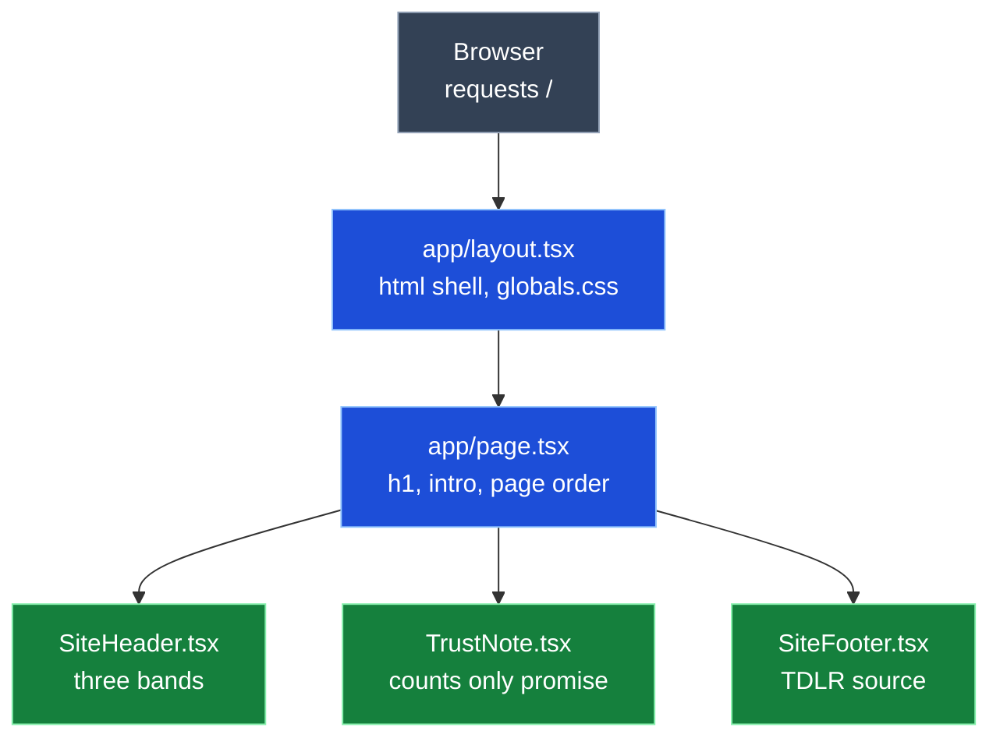

---

## Entry 6 · #1 PROMPT_LOG header

*Oct 15 · ~06:02 to 06:08 CT*

<table>
  <tr><th align="left">Field</th><th align="left">Details</th></tr>
  <tr><td><b>Tool</b></td><td>Claude Code · claude-opus-5-5</td></tr>
  <tr><td><b>Asked</b></td><td>Step 6 only: add the banner, title, 8-layer legend and Project info table to the top of <code>PROMPT_LOG.md</code></td></tr>
  <tr><td><b>Context</b></td><td>
    <ul>
      <li>same as Entry 1</li>
      <li>Week 4 <code>PROMPT_LOG.md</code> header and <code>docs/assets/banner.png</code> (via <code>gh api</code>)</li>
    </ul>
  </td></tr>
  <tr><td><b>Changed</b></td><td>
    1 new file, 1 edited
    <ul>
      <li><code>docs/assets/banner.png</code> (new) · copied from the Week 4 repo, 1280 × 720</li>
      <li><code>PROMPT_LOG.md</code> (modified) · banner, title, legend from <code>CLAUDE.md</code>, Project info (One liner, Privacy, Tools)</li>
    </ul>
  </td></tr>
  <tr><td><b>Decision</b></td><td>accepted</td></tr>
  <tr><td><b>Verified</b></td><td>
    <ul>
      <li><code>file docs/assets/banner.png</code>: PNG image data, 1280 x 720</li>
      <li>06:08 CT · Joseph accepted the step</li>
    </ul>
  </td></tr>
  <tr><td><b>Commit</b></td><td><code>1834dd2</code> docs: prompt log header and entries 5-6 · Closes #1</td></tr>
  <tr><td><b>PIOF and what differed</b></td><td>
    <ul>
      <li>Purpose: the log opens like Week 4, so a grader sees the layers and the project at a glance</li>
      <li>Input: Week 4 header layout, <code>CLAUDE.md</code> legend, banner image</li>
      <li>Output: banner, title, 8-layer legend and Project info table above Entry 1</li>
      <li>Flow: GitHub renders <code>PROMPT_LOG.md</code> → <code>&lt;img&gt;</code> loads <code>docs/assets/banner.png</code> → legend and table → Entries 1 to 6</li>
    </ul>
  </td></tr>
  <tr><td><b>Reflection</b></td><td>
    <ul>
      <li>Step six was pretty simple: we added the banner from Week 4, so the prompt log now matches the Week 4 layout.</li>
      <li>It has the title with the tool and model. The legend is the eight color-coded layers we use to break down the different parts, components, and functionality in the call graphs, along with the notes for each part we work on in the prompt log.</li>
      <li>The banner image is copied from the Week 4 repo into an assets folder, and this step closes issue #1.</li>
      <li>We're going to check this on GitHub, then update the log and check GitHub for the next issues.</li>
    </ul>
  </td></tr>
  <tr><td><b>Explained</b></td><td>
    <b>Entry 6 · #1 PROMPT_LOG header</b>
    <ul>
      <li>What it is: the cover page and table of contents for the build diary</li>
      <li>Why: the legend's color squares are the same ones used in every entry and call graph, so a reader learns them once at the top</li>
      <li>Files:
        <ul>
          <li><code>PROMPT_LOG.md</code>: banner, title, legend, Project info, then the entries</li>
          <li><code>docs/assets/banner.png</code>: the picture at the top</li>
        </ul>
      </li>
      <li>Its role in the project: the graded evidence that Joseph steered each step; every later entry goes under this header</li>
    </ul>
  </td></tr>
</table>

### Entry 6 call graph

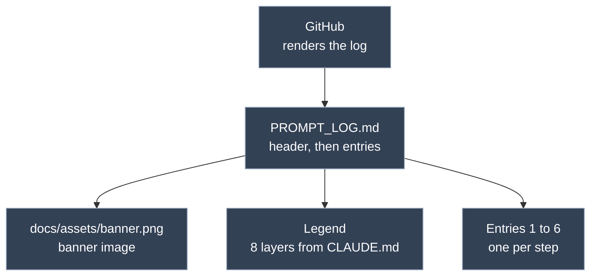

---

## Entry 7 · #2 Research Prisma 7 + Neon setup

*Oct 15 · ~06:20 to 15:00 CT (includes breaks)*

<table>
  <tr><th align="left">Field</th><th align="left">Details</th></tr>
  <tr><td><b>Tool</b></td><td>Claude Code · claude-opus-5-5 · skill <code>research</code> (background agent)</td></tr>
  <tr><td><b>Asked</b></td><td>Work issue #2: post <code>Started</code>, split into 8 steps; then step B2.1 only: <code>/research</code> Prisma 7.10 <code>prisma-client</code> generator, <code>prisma.config.ts</code> with <code>DIRECT_URL</code> and dotenv, <code>PrismaNeon</code> with pooled <code>DATABASE_URL</code> in Next.js 16. Then: restructure the notes so they are digestible (plain words, examples, diagrams) without losing context; rename the reference images in <code>docs/assets</code></td></tr>
  <tr><td><b>Context</b></td><td>
    <ul>
      <li>issue #2 (acceptance criteria) and <code>docs/agents/issue-tracker.md</code></li>
      <li><code>docs/spec/design.md</code> (Database, Validation) and <code>docs/spec/tasks.md</code></li>
      <li><code>CLAUDE.md</code> (Stack)</li>
      <li>Prisma v7 docs, Prisma 7.0.0 and 7.10.0 release notes and source, Neon docs, Next.js docs, <code>npm view</code></li>
    </ul>
  </td></tr>
  <tr><td><b>Changed</b></td><td>
    1 new file, 1 edited, 3 images moved
    <ul>
      <li><code>docs/research/prisma-7-neon.md</code> (new) · findings with sources, glossary, examples, call graphs</li>
      <li><code>docs/spec/design.md</code> (modified) · Database: <code>dotenv</code>, <code>process.env.DIRECT_URL ?? ""</code>, Node 22+, link to the research</li>
      <li><code>docs/assets/reference/</code> (new folder) · <code>prisma-neon-request-flow.png</code>, <code>zod-decision-architecture.png</code>, <code>issue-2-step-plan.png</code> (renamed from <code>image.png</code>, <code>image copy.png</code>, the screenshot)</li>
    </ul>
  </td></tr>
  <tr><td><b>Decision</b></td><td>accepted · gap 1 option (a) <code>process.env.DIRECT_URL ?? ""</code>, gap 2 Node 22+, gap 3 add <code>dotenv</code></td></tr>
  <tr><td><b>Verified</b></td><td>
    <ul>
      <li>06:20 CT · <code>Started</code> comment posted on #2 (blocker #1 closed)</li>
      <li><code>npm view</code>: <code>prisma</code>, <code>@prisma/client</code>, <code>@prisma/adapter-neon</code> all exist at 7.10.0</li>
      <li><code>node --version</code>: v26.7.0 (Node 22+, no <code>ws</code> needed locally)</li>
      <li>research found no outright conflict with <code>design.md</code>; 3 gaps recorded and decided</li>
      <li><code>ls -R docs/assets</code>: <code>banner.png</code> kept (used by this log), 3 images in <code>reference/</code></li>
      <li>15:00 CT · Joseph accepted the step</li>
    </ul>
  </td></tr>
  <tr><td><b>Commit</b></td><td><code>955338d</code> docs+chore: prisma 7 research, neon dev setup, monday checkpoints, prisma 7.10.0 packages; prompt log entries 7-9</td></tr>
  <tr><td><b>PIOF and what differed</b></td><td>
    <ul>
      <li>Purpose: confirm the Prisma 7 + Neon setup against primary sources before any code, and fix the spec where it had gaps</li>
      <li>Input: Prisma v7, Neon, Next.js and npm sources; Joseph's choices for the 3 gaps</li>
      <li>Output: <code>docs/research/prisma-7-neon.md</code> with sources; 3 decisions in <code>design.md</code></li>
      <li>Flow: <code>/research</code> → background agent reads the sources → notes file → restructured for learning → gaps → Joseph decides → <code>design.md</code> updated</li>
    </ul>
  </td></tr>
  <tr><td><b>Reflection</b></td><td>
    <ul>
      <li>In this step we researched Prisma 7 and the Neon setup. In plain words, Prisma shows up in three spots: setup (creating the tables), which I'll do on my laptop; the build, which runs on Netlify; and requests, when people click around the site.</li>
      <li>The setup command is <code>prisma migrate dev</code>. It reads the schema and the Prisma config file, and uses the direct URL.</li>
      <li>The build runs on Netlify with <code>npm run build</code>. It runs <code>prisma generate</code>, then <code>next build</code>. It reads the schema and the config file, but needs no URL to connect.</li>
      <li>Then the request: who runs that? Every API call. It goes from <code>route.ts</code> to <code>lib/db.ts</code>, which uses the generated Prisma client and the pooled database URL to connect.</li>
    </ul>
  </td></tr>
  <tr><td><b>Explained</b></td><td>
    <b>Entry 7 · #2 Research Prisma 7 + Neon setup</b>
    <ul>
      <li>What it is: reading the instructions before building. Prisma 7 changed a lot (no <code>url</code> in the schema, no built-in engine, no automatic <code>.env</code>), so memory or old tutorials would be wrong</li>
      <li>Why: the Netlify build would have failed. <code>prisma generate</code> opens <code>prisma.config.ts</code>, and <code>env("DIRECT_URL")</code> throws when Netlify has no <code>DIRECT_URL</code>; <code>process.env.DIRECT_URL ?? ""</code> does not</li>
      <li>Files:
        <ul>
          <li><code>docs/research/prisma-7-neon.md</code>: the notes, in order setup → build → request</li>
          <li><code>docs/spec/design.md</code>: the 3 decisions</li>
        </ul>
      </li>
      <li>Its role in the project: steps B2.2 to B2.8 follow these notes, so each config line has a source</li>
    </ul>
  </td></tr>
</table>

### Entry 7 call graph

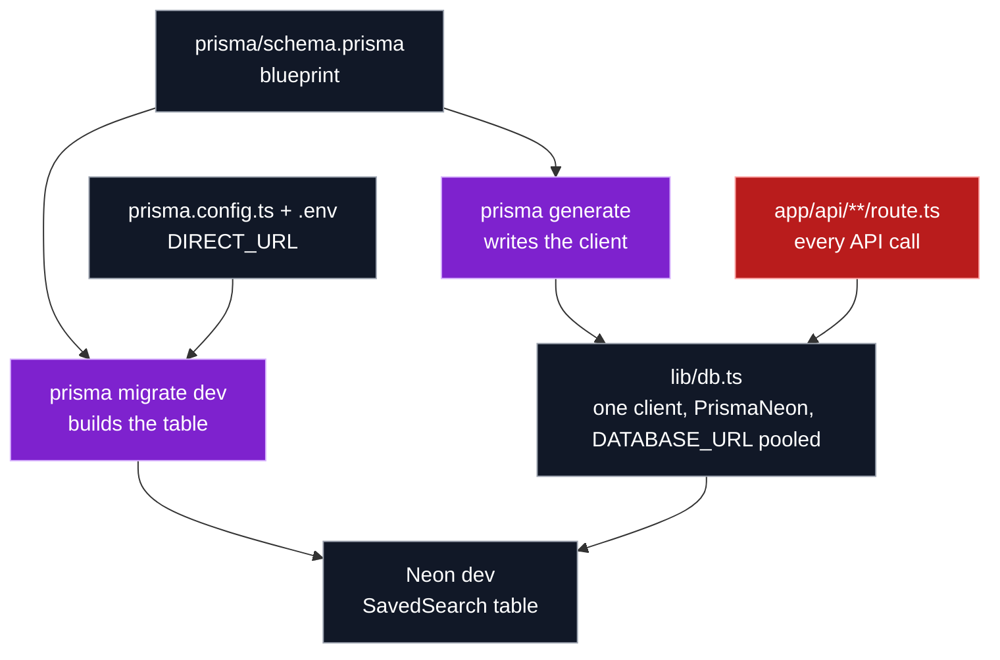

---

## Entry 8 · #2 Neon dev branch and .env

*Oct 15 · ~15:00 to 16:51 CT (includes breaks)*

<table>
  <tr><th align="left">Field</th><th align="left">Details</th></tr>
  <tr><td><b>Tool</b></td><td>Claude Code · claude-opus-5-5 · skill <code>wizard</code></td></tr>
  <tr><td><b>Asked</b></td><td>Step B2.2 only: <code>/wizard</code> Neon dev branch, get pooled <code>DATABASE_URL</code> and direct <code>DIRECT_URL</code> into <code>.env</code>. Then: rename Neon <code>main</code> to <code>production</code> in <code>design.md</code>, <code>CLAUDE.md</code> and the research notes; clean up reflections in Entries 1–7</td></tr>
  <tr><td><b>Context</b></td><td>
    <ul>
      <li><code>.env.example</code>, <code>.gitignore</code> (no <code>.github/</code>, so no CI secrets)</li>
      <li>wizard skill <code>template.sh</code></li>
      <li>Neon console screenshots from Joseph (org setup, Create new branch, branch list)</li>
    </ul>
  </td></tr>
  <tr><td><b>Changed</b></td><td>
    1 new file (git-ignored), 4 edited
    <ul>
      <li>⬛ <code>.env</code> (new, git-ignored) · <code>DATABASE_URL</code> (pooled), <code>DIRECT_URL</code> (direct)</li>
      <li><code>docs/spec/design.md</code> (modified) · Neon <code>main</code> → <code>production</code></li>
      <li><code>CLAUDE.md</code> (modified) · Neon <code>main</code> → <code>production</code></li>
      <li><code>docs/research/prisma-7-neon.md</code> (modified) · 3 mentions of Neon <code>main</code> → <code>production</code></li>
      <li><code>PROMPT_LOG.md</code> (modified) · Reflections in Entries 1–7 cleaned up for grammar and dictation errors (Joseph's permission), plus this entry</li>
      <li>Neon (outside the repo): project <code>tx-license-navigator</code> on AWS US East (Ohio), branches <code>production</code> and <code>dev</code> (auto-delete: never)</li>
    </ul>
  </td></tr>
  <tr><td><b>Decision</b></td><td>accepted · region Ohio · <code>dev</code> branch never auto-deletes · default branch name <code>production</code></td></tr>
  <tr><td><b>Verified</b></td><td>
    <ul>
      <li><code>bash -n</code> on the wizard script: no syntax errors</li>
      <li>wizard checked each paste: pooled string has <code>-pooler</code>, direct string does not</li>
      <li><code>awk</code> check on <code>.env</code> (values never printed): <code>DATABASE_URL set pooler</code> · <code>DIRECT_URL set direct</code></li>
      <li>Joseph's Neon branch list shows <code>production</code> and <code>dev</code></li>
      <li>16:51 CT · Joseph accepted the step</li>
    </ul>
  </td></tr>
  <tr><td><b>Commit</b></td><td><code>955338d</code> docs+chore: prisma 7 research, neon dev setup, monday checkpoints, prisma 7.10.0 packages; prompt log entries 7-9</td></tr>
  <tr><td><b>PIOF and what differed</b></td><td>
    <ul>
      <li>Purpose: the app and Prisma know where the database is</li>
      <li>Input: the <code>dev</code> branch's pooled and direct connection strings from the Neon console, pasted hidden into the wizard</li>
      <li>Output: <code>.env</code> with <code>DATABASE_URL</code> and <code>DIRECT_URL</code>; Neon project with <code>production</code> and <code>dev</code></li>
      <li>Flow: Neon console → new project → new branch <code>dev</code> → Connect (pooling on) → wizard → <code>.env</code>; pooling off → wizard → <code>.env</code></li>
      <li>What differed: Neon names its default branch <code>production</code>, not <code>main</code> as the spec said; the spec now says <code>production</code></li>
    </ul>
  </td></tr>
  <tr><td><b>Reflection</b></td><td>
    <ul>
      <li>We created a Neon account and organization; this was my first login. We created the project <code>tx-license-navigator</code>, the database this app will use once Netlify runs it.</li>
      <li>We created a <code>dev</code> branch from <code>production</code>. <code>dev</code> is the branch we'll build on, and <code>production</code> will serve the live site. So <code>production</code> is like <code>main</code>, and <code>dev</code> is like working on a separate branch in GitHub.</li>
      <li>We got the two URLs: the direct URL for Prisma migrations, and the pooled database URL for the app.</li>
      <li>We made sure both URLs were placed correctly in <code>.env</code>, and the wizard verified they weren't swapped.</li>
      <li>Right now the direct and pooled URLs are in the right places, and <code>.env</code> is covered by <code>.gitignore</code>, so acceptance criterion 2 will close after this.</li>
    </ul>
  </td></tr>
  <tr><td><b>Explained</b></td><td>
    <b>Entry 8 · #2 Neon dev branch and .env</b>
    <ul>
      <li>What it is: getting the database's two phone numbers into a private address book. <code>DATABASE_URL</code> is the switchboard (pooled) the app calls; <code>DIRECT_URL</code> is the private line Prisma uses to build tables</li>
      <li>Why: nothing can reach Neon without them, and swapping them breaks migrations, so the wizard checked for <code>-pooler</code></li>
      <li>Files:
        <ul>
          <li><code>.env</code>: the two secrets, never committed</li>
          <li><code>.env.example</code>: the same names with no values, for anyone setting up the project</li>
        </ul>
      </li>
      <li>Its role in the project: B2.5 (migration) uses <code>DIRECT_URL</code>; B2.6 (<code>lib/db.ts</code>) uses <code>DATABASE_URL</code></li>
    </ul>
  </td></tr>
</table>

### Entry 8 call graph

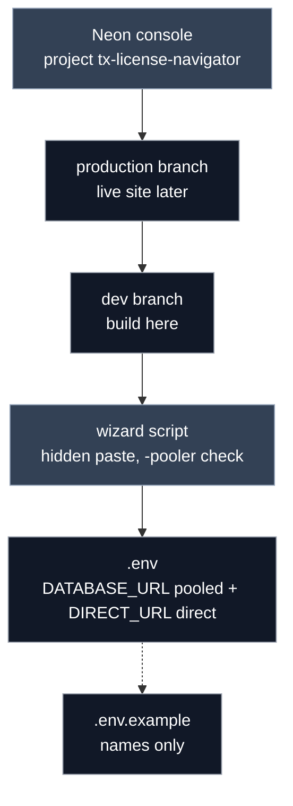

---

## Entry 9 · #2 Prisma packages and build script

*Oct 15 · ~16:55 to 18:26 CT (includes breaks)*

<table>
  <tr><th align="left">Field</th><th align="left">Details</th></tr>
  <tr><td><b>Tool</b></td><td>Claude Code · claude-opus-5-5</td></tr>
  <tr><td><b>Asked</b></td><td>Step B2.3 only: install <code>prisma</code>, <code>@prisma/client</code>, <code>@prisma/adapter-neon</code> at exactly 7.10.0, plus <code>zod</code>, <code>dotenv</code>, <code>server-only</code>; build script <code>prisma generate &amp;&amp; next build</code>. Then: fix the skipped Prisma install scripts, review the 9 <code>npm audit</code> findings before going on, and a step-through visual of the step</td></tr>
  <tr><td><b>Context</b></td><td>
    <ul>
      <li><code>docs/research/prisma-7-neon.md</code> (packages table)</li>
      <li><code>package.json</code></li>
      <li>Prisma's install scripts: <code>prisma/scripts/preinstall-entry.js</code>, <code>@prisma/engines/scripts/postinstall.js</code></li>
      <li><code>npm audit</code> report and <code>npm view</code> release dates for 7.10.x</li>
    </ul>
  </td></tr>
  <tr><td><b>Changed</b></td><td>
    0 new files, 3 edited
    <ul>
      <li>🟨 <code>package.json</code> (modified) · <code>@prisma/client</code> 7.10.0, <code>@prisma/adapter-neon</code> 7.10.0, <code>zod</code> 4.6.7, <code>server-only</code> 0.0.1; dev: <code>prisma</code> 7.10.0, <code>dotenv</code> 18.0.8 (all exact); <code>build</code> runs <code>prisma generate</code> first; <code>allowScripts</code> for <code>prisma@7.10.0</code> and <code>@prisma/engines@7.10.0</code></li>
      <li>🟨 <code>package-lock.json</code> (modified)</li>
      <li><code>docs/research/prisma-7-neon.md</code> (modified) · note to recheck Prisma 7.10.1 before deploy (#11)</li>
      <li>Outside the repo: step-through page <a href="https://claude.ai/artifact/7p8jDC39uEZnF6oheMA594">B2.3 Package Flow</a> (private)</li>
    </ul>
  </td></tr>
  <tr><td><b>Decision</b></td><td>accepted · approve only the two Prisma install scripts (leave ESLint's <code>unrs-resolver</code>) · audit option A: stay on 7.10.0, recheck 7.10.1 before #11, never <code>npm audit fix --force</code></td></tr>
  <tr><td><b>Verified</b></td><td>
    <ul>
      <li><code>npx prisma --version</code>: <code>prisma</code> 7.10.0, <code>@prisma/client</code> 7.10.0, Node v26.7.0</li>
      <li><code>ls</code>: <code>schema-engine-darwin-arm64</code> on disk (25 MB)</li>
      <li><code>npm install-scripts approve</code> then <code>npm rebuild</code>: "rebuilt dependencies successfully"; <code>npm install-scripts ls</code> lists only <code>unrs-resolver</code></li>
      <li><code>npm audit</code>: 9 high, all dev-only (5 in the <code>eslint-config-next</code> chain, 4 in the <code>prisma</code> CLI); fix 7.10.1 published 2026-10-15 19:25 UTC</li>
      <li><code>npm run build</code> not run: <code>prisma generate</code> needs <code>schema.prisma</code> (B2.4)</li>
      <li>18:26 CT · Joseph accepted the step</li>
    </ul>
  </td></tr>
  <tr><td><b>Commit</b></td><td><code>955338d</code> docs+chore: prisma 7 research, neon dev setup, monday checkpoints, prisma 7.10.0 packages; prompt log entries 7-9</td></tr>
  <tr><td><b>PIOF and what differed</b></td><td>
    <ul>
      <li>Purpose: the project has Prisma, the Neon adapter, Zod and dotenv at pinned versions, and the build prints the Prisma client before building the app</li>
      <li>Input: npm registry packages at exact versions</li>
      <li>Output: updated <code>package.json</code> and lockfile, packages and the migration engine in <code>node_modules</code></li>
      <li>Flow: <code>npm install</code> → <code>npm install -D</code> → npm skips Prisma's scripts → read them → approve → <code>npm rebuild</code> → <code>prisma --version</code> OK → <code>npm audit</code> → stay on 7.10.0</li>
      <li>What differed: npm blocked Prisma's install scripts by default, and the audit flagged 9 dev-only findings; both were handled before moving on</li>
    </ul>
  </td></tr>
  <tr><td><b>Reflection</b></td><td>
    <ul>
      <li>The <code>.env</code> file holds our secrets: two URLs, one pooled and one direct. <code>dotenv</code> loads them so <code>prisma.config.ts</code> can pass the direct URL to the Prisma CLI.</li>
      <li>The CLI uses the migration engine, which runs the SQL. Its setup scripts were blocked, so we approved them, and now that whole process is set up properly.</li>
      <li>From there the migration goes to Neon <code>dev</code>, using the direct URL and the <code>dev</code> branch.</li>
      <li>Then <code>npm run build</code> on Netlify: <code>prisma generate</code> reads the schema and prints the Prisma client, the code our routes will use, mapped against the schema.</li>
      <li>Next.js can't build until that "remote control" exists. Then it builds the app, and <code>server-only</code> checks that nothing leaks.</li>
      <li>On every click, the browser fetches <code>/api/searches</code> and goes through the route. Zod checks what the browser sent: if it passes, it continues; if not, 400.</li>
      <li><code>server-only</code> is our key: it keeps <code>lib/db.ts</code>, and the database password, away from the browser.</li>
      <li>The Prisma client takes our TypeScript call, checks it against the schema and turns it into a query. The adapter carries it to Neon over the pooled <code>DATABASE_URL</code>, through the Neon pooler into Postgres.</li>
      <li>In one sentence: <code>dotenv</code> and Prisma set up the database on the laptop, the build script prints the client before Netlify builds the app, and on every click Zod checks the input, <code>server-only</code> guards the door, and the client plus the adapter carry the query to Neon.</li>
    </ul>
  </td></tr>
  <tr><td><b>Explained</b></td><td>
    <b>Entry 9 · #2 Prisma packages and build script</b>
    <ul>
      <li>What it is: stocking the toolbox. Two tools for the laptop and build (<code>prisma</code>, <code>dotenv</code>), four packages that ship with the app (<code>@prisma/client</code>, <code>@prisma/adapter-neon</code>, <code>zod</code>, <code>server-only</code>)</li>
      <li>Why: exact versions mean nothing changes under us before the demo; the build order means Netlify prints the client before Next.js needs it</li>
      <li>Files:
        <ul>
          <li><code>package.json</code>: the shopping list, the build order, and which install scripts may run</li>
          <li><code>package-lock.json</code>: the exact versions npm actually installed</li>
        </ul>
      </li>
      <li>Its role in the project: B2.4 writes the schema <code>generate</code> reads; B2.5 runs <code>migrate</code>; B2.6 builds <code>lib/db.ts</code> on the client and adapter; B2.8 writes the Zod rules</li>
    </ul>
  </td></tr>
</table>

### Entry 9 call graph

```mermaid
flowchart TD
  PJ[package.json<br/>pins + build order + allowScripts]:::deps
  DE[dotenv<br/>loads .env]:::deps
  CLI[prisma CLI<br/>generate + migrate]:::tool
  EN[migration engine<br/>setup script approved]:::tool
  NB[next build<br/>runs after generate]:::tool
  CL[@prisma/client<br/>base of the client]:::db
  AD[@prisma/adapter-neon<br/>phone line to Neon]:::db
  Z[zod<br/>checks input]:::server
  SO[server-only<br/>keeps db.ts off the browser]:::deps
  N[Neon<br/>pooler + Postgres]:::db
  PJ --> DE
  PJ --> CLI
  PJ --> NB
  DE --> CLI
  CLI --> EN
  EN --> N
  CLI --> CL
  NB --> SO
  Z --> CL
  CL --> AD
  AD --> N
  classDef server fill:#b91c1c,color:#fff,stroke:#fca5a5
  classDef db fill:#111827,color:#fff,stroke:#9ca3af
  classDef tool fill:#7e22ce,color:#fff,stroke:#d8b4fe
  classDef deps fill:#a16207,color:#fff,stroke:#fde68a
```

---

## Entry 10 · #2 Prisma schema and config

*Oct 15 · ~18:40 to 19:34 CT (includes breaks)*

<table>
  <tr><th align="left">Field</th><th align="left">Details</th></tr>
  <tr><td><b>Tool</b></td><td>Claude Code · claude-opus-5-5</td></tr>
  <tr><td><b>Asked</b></td><td>Step B2.4 only: write <code>prisma/schema.prisma</code> and <code>prisma.config.ts</code> from <code>design.md</code>, then <code>npx prisma validate</code></td></tr>
  <tr><td><b>Context</b></td><td>
    <ul>
      <li><code>docs/spec/design.md</code> (Database)</li>
      <li><code>docs/research/prisma-7-neon.md</code> (§4.1 config, §4.2 schema, §5 build)</li>
    </ul>
  </td></tr>
  <tr><td><b>Changed</b></td><td>
    2 new files
    <ul>
      <li>⬛ <code>prisma/schema.prisma</code> (new) · <code>prisma-client</code> generator to <code>../generated/prisma</code>, <code>postgresql</code> datasource with no <code>url</code>, <code>SavedSearch</code> with <code>@@unique([licenseType, county])</code></li>
      <li>⬛ <code>prisma.config.ts</code> (new) · <code>import "dotenv/config"</code>, schema and migrations paths, <code>url: process.env.DIRECT_URL ?? ""</code></li>
    </ul>
  </td></tr>
  <tr><td><b>Decision</b></td><td>accepted</td></tr>
  <tr><td><b>Verified</b></td><td>
    <ul>
      <li><code>npx prisma validate</code>: "The schema at prisma/schema.prisma is valid"</li>
      <li><code>DIRECT_URL= npx prisma generate</code>: "Generated Prisma Client (7.10.0) to ./generated/prisma" (no <code>DIRECT_URL</code>, as on Netlify)</li>
      <li>19:34 CT · Joseph accepted the step</li>
    </ul>
  </td></tr>
  <tr><td><b>Commit</b></td><td><code>958ed39</code> feat: prisma schema (SavedSearch) and prisma.config.ts; prompt log entry 10</td></tr>
  <tr><td><b>PIOF and what differed</b></td><td>
    <ul>
      <li>Purpose: Prisma has a blueprint and settings, so it can print the client and build the table</li>
      <li>Input: <code>schema.prisma</code>, <code>prisma.config.ts</code>, <code>DIRECT_URL</code> from <code>.env</code> via dotenv</li>
      <li>Output: <code>prisma validate</code> passes; client printed to <code>generated/prisma/</code> (git-ignored)</li>
      <li>Flow: <code>prisma</code> CLI → <code>prisma.config.ts</code> → dotenv loads <code>.env</code> → <code>schema.prisma</code> → validate ✓ → generate → <code>generated/prisma/client.ts</code></li>
    </ul>
  </td></tr>
  <tr><td><b>Reflection</b></td><td>
    <ul>
      <li><code>npx prisma validate</code> is the inspector: it catches blueprint mistakes before they reach the real database.</li>
      <li><code>prisma.config.ts</code> is a configuration file that imports dotenv, which loads <code>.env</code> so the config can pass the direct URL to the CLI. It also points at the schema, and Prisma knows what a valid schema looks like.</li>
      <li>We simulated the Netlify build by leaving <code>DIRECT_URL</code> blank, because Netlify won't have it, and ran <code>prisma generate</code>. <code>?? ""</code> means "use empty if it's missing", and the generate worked without crashing.</li>
      <li>Once the schema exists, the client can be created. Later, <code>lib/db.ts</code> locks it to the server and plugs it into the adapter, which uses the pooled URL.</li>
      <li>In one sentence: the config tells Prisma where things are, the schema says what the table looks like and forbids duplicates, <code>validate</code> confirmed both are correct, and a blank-URL <code>generate</code> proved the Netlify build will work.</li>
    </ul>
  </td></tr>
  <tr><td><b>Explained</b></td><td>
    <b>Entry 10 · #2 Prisma schema and config</b>
    <ul>
      <li>What it is: the blueprint (<code>schema.prisma</code>) and the address book for the builder (<code>prisma.config.ts</code>)</li>
      <li>Why: <code>generate</code> and <code>migrate</code> both read the blueprint; the config tells them where it is and which database line to use</li>
      <li>Files:
        <ul>
          <li><code>prisma/schema.prisma</code>: <code>SavedSearch</code>, 7 columns, one saved search per license type + county</li>
          <li><code>prisma.config.ts</code>: loads <code>.env</code>, gives the CLI <code>DIRECT_URL</code>, blank-safe for Netlify</li>
        </ul>
      </li>
      <li>Its role in the project: B2.5 turns the blueprint into a real table on Neon <code>dev</code>; B2.6 imports the printed client in <code>lib/db.ts</code></li>
    </ul>
  </td></tr>
</table>

### Entry 10 call graph

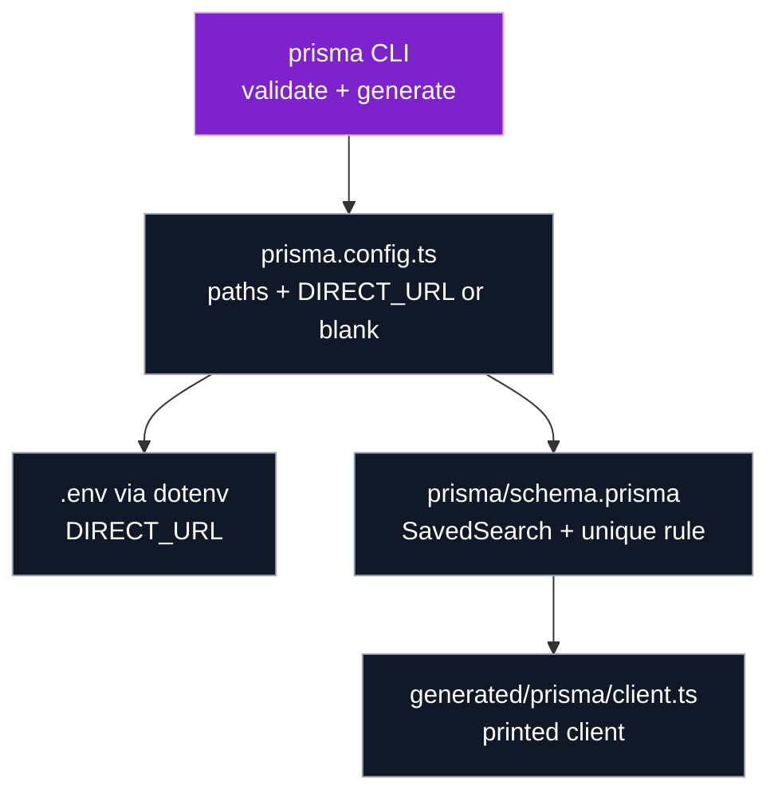

---

## Entry 11 · #2 Init migration on Neon dev

*Oct 15 · ~19:36 to 19:53 CT*

<table>
  <tr><th align="left">Field</th><th align="left">Details</th></tr>
  <tr><td><b>Tool</b></td><td>Claude Code · claude-opus-5-5</td></tr>
  <tr><td><b>Asked</b></td><td>Step B2.5 only: <code>npx prisma migrate dev --name init</code> against Neon <code>dev</code>, then check the table</td></tr>
  <tr><td><b>Context</b></td><td>
    <ul>
      <li><code>prisma/schema.prisma</code>, <code>prisma.config.ts</code>, <code>.env</code> (<code>DIRECT_URL</code>)</li>
      <li>Joseph's Neon console screenshot (Computes · <code>dev</code> · ACTIVE)</li>
    </ul>
  </td></tr>
  <tr><td><b>Changed</b></td><td>
    2 new files, plus the Neon database
    <ul>
      <li>⬛ <code>prisma/migrations/20261016004014_init/migration.sql</code> (new) · <code>CREATE TABLE "SavedSearch"</code> and unique index <code>SavedSearch_licenseType_county_key</code></li>
      <li>⬛ <code>prisma/migrations/migration_lock.toml</code> (new) · provider <code>postgresql</code></li>
      <li>⬛ Neon <code>dev</code> · <code>SavedSearch</code> table and Prisma's <code>_prisma_migrations</code> log</li>
    </ul>
  </td></tr>
  <tr><td><b>Decision</b></td><td>accepted</td></tr>
  <tr><td><b>Verified</b></td><td>
    <ul>
      <li>1st <code>migrate dev</code>: ✗ P1001 can't reach <code>ep-long-rain-b42vrn8u…us-east-2.aws.neon.tech:5432</code></li>
      <li><code>nc -z</code> to port 5432: connection succeeded (network open; compute was waking)</li>
      <li>2nd <code>migrate dev</code>: "Applying migration 20261016004014_init" · "Your database is now in sync with your schema"</li>
      <li><code>npx prisma migrate status</code>: "1 migration found" · "Database schema is up to date!"</li>
      <li>Neon console: compute <code>ep-long-rain-b42vrn8u</code> on <code>dev</code> ACTIVE</li>
      <li>Neon console · Tables · branch <code>dev</code>: <code>SavedSearch</code> and <code>_prisma_migrations</code> listed; <code>_prisma_migrations</code> has 1 row, <code>20261016004014_init</code>, 1 applied step</li>
      <li>19:53 CT · Joseph accepted the step</li>
    </ul>
  </td></tr>
  <tr><td><b>Commit</b></td><td><code>5174008</code> feat: init migration creates SavedSearch on neon dev; prompt log entry 11</td></tr>
  <tr><td><b>PIOF and what differed</b></td><td>
    <ul>
      <li>Purpose: the table exists in a real database, so the app has somewhere to save searches</li>
      <li>Input: <code>schema.prisma</code>; <code>DIRECT_URL</code> via <code>prisma.config.ts</code> and dotenv</li>
      <li>Output: <code>migration.sql</code> and <code>migration_lock.toml</code> in the repo; <code>SavedSearch</code> on Neon <code>dev</code></li>
      <li>Flow: <code>prisma migrate dev</code> → config → <code>DIRECT_URL</code> → Neon <code>dev</code> → shadow DB check → write SQL → apply → <code>migrate status</code> ✓</li>
      <li>What differed: the first run hit P1001 while the free-tier compute was asleep; one retry after a network check worked</li>
    </ul>
  </td></tr>
  <tr><td><b>Reflection</b></td><td>
    <ul>
      <li>Neon is the company: people sign up and use its service, which runs in the cloud. Postgres is the type of database it runs.</li>
      <li>What we just did was use the direct line to the database so our schema now matches a real table inside it, named <code>SavedSearch</code>. If we go to Neon and look in the database, it's a SQL database, and the table inside is based on our schema.</li>
      <li>We need a tool to build all this, and that's where Prisma comes in: tools on my side, run from my laptop. The CLI builds tables, which is what we just did.</li>
      <li>The client reads and writes rows. It's TypeScript, typed against the schema, and Zod checks the browser's input before it gets there.</li>
    </ul>
  </td></tr>
  <tr><td><b>Explained</b></td><td>
    <b>Entry 11 · #2 Init migration on Neon dev</b>
    <ul>
      <li>What it is: the builder turning the blueprint into a real room, and keeping the receipt (<code>migration.sql</code>)</li>
      <li>Why: the app needs a real table to save into; the receipt lets <code>production</code> get the identical table later with <code>prisma migrate deploy</code></li>
      <li>Files:
        <ul>
          <li><code>prisma/migrations/…_init/migration.sql</code>: the exact SQL that ran</li>
          <li><code>prisma/migrations/migration_lock.toml</code>: locks the project to Postgres</li>
        </ul>
      </li>
      <li>Its role in the project: closes AC 4 (init migration exists) and AC 5 (table on <code>dev</code>); routes in #3 read and write this table</li>
    </ul>
  </td></tr>
</table>

### Entry 11 call graph

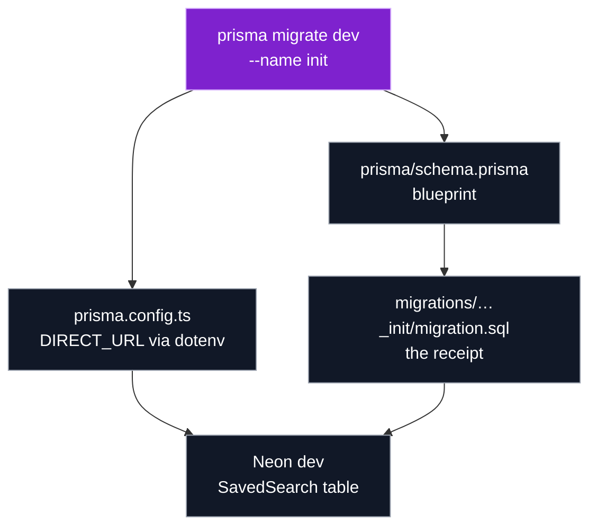

## Entry 12 · #2 lib/db.ts shared Prisma client

*Oct 15 · ~21:05 CT to Oct 16 · 08:57 CT (overnight break)*

<table>
  <tr><th align="left">Field</th><th align="left">Details</th></tr>
  <tr><td><b>Tool</b></td><td>Claude Code · claude-opus-5-5 (Joseph also talked the restatement through with Grok)</td></tr>
  <tr><td><b>Asked</b></td><td>Step B2.6 only: <code>lib/db.ts</code>, one shared Prisma client that connects through the Neon adapter</td></tr>
  <tr><td><b>Context</b></td><td>
    <ul>
      <li><code>docs/spec/design.md</code>, <code>docs/research/prisma-7-neon.md</code></li>
      <li><code>generated/prisma/</code> (output of <code>prisma generate</code> from B2.4)</li>
    </ul>
  </td></tr>
  <tr><td><b>Changed</b></td><td>
    1 new file
    <ul>
      <li>⬛ <code>lib/db.ts</code> (new) · <code>server-only</code>; <code>PrismaNeon</code> adapter with pooled <code>DATABASE_URL</code>; one <code>PrismaClient</code> kept on <code>globalThis</code> in dev; <code>export const prisma</code></li>
    </ul>
  </td></tr>
  <tr><td><b>Decision</b></td><td>accepted</td></tr>
  <tr><td><b>Verified</b></td><td>
    <ul>
      <li><code>npx tsc --noEmit</code>: no output (types check, including the import from <code>../generated/prisma/client</code>)</li>
      <li><code>ls generated/prisma</code>: <code>client.ts</code>, <code>models/SavedSearch.ts</code>, <code>models.ts</code>, <code>enums.ts</code>, <code>commonInputTypes.ts</code>, <code>browser.ts</code>, <code>internal/</code></li>
      <li>No live query yet; the first one runs in #3</li>
      <li>08:57 CT · Joseph restated the step</li>
    </ul>
  </td></tr>
  <tr><td><b>Commit</b></td><td><code>1f465c6</code> feat: lib/db.ts shared prisma client with neon adapter; prompt log entry 12</td></tr>
  <tr><td><b>PIOF and what differed</b></td><td>
    <ul>
      <li>Purpose: every route in #3 imports one ready client instead of building its own</li>
      <li>Input: <code>DATABASE_URL</code> (pooled); the generated <code>PrismaClient</code></li>
      <li>Output: <code>prisma</code>, a client with <code>prisma.savedSearch.create / findMany / update / delete</code></li>
      <li>Flow: <code>route.ts</code> → <code>import { prisma } from "@/lib/db"</code> → <code>PrismaClient</code> → SQL → <code>PrismaNeon</code> adapter → <code>DATABASE_URL</code> (pooler) → Neon <code>dev</code> → row back</li>
    </ul>
  </td></tr>
  <tr><td><b>Reflection</b></td><td>
    <ul>
      <li>The router already has the method and headers, so it knows which URL path to follow and which function (for example <code>POST</code>) to run. The only thing still on its way is the JSON body, which arrives as text because it travels over HTTP.</li>
      <li>Once received, <code>await req.json()</code> turns that text into an object. Zod checks it, and if it passes, it reaches the Prisma client.</li>
      <li>The client is a remote with a set of buttons (<code>create</code>, <code>findMany</code>, <code>update</code>, <code>delete</code>). <code>prisma generate</code> built those buttons from the model blueprint in the schema.</li>
      <li>The gap is that my code speaks TypeScript and the database only understands SQL. The remote is the translator. It isn't a straight conversion: it turns the object into SQL for the specific job of the button I pressed.</li>
      <li>That SQL travels through the adapter, over the pooled database URL, to Postgres, which runs it and stores the row.</li>
      <li>Translating TypeScript into SQL is what any Prisma client does. What makes ours <i>shared</i> is that there's only one copy: <code>lib/db.ts</code> creates it once, keeps it on the <code>globalThis</code> shelf, and exports it, so every route imports that same one instead of building a new client per click.</li>
      <li>That matters because each new client opens its own connections to Neon. If every request or hot reload made a new one, we'd run out of connections. One shared copy, plus the pooler behind <code>DATABASE_URL</code>, keeps that number small.</li>
    </ul>
  </td></tr>
  <tr><td><b>Explained</b></td><td>
    <b>Entry 12 · #2 lib/db.ts shared Prisma client</b>
    <ul>
      <li>What it is: the one remote control the whole app shares, wired to Neon's pooler</li>
      <li>Why: Next.js reloads modules on every save in dev; without <code>globalThis</code>, each reload would open a new connection pool</li>
      <li>Files:
        <ul>
          <li><code>lib/db.ts</code>: creates the adapter and client once and exports <code>prisma</code></li>
        </ul>
      </li>
      <li>Its role in the project: the only door from route handlers to the database; #3 routes import it</li>
    </ul>
  </td></tr>
</table>

### Entry 12 call graph

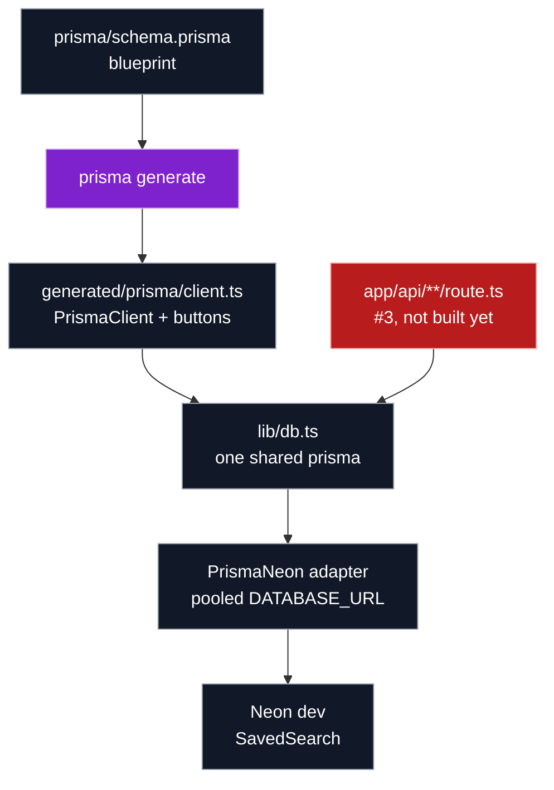

## Entry 13 · #2 lib/counties.ts 13 counties

*Oct 16 · ~09:05 to 09:20 CT*

<table>
  <tr><th align="left">Field</th><th align="left">Details</th></tr>
  <tr><td><b>Tool</b></td><td>Claude Code · claude-opus-5-5</td></tr>
  <tr><td><b>Asked</b></td><td>Step B2.7 only: port the 13 Week 4 counties to <code>lib/counties.ts</code> as <code>{ label, value }</code></td></tr>
  <tr><td><b>Context</b></td><td>
    <ul>
      <li>Week 4 repo <code>ClayClimate-AI/tx-license-navigator</code> · <code>src/data/counties.js</code> (via <code>gh api</code>)</li>
      <li><code>docs/spec/design.md</code> lines 25 and 82 (<code>county</code>: one of the <code>lib/counties.ts</code> values)</li>
    </ul>
  </td></tr>
  <tr><td><b>Changed</b></td><td>
    1 new file
    <ul>
      <li>🟩 <code>lib/counties.ts</code> (new) · <code>COUNTIES</code>, 13 <code>{ label, value }</code> in Week 4 order, <code>as const</code>; type <code>CountyValue</code></li>
    </ul>
  </td></tr>
  <tr><td><b>Decision</b></td><td>accepted</td></tr>
  <tr><td><b>Verified</b></td><td>
    <ul>
      <li><code>gh api</code> returned the Week 4 list: 13 counties, Harris to Loving, with the Oct 7 dataset note</li>
      <li><code>npx tsc --noEmit</code>: no output</li>
      <li>Joseph accepted the step</li>
    </ul>
  </td></tr>
  <tr><td><b>Commit</b></td><td><code>4361b7f</code> feat: lib/counties.ts 13 week 4 counties; prompt log entry 13</td></tr>
  <tr><td><b>PIOF and what differed</b></td><td>
    <ul>
      <li>Purpose: one county list for the county dropdown in <code>LicensePicker.tsx</code> (#6 Search a license count) and for Zod (B2.8)</li>
      <li>Input: none (fixed data)</li>
      <li>Output: <code>COUNTIES</code> and <code>CountyValue</code> (<code>"HARRIS" | "DALLAS" | …</code>)</li>
      <li>Flow: <code>lib/counties.ts</code> → dropdown shows <code>label</code> → browser sends <code>value</code> → Zod checks it is one of the 13 → <code>lib/tdlr.ts</code> / Prisma</li>
    </ul>
  </td></tr>
  <tr><td><b>Reflection</b></td><td>
    <ul>
      <li><code>counties.ts</code> is a shared list that tells the screen what to show and the server what to accept.</li>
      <li>The screen and the server read the same list, so they can't drift apart, and that's why there are no typos between them.</li>
      <li>The accepting part maps to the Zod rules. It's a single check: is this value exactly one of the thirteen on the list?</li>
      <li>Zod doesn't know what a real county is. A real county that isn't on the list, or the right county in the wrong case, gets a 400.</li>
    </ul>
  </td></tr>
  <tr><td><b>Explained</b></td><td>
    <b>Entry 13 · #2 lib/counties.ts 13 counties</b>
    <ul>
      <li>What it is: the list of 13 counties, each with a display name and the exact ALL CAPS value TDLR stores</li>
      <li>Why: "Fort Bend" for people, <code>FORT BEND</code> for TDLR; <code>as const</code> keeps the exact words so Zod can allow only these</li>
      <li>Files:
        <ul>
          <li><code>lib/counties.ts</code>: <code>COUNTIES</code> and <code>CountyValue</code></li>
        </ul>
      </li>
      <li>Its role in the project: read by <code>lib/validation.ts</code> (B2.8) and the county dropdown in <code>LicensePicker.tsx</code> (#6 Search a license count)</li>
    </ul>
  </td></tr>
</table>

### Entry 13 call graph

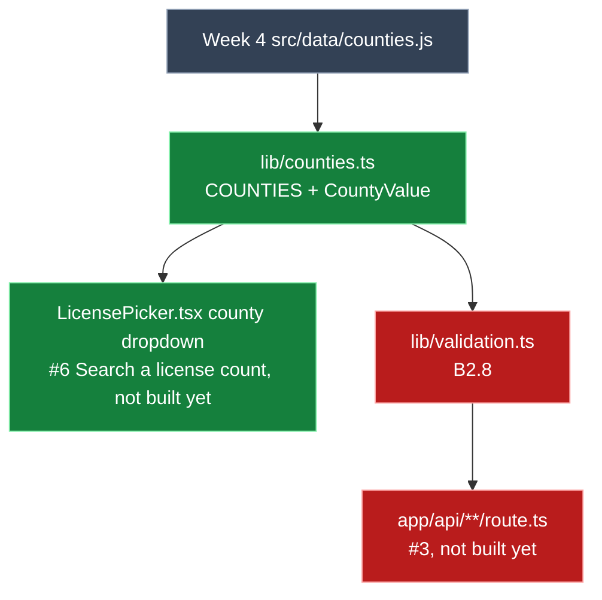

## Entry 14 · #2 Repo audit and cleanup

*Oct 16 · ~09:25 to 10:00 CT*

<table>
  <tr><th align="left">Field</th><th align="left">Details</th></tr>
  <tr><td><b>Tool</b></td><td>Claude Code · claude-opus-5-5</td></tr>
  <tr><td><b>Asked</b></td><td>A full read-only audit of the repo before B2.8, then: rename the reference images to <code>week5_issue2_{step}_{topic}.png</code>, fix Entry 13's issue references, and hold notes for B2.8</td></tr>
  <tr><td><b>Context</b></td><td>
    <ul>
      <li>Every project file outside <code>node_modules</code>, <code>.next</code> and <code>generated</code></li>
      <li><code>docs/spec/design.md</code>, <code>.claude/tickets.md</code>, <code>gh issue list</code>, the GitHub file tree of <code>main</code> (via <code>gh api</code>)</li>
      <li><code>node_modules/next/dist/docs/01-app/01-getting-started/15-route-handlers.md</code> (Cache Components)</li>
    </ul>
  </td></tr>
  <tr><td><b>Changed</b></td><td>
    10 renamed images, 1 modified file
    <ul>
      <li><code>docs/assets/reference/</code> · all 10 images renamed to <code>week5_issue2_{step}_{topic}.png</code>; 6 committed ones by Joseph with <code>git mv</code>, 4 uncommitted ones by the agent with <code>mv</code></li>
      <li><code>PROMPT_LOG.md</code> (modified) · Entry 13: county dropdown is in <code>LicensePicker.tsx</code> (#6 Search a license count), not #4; Commit row <code>4361b7f</code></li>
    </ul>
  </td></tr>
  <tr><td><b>Decision</b></td><td>accepted; each change shown and approved before it was made</td></tr>
  <tr><td><b>Verified</b></td><td>
    <ul>
      <li><code>npx tsc --noEmit</code> and <code>npm run lint</code>: no output</li>
      <li>Secret scan for connection strings: only the <code>FAKEPASSWORD</code> placeholders in <code>docs/research/prisma-7-neon.md</code></li>
      <li><code>gh api</code> tree of <code>main</code>: no <code>.env</code>, no <code>generated/</code>, no <code>.claude/settings.local.json</code></li>
      <li><code>npm audit --omit=dev</code>: 4 high, all <code>deepmerge-ts</code> and <code>mysql2</code> inside the Prisma CLI; fixed in Prisma 7.10.1</li>
      <li><code>md5 -r</code>: all 10 images distinct, no duplicates</li>
      <li><code>ls docs/assets/reference</code>: all 10 <code>week5_issue2_*.png</code> names, no old names left</li>
      <li>Next.js docs: a database query stops a <code>GET</code> route from being prerendered under Cache Components, so <code>GET /api/searches</code> runs per request</li>
    </ul>
  </td></tr>
  <tr><td><b>Commit</b></td><td><code>2225c5a</code> image renames and Entry 13 fix · <code>d0b4b76</code> Entry 14 (both: docs: rename reference images, fix entry 13 issue refs; prompt log entry 14)</td></tr>
  <tr><td><b>PIOF and what differed</b></td><td>
    <ul>
      <li>Purpose: check the project is still on track before the last step of #2</li>
      <li>Input: the repo, GitHub, the specs and the installed Next.js docs</li>
      <li>Output: 11 findings, ranked; image renames; Entry 13 fix; notes for B2.8</li>
      <li>Flow: inventory → configs → code vs <code>design.md</code> → secrets → <code>tsc</code>, lint, audit → GitHub tree → findings → approved changes</li>
      <li>Carried forward: <code>idParam</code> <code>.max(2147483647)</code>, strict <code>createBody</code> and <code>updateBody</code> (both <code>label</code> and <code>note</code> required), <code>COUNTY_VALUES</code> built from <code>COUNTIES</code>, and <code>lib/validation.ts</code> in the legend → B2.8 · Prisma 7.10.1 and Node pin → #11 · README, <code>public/*.svg</code>, the Neon hostname in Entry 11, the <code>npm install</code> permission → open</li>
    </ul>
  </td></tr>
  <tr><td><b>Reflection</b></td><td>
    <ul>
      <li>This was a good time to look at the project and check that we were still on track.</li>
      <li>Along the way we found things worth noting and made changes to match.</li>
    </ul>
  </td></tr>
  <tr><td><b>Explained</b></td><td>
    <b>Entry 14 · #2 Repo audit and cleanup</b>
    <ul>
      <li>What it is: a check of the whole repo against the spec and the rules, with nothing changed until each fix was approved</li>
      <li>Why: catching a 500-instead-of-404 bug and a wrong issue number now is cheaper than after the routes exist</li>
      <li>Files:
        <ul>
          <li><code>docs/assets/reference/week5_issue2_*.png</code>: names now say which step and topic each image shows</li>
        </ul>
      </li>
      <li>Its role in the project: sets up B2.8 with clear rules and leaves #11 a short list</li>
    </ul>
  </td></tr>
</table>

### Entry 14 call graph

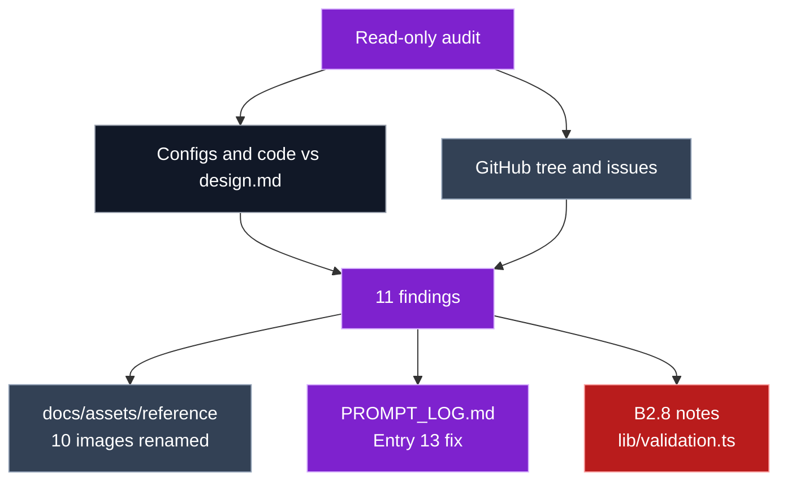

## Entry 15 · #2 lib/validation.ts Zod schemas and build

*Oct 16 · ~13:45 to 14:15 CT*

<table>
  <tr><th align="left">Field</th><th align="left">Details</th></tr>
  <tr><td><b>Tool</b></td><td>Claude Code · claude-opus-5-5</td></tr>
  <tr><td><b>Asked</b></td><td>Step B2.8 only: the 4 Zod schemas in <code>lib/validation.ts</code> per <code>design.md</code> and the notes approved in Entry 14, then <code>npm run build</code></td></tr>
  <tr><td><b>Context</b></td><td>
    <ul>
      <li><code>docs/spec/design.md</code> Validation table; <code>docs/spec/requirements.md</code> C3, U2, E1</li>
      <li>Joseph's decisions: <code>idParam</code> max 2147483647; strict <code>createBody</code> and <code>updateBody</code>; <code>label</code> and <code>note</code> both required on PATCH; <code>COUNTY_VALUES</code> built from <code>COUNTIES</code></li>
      <li><code>node_modules/zod/v4/classic/schemas.d.ts</code> (<code>z.enum</code> accepts a <code>readonly string[]</code>)</li>
    </ul>
  </td></tr>
  <tr><td><b>Changed</b></td><td>
    1 new file, 4 modified
    <ul>
      <li>🟥 <code>lib/validation.ts</code> (new) · <code>idParam</code>, <code>countQuery</code>, <code>createBody</code>, <code>updateBody</code></li>
      <li>🟩 <code>lib/counties.ts</code> (modified) · <code>COUNTY_VALUES = COUNTIES.map((c) =&gt; c.value)</code></li>
      <li><code>docs/spec/design.md</code> (modified) · Validation rows: id max, optional note on create, extra keys rejected on create, both fields required on update</li>
      <li><code>CLAUDE.md</code>, <code>PROMPT_LOG.md</code> (modified) · <code>lib/validation.ts</code> added to 🟥 Server in the legend</li>
    </ul>
  </td></tr>
  <tr><td><b>Decision</b></td><td>accepted</td></tr>
  <tr><td><b>Verified</b></td><td>
    <ul>
      <li><code>npx tsc --noEmit</code> and <code>npm run lint</code>: no output</li>
      <li><code>npm run build</code>: "Generated Prisma Client (7.10.0)" · "Compiled successfully" · routes <code>/</code> and <code>/_not-found</code> static (agent's run and Joseph's run)</li>
      <li>Joseph's build showed Prisma's "Update available 7.10.0 -&gt; 8.0.0-rc.23" box; ignored, the pin stays</li>
      <li>Issue #2: all 6 ACs ticked; <code>Actual: 31.9 h (wall clock, includes breaks)</code> added via <code>gh issue edit</code></li>
    </ul>
  </td></tr>
  <tr><td><b>Commit</b></td><td><code>1a9df68</code> feat: lib/validation.ts zod schemas, build passes; prompt log entry 15 (Closes #2)</td></tr>
  <tr><td><b>PIOF and what differed</b></td><td>
    <ul>
      <li>Purpose: every route from #3 on checks input first, so bad input stops at 400 before the database</li>
      <li>Input: the <code>id</code> text from the URL, query values, JSON bodies</li>
      <li>Output: clean data (trimmed, empty note → <code>null</code>, id → number) or a failed parse → 400</li>
      <li>Flow: browser → <code>route.ts</code> → <code>schema.safeParse()</code> → ✗ 400 / ✓ <code>lib/db.ts</code> → Prisma → Neon</li>
    </ul>
  </td></tr>
  <tr><td><b>Reflection</b></td><td>
    <ul>
      <li>We created <code>validation.ts</code>, which holds the checklists for what passes or fails. <code>createBody</code> and <code>updateBody</code> check the JSON body; <code>idParam</code> checks the id in the URL, and <code>countQuery</code> checks the search terms after the <code>?</code>.</li>
      <li>We gave Zod a direct reference to the thirteen counties, so no county outside that list can be approved.</li>
      <li>We updated the rules in <code>design.md</code> to match.</li>
      <li>Then we ran a practice build to mimic what Netlify will do. It created the Prisma client and type-checked and compiled the app. It didn't run tests, because this project has no unit tests yet.</li>
    </ul>
  </td></tr>
  <tr><td><b>Explained</b></td><td>
    <b>Entry 15 · #2 lib/validation.ts Zod schemas and build</b>
    <ul>
      <li>What it is: the expediter's four checklists, plus a dress rehearsal of the Netlify build</li>
      <li>Why: TypeScript checks our code before it runs; Zod checks the browser's data while it runs</li>
      <li>Files:
        <ul>
          <li><code>lib/validation.ts</code>: the 4 schemas</li>
          <li><code>lib/counties.ts</code>: <code>COUNTY_VALUES</code> for <code>z.enum</code></li>
        </ul>
      </li>
      <li>Its role in the project: closes AC 6 and issue #2; every route in #3–#8 imports these schemas</li>
    </ul>
  </td></tr>
</table>

### Entry 15 call graph

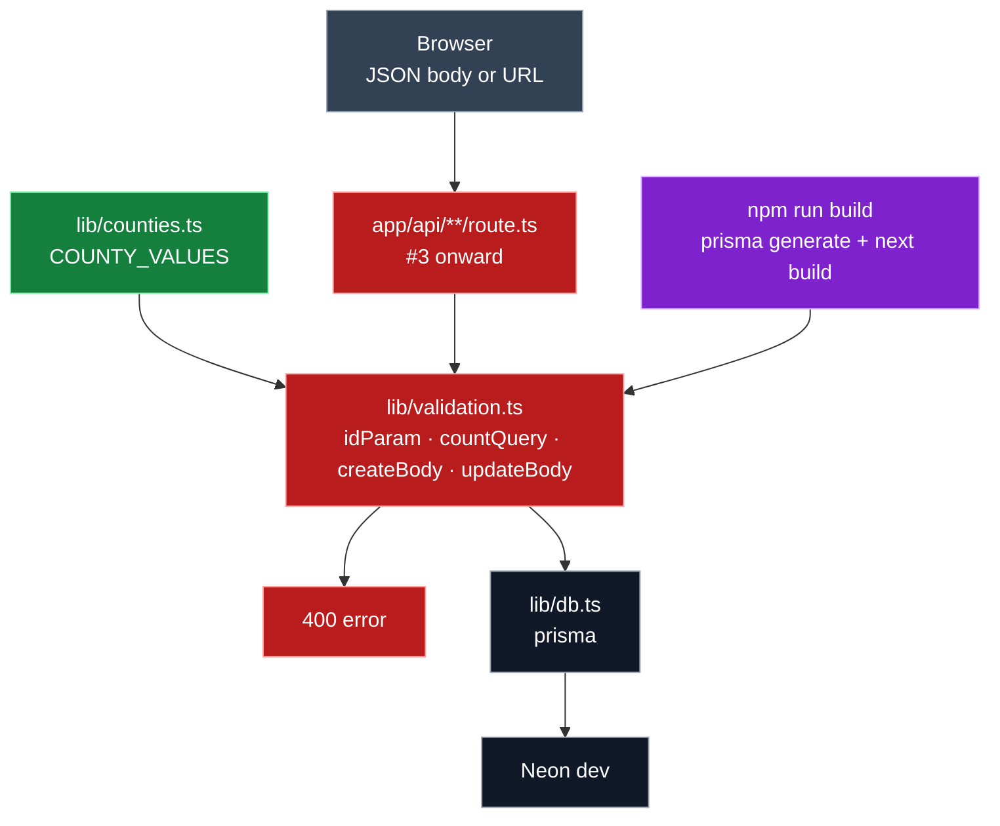

## Entry 16 · #2 README and Node version

*Oct 16 · ~14:20 to 14:45 CT*

<table>
  <tr><th align="left">Field</th><th align="left">Details</th></tr>
  <tr><td><b>Tool</b></td><td>Claude Code · claude-opus-5-5</td></tr>
  <tr><td><b>Asked</b></td><td>Address the review's gaps before #3: rewrite the starter <code>README.md</code>, write down the Node version, and keep the README updated as part of the loop</td></tr>
  <tr><td><b>Context</b></td><td>
    <ul>
      <li>An outside review: the README was the biggest gap; the Node version was not written down</li>
      <li>Entry 14 audit findings 2 (Node pin) and 7 (README boilerplate)</li>
      <li><code>docs/spec/design.md</code>, <code>.claude/tickets.md</code>, <code>package.json</code>, <code>SiteFooter.tsx</code> (data source wording)</li>
    </ul>
  </td></tr>
  <tr><td><b>Changed</b></td><td>
    1 new file, 4 modified
    <ul>
      <li><code>.nvmrc</code> (new) · <code>22</code></li>
      <li>🟨 <code>package.json</code> (modified) · <code>"engines": { "node": "&gt;=22" }</code></li>
      <li><code>docs/spec/design.md</code> (modified) · Node pin now lives in <code>.nvmrc</code> and <code>engines</code>, not #11</li>
      <li><code>README.md</code> (modified) · rewritten: what it does, counts-only privacy, Status table #1–#11, stack, mermaid call graph, run locally, scripts, layout, how it's built, data source</li>
      <li><code>CLAUDE.md</code> (modified) · The loop: keep <code>README.md</code> current; Status table updated at each issue close</li>
    </ul>
  </td></tr>
  <tr><td><b>Decision</b></td><td>accepted; plan shown and approved before each change</td></tr>
  <tr><td><b>Verified</b></td><td>
    <ul>
      <li><code>npm pkg get engines</code>: <code>{ "node": "&gt;=22" }</code></li>
      <li>README has no Vercel, Geist, or connection string text</li>
    </ul>
  </td></tr>
  <tr><td><b>Commit</b></td><td><code>039af6f</code> docs: rewrite README, pin node 22; prompt log entry 16</td></tr>
  <tr><td><b>PIOF and what differed</b></td><td>
    <ul>
      <li>Purpose: the front page tells the truth about the app, and Netlify builds on a known Node version</li>
      <li>Input: the review, the audit findings, the spec</li>
      <li>Output: a project README with a Status table and call graph; Node 22 pinned</li>
      <li>Flow: plan → approve → Node pin → diff → approve → README rewrite and loop rule → accept</li>
    </ul>
  </td></tr>
  <tr><td><b>Reflection</b></td><td>
    <ul>
      <li>We updated the README.</li>
    </ul>
  </td></tr>
  <tr><td><b>Explained</b></td><td>
    <b>Entry 16 · #2 README and Node version</b>
    <ul>
      <li>What it is: the project's front door, rewritten, plus the Node version written into the repo</li>
      <li>Why: the README is the first page a grader or demo viewer sees; the Neon adapter needs Node 22's built-in WebSocket</li>
      <li>Files:
        <ul>
          <li><code>README.md</code>: what, privacy, status, stack, flow, setup</li>
          <li><code>.nvmrc</code> and <code>package.json</code> <code>engines</code>: Node 22 or later</li>
        </ul>
      </li>
      <li>Its role in the project: the Status table is updated at every issue close from now on</li>
    </ul>
  </td></tr>
</table>

### Entry 16 call graph

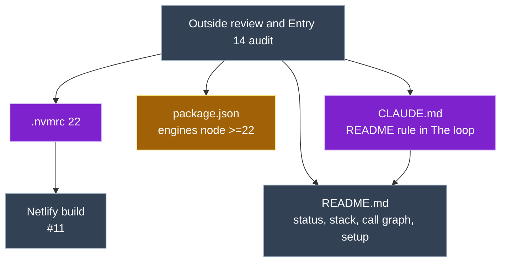

## Entry 17 · #3 GET /api/searches

*Oct 16 · ~16:48 to 17:27 CT*

<table>
  <tr><th align="left">Field</th><th align="left">Details</th></tr>
  <tr><td><b>Tool</b></td><td>Claude Code · claude-opus-5-5</td></tr>
  <tr><td><b>Asked</b></td><td>Work issue #3. Step C1.1 only: <code>GET /api/searches</code> returns the saved list, newest first, or a 500 with the E3 message</td></tr>
  <tr><td><b>Context</b></td><td>
    <ul>
      <li>Issue #3 ACs; <code>docs/spec/requirements.md</code> R1, R5, E3; <code>docs/spec/design.md</code> API contracts and UI wording</li>
      <li><code>node_modules/next/dist/docs/…/15-route-handlers.md</code> and <code>…/connection.md</code></li>
      <li><code>lib/db.ts</code> (shared Prisma client)</li>
    </ul>
  </td></tr>
  <tr><td><b>Changed</b></td><td>
    1 new file, plus <code>.env</code> outside git
    <ul>
      <li>🟥 <code>app/api/searches/route.ts</code> (new) · <code>GET</code>: <code>await connection()</code>, <code>findMany</code> by <code>createdAt</code> desc → <code>200 { searches }</code>; on error → <code>500 { error }</code></li>
      <li><code>.env</code> (git-ignored) · Joseph reset the <code>neondb_owner</code> password on <code>dev</code> and pasted fresh <code>dev</code> pooled and direct URLs</li>
    </ul>
  </td></tr>
  <tr><td><b>Decision</b></td><td>accepted</td></tr>
  <tr><td><b>Verified</b></td><td>
    <ul>
      <li><code>gh issue comment 3</code>: <code>Started</code> posted 2026-10-16T21:48:29Z</li>
      <li><code>npx tsc --noEmit</code>: no output</li>
      <li>First <code>curl /api/searches</code>: <code>500</code> "We could not reach the saved searches database." Dev log: P1000 <code>AuthenticationFailed</code></li>
      <li>URL shape check: <code>DATABASE_URL</code> pointed at a different Neon endpoint than <code>DIRECT_URL</code> (<code>dev</code>)</li>
      <li>After the fix: both URLs on the <code>dev</code> endpoint, <code>DATABASE_URL</code> pooled; <code>curl</code> → <code>{"searches":[]}</code> status <code>200</code></li>
    </ul>
  </td></tr>
  <tr><td><b>Commit</b></td><td><code>be5f8bf</code> feat: GET /api/searches returns saved searches newest first; prompt log entry 17</td></tr>
  <tr><td><b>PIOF and what differed</b></td><td>
    <ul>
      <li>Purpose: the browser can ask the server for the saved list</li>
      <li>Input: a <code>GET</code> with no body or params; <code>DATABASE_URL</code> via <code>lib/db.ts</code></li>
      <li>Output: <code>200 { searches }</code> newest first, or <code>500 { error }</code></li>
      <li>Flow: <code>fetch</code> → <code>route.ts</code> → <code>connection()</code> → <code>prisma.savedSearch.findMany</code> → Neon pooler → Postgres → JSON</li>
      <li>What differed: the first call failed because <code>.env</code>'s <code>DATABASE_URL</code> pointed at the wrong Neon endpoint. While diagnosing, the agent's test script crashed and printed the pooled URL with its password to the terminal; Joseph reset the password and replaced both URLs</li>
    </ul>
  </td></tr>
  <tr><td><b>Reflection</b></td><td>
    <ul>
      <li><code>route.ts</code> is the counter where the browser asks for the saved list, and it answers with the rows or a plain error.</li>
      <li>C1.1 is our first real round trip in terms of a GET request: the browser asks for the saved list, the server asks the database, and the answer comes back as JSON.</li>
      <li>So far it only reads. The methods that write, like POST and PATCH, come later.</li>
    </ul>
  </td></tr>
  <tr><td><b>Explained</b></td><td>
    <b>Entry 17 · #3 GET /api/searches</b>
    <ul>
      <li>What it is: the first Route Handler, answering at <code>/api/searches</code></li>
      <li>Why: the saved list (C1.3, C1.4) needs a server door to the database; the browser never talks to Neon directly</li>
      <li>Files:
        <ul>
          <li><code>app/api/searches/route.ts</code>: <code>GET</code> now; <code>POST</code> joins in #8</li>
        </ul>
      </li>
      <li>Its role in the project: the list the watchlist shows, and the refetch after every save, edit, and delete [R5]</li>
    </ul>
  </td></tr>
</table>

### Entry 17 call graph

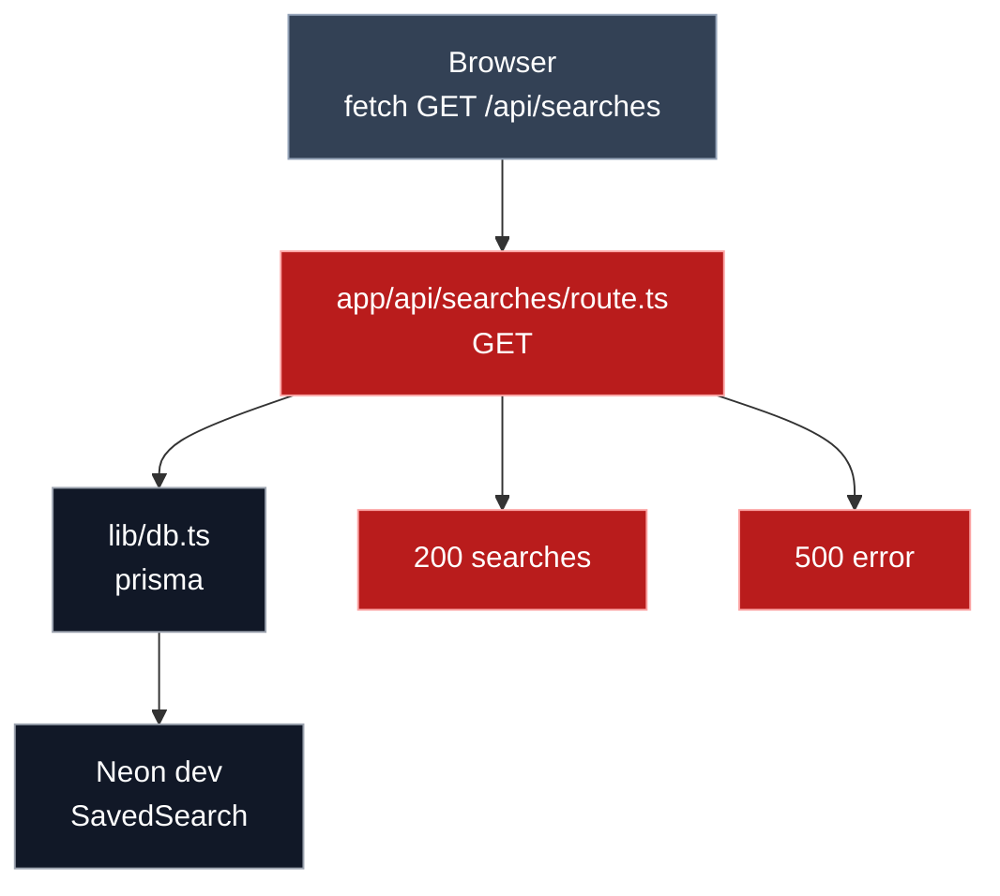

## Entry 18 · #3 Rows in Neon and restart check

*Oct 16 · ~17:30 to 17:50 CT*

<table>
  <tr><th align="left">Field</th><th align="left">Details</th></tr>
  <tr><td><b>Tool</b></td><td>Claude Code · claude-opus-5-5</td></tr>
  <tr><td><b>Asked</b></td><td>Step C1.2 only: add 2 rows by hand in Neon <code>dev</code>, check the route returns them newest first, then again after a dev server restart</td></tr>
  <tr><td><b>Context</b></td><td>
    <ul>
      <li>Issue #3 ACs (rows added in Neon, newest first, survive restart); R1, R5</li>
      <li><code>prisma/migrations/…_init/migration.sql</code> (column names and <code>NOT NULL</code> on <code>updatedAt</code>)</li>
    </ul>
  </td></tr>
  <tr><td><b>Changed</b></td><td>
    No code; data only
    <ul>
      <li>⬛ Neon <code>dev</code> · <code>SavedSearch</code>: id 1 HARRIS (with note, created a day earlier), id 2 TRAVIS (note <code>NULL</code>), inserted in the SQL Editor by Joseph</li>
    </ul>
  </td></tr>
  <tr><td><b>Decision</b></td><td>accepted</td></tr>
  <tr><td><b>Verified</b></td><td>
    <ul>
      <li>Neon SQL Editor (branch <code>dev</code>, database <code>neondb</code>): "Statement executed successfully"</li>
      <li><code>curl /api/searches</code>: status <code>200</code>, id 2 TRAVIS then id 1 HARRIS</li>
      <li>After Joseph restarted <code>npm run dev</code>: same <code>200</code>, same 2 rows, same order; dev log "GET /api/searches 200 in 1494ms"</li>
      <li>A stray draft row in <code>_prisma_migrations</code> (Tables view, Add record) was discarded before saving</li>
    </ul>
  </td></tr>
  <tr><td><b>Commit</b></td><td><code>0d74b88</code> docs: rows in neon survive restart; prompt log entry 18</td></tr>
  <tr><td><b>PIOF and what differed</b></td><td>
    <ul>
      <li>Purpose: prove the route returns real rows, newest first, and that they survive a server restart [R1, R5]</li>
      <li>Input: 2 rows inserted with SQL in Neon <code>dev</code></li>
      <li>Output: <code>200 { searches: [TRAVIS, HARRIS] }</code> before and after the restart</li>
      <li>Flow: SQL Editor → Neon <code>dev</code> → restart Next.js → <code>curl</code> → <code>route.ts</code> → Prisma → Neon → same JSON</li>
    </ul>
  </td></tr>
  <tr><td><b>Reflection</b></td><td>
    <ul>
      <li>This one was pretty cool: we put real rows into the Neon database by hand, and the route returned them in the right order before and after the restart.</li>
      <li>The first response came back in the right order, but we couldn't yet rule out that the server was answering from memory. So we restarted it and sent the request again.</li>
      <li>Getting the same response means it really came from Neon, so the information we received before was accurate, and we'll get consistent results even when the server restarts.</li>
    </ul>
  </td></tr>
  <tr><td><b>Explained</b></td><td>
    <b>Entry 18 · #3 Rows in Neon and restart check</b>
    <ul>
      <li>What it is: test data added by hand, plus proof that the database, not the server, holds it</li>
      <li>Why: POST arrives in #8, so the list needs rows to show now; the restart rules out server memory</li>
      <li>Files: none; 2 rows in Neon <code>dev</code></li>
      <li>Its role in the project: the cards in C1.3 and C1.4 render these 2 rows, including the one with no note</li>
    </ul>
  </td></tr>
</table>

### Entry 18 call graph

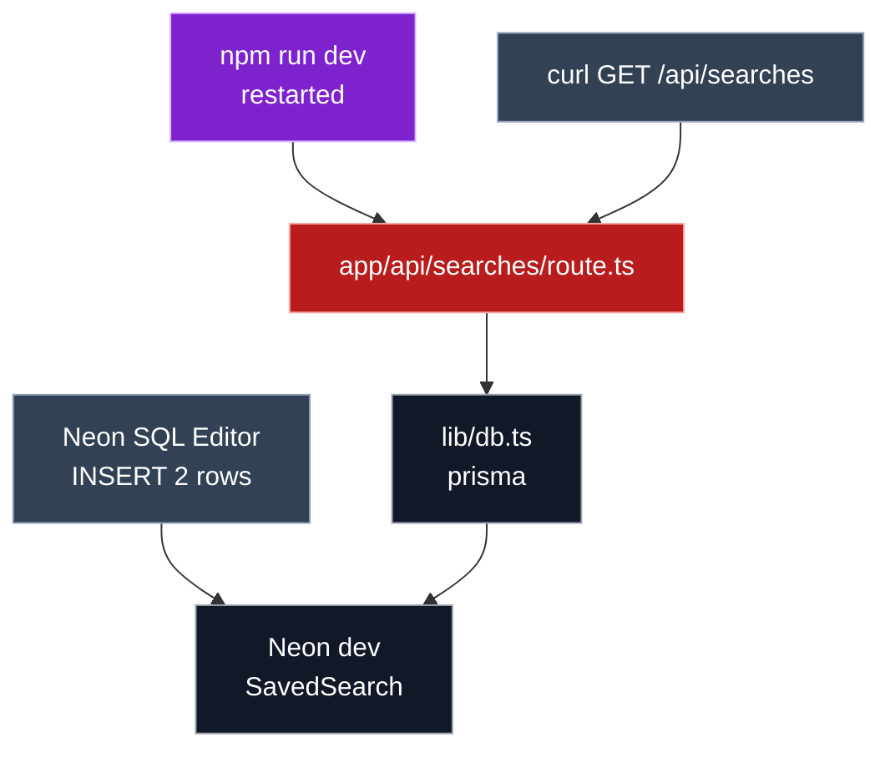

## Entry 19 · #3 SavedCard and SavedList

*Oct 16 · ~17:55 to 18:15 CT*

<table>
  <tr><th align="left">Field</th><th align="left">Details</th></tr>
  <tr><td><b>Tool</b></td><td>Claude Code · claude-opus-5-5</td></tr>
  <tr><td><b>Asked</b></td><td>Step C1.3 only: <code>SavedCard</code> (view only) and <code>SavedList</code> (heading, loading, empty, error with Try again, list)</td></tr>
  <tr><td><b>Context</b></td><td>
    <ul>
      <li><code>docs/spec/design.md</code> UI wording, saved card look, focus ids (A2); R1, R2, R3, E3</li>
      <li><code>SOT_documents/UI.md</code> Part 1 colors (border <code>#C7D0DB</code>, error <code>#FDF2F4</code> / <code>#A3243B</code>); <code>lib/counties.ts</code></li>
    </ul>
  </td></tr>
  <tr><td><b>Changed</b></td><td>
    2 new files
    <ul>
      <li>🟩 <code>components/SavedCard.tsx</code> (new) · <code>SavedSearch</code> type; <code>countyLabel()</code>; h3 label with <code>id="saved-{id}-heading"</code> and <code>tabIndex={-1}</code>; "{type} · {county label} County"; note only if present</li>
      <li>🟩 <code>components/SavedList.tsx</code> (new) · <code>ListStatus</code>; h2 "My saved searches" (<code>id="saved-heading"</code>, <code>tabIndex={-1}</code>); loading text; error box with Try again → <code>onRetry</code>; empty text; <code>&lt;ul&gt;</code> of cards keyed by id</li>
    </ul>
  </td></tr>
  <tr><td><b>Decision</b></td><td>accepted</td></tr>
  <tr><td><b>Verified</b></td><td>
    <ul>
      <li><code>npx tsc --noEmit</code> and <code>npm run lint</code>: no output</li>
      <li>Not yet visible on the page; <code>Navigator</code> renders it in C1.4</li>
    </ul>
  </td></tr>
  <tr><td><b>Commit</b></td><td><code>a3a20cb</code> feat: SavedCard and SavedList components; prompt log entry 19</td></tr>
  <tr><td><b>PIOF and what differed</b></td><td>
    <ul>
      <li>Purpose: the parts that draw the saved list and its states</li>
      <li>Input: <code>SavedList</code> gets <code>searches</code>, <code>status</code>, <code>onRetry</code>; <code>SavedCard</code> gets one <code>search</code></li>
      <li>Output: h2 heading, then loading text, error box, empty text, or a list of cards</li>
      <li>Flow: <code>Navigator</code> (C1.4) → <code>SavedList</code> picks a state → <code>SavedCard</code> per row → <code>countyLabel</code></li>
      <li>New wording not in <code>design.md</code>: "Loading saved searches…"</li>
    </ul>
  </td></tr>
  <tr><td><b>Reflection</b></td><td>
    <ul>
      <li><code>SavedList</code> decides which state to show, and <code>SavedCard</code> draws one saved search.</li>
      <li>There are no fetches in this part. They only display what the <code>Navigator</code> hands them.</li>
    </ul>
  </td></tr>
  <tr><td><b>Explained</b></td><td>
    <b>Entry 19 · #3 SavedCard and SavedList</b>
    <ul>
      <li>What it is: two display-only components for the watchlist</li>
      <li>Why: keeping fetching in <code>Navigator</code> and drawing here means each piece has one job</li>
      <li>Files:
        <ul>
          <li><code>components/SavedList.tsx</code>: the section and its four states</li>
          <li><code>components/SavedCard.tsx</code>: one saved search; Edit, Delete (#4, #5) and the count (#9) join later</li>
        </ul>
      </li>
      <li>Its role in the project: what the visitor sees under "My saved searches"</li>
    </ul>
  </td></tr>
</table>

### Entry 19 call graph

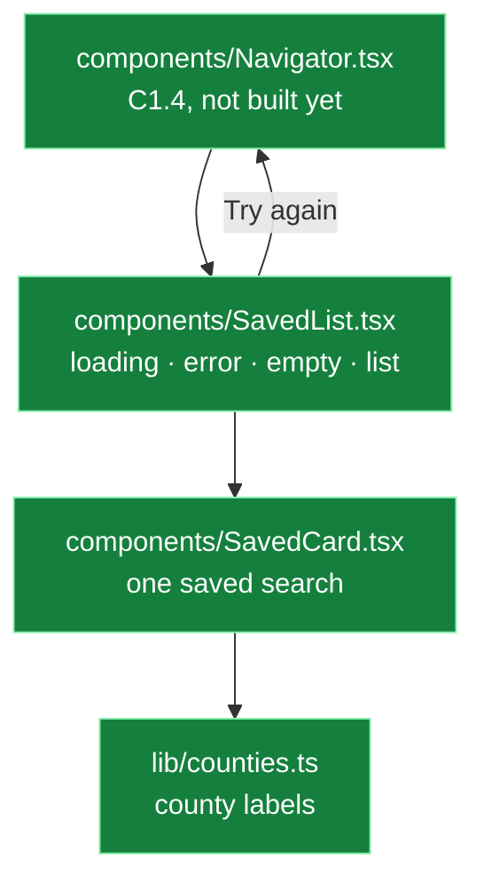

## Entry 20 · #3 Navigator and page

*Oct 16 · ~18:20 to 18:50 CT*

<table>
  <tr><th align="left">Field</th><th align="left">Details</th></tr>
  <tr><td><b>Tool</b></td><td>Claude Code · claude-opus-5-5</td></tr>
  <tr><td><b>Asked</b></td><td>Step C1.4 only: <code>Navigator</code> (client) fetches the saved list, tracks its status, holds the status line, and <code>page.tsx</code> renders it</td></tr>
  <tr><td><b>Context</b></td><td>
    <ul>
      <li><code>docs/spec/design.md</code> State ownership and page order; issue #3 ACs (status line <code>role="status"</code>, Network 200)</li>
      <li><code>components/SavedList.tsx</code>, <code>components/SavedCard.tsx</code> (C1.3)</li>
    </ul>
  </td></tr>
  <tr><td><b>Changed</b></td><td>
    1 new file, 1 modified
    <ul>
      <li>🟩 <code>components/Navigator.tsx</code> (new) · <code>"use client"</code>; <code>fetchSearches()</code>; state <code>searches</code>, <code>listStatus</code>, <code>reloadKey</code>, <code>message</code>; <code>useEffect</code> on <code>reloadKey</code>; <code>retry()</code>; <code>&lt;p role="status"&gt;</code> + <code>&lt;SavedList/&gt;</code></li>
      <li>🟦 <code>app/page.tsx</code> (modified) · imports and renders <code>&lt;Navigator /&gt;</code> after the trust note</li>
    </ul>
  </td></tr>
  <tr><td><b>Decision</b></td><td>accepted</td></tr>
  <tr><td><b>Verified</b></td><td>
    <ul>
      <li><code>npx tsc --noEmit</code> and <code>npm run lint</code>: no output</li>
      <li><code>curl /</code>: HTML contains <code>role="status"</code>, "My saved searches", "Loading saved searches…"</li>
      <li>Joseph's browser: 2 cards, Travis then Harris, Harris with its note. First screenshot had unstyled cards (CSS not yet rebuilt for the new files); served CSS then contained <code>bg-white</code>, <code>border-[#C7D0DB]</code>, <code>space-y-3</code>; after a hard refresh the cards were white with the light border</li>
    </ul>
  </td></tr>
  <tr><td><b>Commit</b></td><td><code>1481606</code> feat: Navigator loads saved searches on the page; prompt log entry 20</td></tr>
  <tr><td><b>PIOF and what differed</b></td><td>
    <ul>
      <li>Purpose: the saved list appears on the page, loaded from Neon, with a working Try again</li>
      <li>Input: none from outside; fetches <code>GET /api/searches</code> on mount</li>
      <li>Output: status line (empty for now) and <code>SavedList</code> in its current state</li>
      <li>Flow: page loads → <code>Navigator</code> mounts → <code>useEffect</code> → <code>fetch /api/searches</code> → <code>route.ts</code> → Prisma → Neon → JSON → <code>setSearches</code> → <code>SavedList</code> → <code>SavedCard</code> × 2</li>
    </ul>
  </td></tr>
  <tr><td><b>Reflection</b></td><td>
    <ul>
      <li>All this time I understood that the browser wouldn't make requests. This solidifies the client component that facilitates those requests: what's received, and how that information is allocated and used once it's received.</li>
      <li>The browser is what sends requests over the network, and the <code>Navigator</code> is the code inside the browser that tells it to send <code>/api/searches</code>.</li>
      <li>The <code>Navigator</code> fetches the saved list when the page opens and hands it to <code>SavedList</code>, which shows the cards, the empty text, or an error with Try again.</li>
    </ul>
  </td></tr>
  <tr><td><b>Explained</b></td><td>
    <b>Entry 20 · #3 Navigator and page</b>
    <ul>
      <li>What it is: the page's brain, the one component that fetches and remembers</li>
      <li>Why: state and <code>useEffect</code> only run in the browser, so this part is a client component while the page stays a server component</li>
      <li>Files:
        <ul>
          <li><code>components/Navigator.tsx</code>: fetch, state, status line</li>
          <li><code>app/page.tsx</code>: renders it under the trust note</li>
        </ul>
      </li>
      <li>Its role in the project: the save, edit, and delete flows (#4, #5, #8) refetch through <code>reloadKey</code> and announce through the status line</li>
    </ul>
  </td></tr>
</table>

### Entry 20 call graph

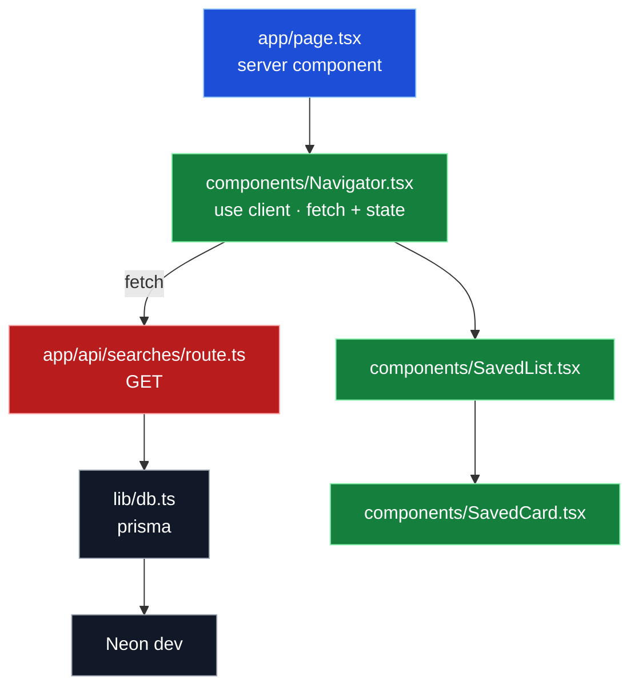

## Entry 21 · #3 Browser checks and close

*Oct 16 · ~18:55 to 19:15 CT*

<table>
  <tr><th align="left">Field</th><th align="left">Details</th></tr>
  <tr><td><b>Tool</b></td><td>Claude Code · claude-opus-5-5</td></tr>
  <tr><td><b>Asked</b></td><td>Step C1.5: walk me through each browser check for issue #3, one at a time; then "You're gonna have to check this one on your side" for the empty state</td></tr>
  <tr><td><b>Context</b></td><td>
    <ul>
      <li>Issue #3 acceptance criteria (R1–R3, R5, E3, Network 200, <code>role="status"</code>)</li>
      <li><code>components/Navigator.tsx</code>, <code>components/SavedList.tsx</code> (C1.3, C1.4)</li>
      <li><code>docs/agents/issue-tracker.md</code> (Actual rule)</li>
    </ul>
  </td></tr>
  <tr><td><b>Changed</b></td><td>
    1 modified, plus the issue
    <ul>
      <li><code>README.md</code> (modified) · Status table: #3 ⬜ → ✅</li>
      <li>GitHub issue #3 body · all 6 boxes ticked; <code>Actual: 2.25 h (wall clock, includes breaks)</code></li>
      <li>No app code changed</li>
    </ul>
  </td></tr>
  <tr><td><b>Decision</b></td><td>accepted</td></tr>
  <tr><td><b>Verified</b></td><td>
    <ul>
      <li>Check 1 · Joseph's browser: Travis card above Harris; label, type, county display name; Harris shows its note, Travis has none</li>
      <li>Check 2 · Firefox Network (All selected): <code>searches</code> · <code>GET</code> · <code>200</code> · json; Response <code>searches: [ {id: 2, TRAVIS}, {id: 1, HARRIS} ]</code></li>
      <li>Check 3 · Firefox Inspector: <code>&lt;p … role="status"&gt;&lt;/p&gt;</code> inside <code>&lt;main&gt;</code>, followed by <code>&lt;section aria-labelledby="saved-heading"&gt;</code></li>
      <li>Check 4 · Firefox Request Blocking on <code>/api/searches</code>: page showed "We could not reach the saved searches database." with Try again; after unblocking and Try again (no reload; blocked rows still in the list) the 2 cards returned with new <code>200</code> rows</li>
      <li>Check 5 · agent, headless Chrome via <code>playwright-core</code> in the scratchpad, <code>/api/searches</code> answered with <code>{"searches":[]}</code>: section text "Nothing saved yet. Run a search above, then select Save to watchlist.", 0 cards; Neon not touched</li>
      <li>Check 6 · Joseph: cards still there after reload and after stopping and restarting <code>npm run dev</code></li>
      <li><code>gh issue edit 3</code> returned the issue URL</li>
    </ul>
  </td></tr>
  <tr><td><b>Commit</b></td><td><code>33c81c3</code> docs: browser checks pass for #3; prompt log entry 21</td></tr>
  <tr><td><b>PIOF and what differed</b></td><td>
    <ul>
      <li>Purpose: show #3 works in a real browser against every acceptance criterion, so it can close</li>
      <li>Input: the running dev server, Neon <code>dev</code> with 2 rows, Firefox DevTools; headless Chrome for check 5</li>
      <li>Output: 6 of 6 checks passed; issue #3 ticked with Actual; README Status updated</li>
      <li>Flow: page load → <code>Navigator</code> <code>useEffect</code> → <code>fetch /api/searches</code> → <code>route.ts</code> → Prisma → Neon → JSON → <code>SavedList</code> (cards, empty, or error) → Try again → refetch</li>
      <li>What differed: Firefox cannot override a <code>fetch</code> response, so the agent ran check 5; Try again produced 3 <code>200</code> rows where 1 was expected (no harm, same data; look again with <code>diagnosing-bugs</code> if it repeats)</li>
    </ul>
  </td></tr>
  <tr><td><b>Reflection</b></td><td>
    <ul>
      <li>We did six browser checks that showed the saved list loads from Neon newest first, handles the empty state (checked headless) and the failed state, and survives a restart. So #3 is ready to close.</li>
      <li>For me personally, this sequence of methods was a really good way to test the application outside the IDE, using the browser's tools.</li>
    </ul>
  </td></tr>
  <tr><td><b>Explained</b></td><td>
    <b>Entry 21 · #3 Browser checks and close</b>
    <ul>
      <li>What it is: proving each acceptance criterion by looking, not by trusting the code</li>
      <li>Why: the empty and error states never show with real data, so they have to be forced (block the URL, fake the reply)</li>
      <li>Tools:
        <ul>
          <li>Network tab: the request, its status, its JSON</li>
          <li>Inspector: the <code>role="status"</code> element</li>
          <li>Request Blocking: a failed request without touching the server</li>
          <li>Headless Chrome: a browser with no window that a script drives, here to fake an empty list</li>
        </ul>
      </li>
      <li>Its role in the project: the same kind of checks make up the manual check list for #10 and #11</li>
    </ul>
  </td></tr>
</table>

### Entry 21 call graph

```mermaid
flowchart TD
  FF[Firefox DevTools<br/>Network · Inspector · Blocking]:::run
  HC[Headless Chrome<br/>fakes empty reply]:::run
  NAV[components/Navigator.tsx<br/>fetch + listStatus]:::ui
  RT[app/api/searches/route.ts<br/>GET]:::server
  NEON[Neon dev]:::db
  SL[components/SavedList.tsx<br/>cards · empty · error]:::ui
  FF --> NAV
  HC --> NAV
  NAV -->|fetch| RT
  RT --> NEON
  NAV --> SL
  classDef ui fill:#15803d,color:#fff,stroke:#86efac
  classDef server fill:#b91c1c,color:#fff,stroke:#fca5a5
  classDef db fill:#111827,color:#fff,stroke:#9ca3af
  classDef run fill:#334155,color:#fff,stroke:#94a3b8
```

## Entry 22 · #4 DELETE /api/searches/[id]

*Oct 17 · ~08:52 to 09:35 CT*

<table>
  <tr><th align="left">Field</th><th align="left">Details</th></tr>
  <tr><td><b>Tool</b></td><td>Claude Code · claude-opus-5-5</td></tr>
  <tr><td><b>Asked</b></td><td>Work issue #4. Step C2.1 only: <code>DELETE /api/searches/[id]</code> checks the id with Zod and deletes the row; 204, 400, 404, 500. Failed-delete wording on the page: reuse the 404 and 500 messages</td></tr>
  <tr><td><b>Context</b></td><td>
    <ul>
      <li>Issue #4 ACs; <code>docs/spec/design.md</code> API contracts (DELETE), Validation (<code>idParam</code>), error messages; <code>docs/agents/issue-tracker.md</code></li>
      <li><code>lib/validation.ts</code>, <code>lib/db.ts</code>, <code>app/api/searches/route.ts</code></li>
    </ul>
  </td></tr>
  <tr><td><b>Changed</b></td><td>
    1 new file
    <ul>
      <li>🟥 <code>app/api/searches/[id]/route.ts</code> (new) · <code>DELETE</code>: <code>await params</code> → <code>idParam.safeParse</code> (400) → <code>prisma.savedSearch.delete</code> → <code>204</code>; <code>P2025</code> → <code>404</code>; other errors → <code>500</code></li>
    </ul>
  </td></tr>
  <tr><td><b>Decision</b></td><td>accepted</td></tr>
  <tr><td><b>Verified</b></td><td>
    <ul>
      <li><code>gh issue comment 4</code>: <code>Started</code> posted 2026-10-17T13:52:30Z</li>
      <li><code>npx tsc --noEmit</code>: no output</li>
      <li>14:18:55 GMT · <code>curl -X DELETE /api/searches/abc</code>: <code>400</code> "That is not a valid saved search id."</li>
      <li>14:19:15 GMT · <code>curl -X DELETE /api/searches/99999</code>: <code>404</code> "That saved search no longer exists."</li>
      <li>14:29:19 GMT · Joseph: <code>curl -i -X DELETE /api/searches/2</code>: <code>204 No Content</code>, no body</li>
      <li>Joseph's Neon Tables view, <code>SavedSearch</code>: only id 1 HARRIS left (1 of 1)</li>
    </ul>
  </td></tr>
  <tr><td><b>Commit</b></td><td><code>90f7881</code> feat: DELETE /api/searches/[id] removes a saved search; prompt log entry 22</td></tr>
  <tr><td><b>PIOF and what differed</b></td><td>
    <ul>
      <li>Purpose: the server can delete one saved search by id and refuse bad or missing ids [D2, E1, E2]</li>
      <li>Input: <code>params.id</code> from the URL, as text</li>
      <li>Output: <code>204</code> with no body (row gone from Neon), or <code>400</code> / <code>404</code> / <code>500</code> with <code>{ error }</code></li>
      <li>Flow: <code>curl</code> or browser <code>fetch</code> DELETE → <code>route.ts</code> → <code>await params</code> → Zod <code>idParam</code> → Prisma <code>delete</code> → Neon → <code>204</code> (or <code>P2025</code> → <code>404</code>)</li>
      <li>New wording not in <code>design.md</code>: 400 "That is not a valid saved search id."</li>
    </ul>
  </td></tr>
  <tr><td><b>Reflection</b></td><td>
    <ul>
      <li>In this step we added a new route at <code>/api/searches/[id]</code>. The ids are unique to the data stored in the Neon database, and the delete function needs them.</li>
      <li>The new route checks the id with Zod, asks Prisma to delete that row in Neon, and answers with 204, 400, 404, or 500.</li>
      <li>This is important because Prisma throws an error code when no row has that id, and we turn it into a 404, a friendly message instead of a crash.</li>
    </ul>
  </td></tr>
  <tr><td><b>Explained</b></td><td>
    <b>Entry 22 · #4 DELETE /api/searches/[id]</b>
    <ul>
      <li>What it is: the second Route Handler, the first one that writes; the <code>[id]</code> folder makes one file answer for every id</li>
      <li>Why: the Delete button (C2.2, C2.3) needs a server door that removes one row; Zod stops bad ids before they reach Neon</li>
      <li>Files:
        <ul>
          <li><code>app/api/searches/[id]/route.ts</code>: <code>DELETE</code> now; <code>PATCH</code> joins in #5</li>
        </ul>
      </li>
      <li>Its role in the project: the server half of delete; the card and <code>Navigator</code> call it next</li>
    </ul>
  </td></tr>
</table>

### Entry 22 call graph

```mermaid
flowchart TD
  CL[curl / Browser<br/>DELETE /api/searches/2]:::run
  RT["app/api/searches/[id]/route.ts<br/>DELETE"]:::server
  ZOD[lib/validation.ts<br/>idParam]:::server
  DB[lib/db.ts<br/>prisma.savedSearch.delete]:::db
  NEON[Neon dev<br/>SavedSearch]:::db
  R204[204 no body]:::server
  R400[400 not a valid id]:::server
  R404[404 P2025 no longer exists]:::server
  R500[500 database error]:::server
  CL --> RT
  RT --> ZOD
  ZOD -->|fail| R400
  ZOD -->|ok| DB
  DB --> NEON
  DB --> R204
  DB -->|P2025| R404
  DB -->|other| R500
  classDef run fill:#334155,color:#fff,stroke:#94a3b8
  classDef server fill:#b91c1c,color:#fff,stroke:#fca5a5
  classDef db fill:#111827,color:#fff,stroke:#9ca3af
```

## Entry 23 · #4 Delete and confirm on the card

*Oct 17 · after the <code>90f7881</code> push to ~11:06 CT*

<table>
  <tr><th align="left">Field</th><th align="left">Details</th></tr>
  <tr><td><b>Tool</b></td><td>Claude Code · claude-opus-5-5</td></tr>
  <tr><td><b>Asked</b></td><td>Step C2.2 only: the card gets Delete; Delete asks "Delete this saved search?" with Delete and Keep; Keep returns the card to normal and focus to Delete; confirmed Delete calls <code>onDelete(id)</code>. Then: "Yes to both. Add #EEF2F6 to UI.md"</td></tr>
  <tr><td><b>Context</b></td><td>
    <ul>
      <li>Issue #4 ACs (D1, A2, keyboard alone); <code>docs/spec/design.md</code> State ownership, UI wording, Focus</li>
      <li><code>SOT_documents/UI.md</code> Part 1 button and error colors</li>
      <li><code>components/SavedCard.tsx</code>, <code>components/SavedList.tsx</code>, <code>components/Navigator.tsx</code></li>
    </ul>
  </td></tr>
  <tr><td><b>Changed</b></td><td>
    4 modified
    <ul>
      <li>🟩 <code>components/SavedCard.tsx</code> (modified) · <code>mode</code> state (<code>view</code> / <code>confirmingDelete</code>); <code>deleteRef</code>, <code>keepRef</code>, <code>backToDelete</code>; <code>useEffect</code> on <code>mode</code> focuses Keep or Delete; confirm in a <code>role="group"</code> labelled by the question; red Delete calls <code>onDelete(search.id)</code></li>
      <li>🟩 <code>components/SavedList.tsx</code> (modified) · <code>onDelete</code> prop passed to each card</li>
      <li>🟩 <code>components/Navigator.tsx</code> (modified) · placeholder <code>onDelete={() => {}}</code> until C2.3</li>
      <li><code>SOT_documents/UI.md</code> (modified) · outline button: white, navy border and text, hover <code>#EEF2F6</code>; confirmed Delete uses the red Try again style</li>
    </ul>
  </td></tr>
  <tr><td><b>Decision</b></td><td>accepted; focus to Keep when the confirm opens, and hover <code>#EEF2F6</code>, both approved by Joseph</td></tr>
  <tr><td><b>Verified</b></td><td>
    <ul>
      <li><code>npx tsc --noEmit</code> and <code>npm run lint</code>: no output</li>
      <li>Joseph's browser, keyboard only: "Tests passed" (Delete opens the confirm with focus on Keep; Keep returns to view with focus on Delete; confirmed Delete does nothing yet)</li>
    </ul>
  </td></tr>
  <tr><td><b>Commit</b></td><td><code>8ff7697</code> feat: delete confirm on the saved card; prompt log entry 23</td></tr>
  <tr><td><b>PIOF and what differed</b></td><td>
    <ul>
      <li>Purpose: each card can ask "Delete this saved search?" and back out with Keep, without leaving the card [D1, A2]</li>
      <li>Input: <code>SavedCard</code> gets <code>search</code> and <code>onDelete(id)</code>; <code>SavedList</code> gets <code>onDelete</code></li>
      <li>Output: the card shows Delete, or the question with red Delete and Keep; confirming calls <code>onDelete(id)</code></li>
      <li>Flow: Delete → <code>setMode("confirmingDelete")</code> → <code>useEffect</code> focuses Keep · Keep → <code>backToDelete = true</code> → <code>setMode("view")</code> → <code>useEffect</code> focuses Delete · red Delete → <code>onDelete(id)</code> → <code>SavedList</code> → <code>Navigator</code> (placeholder)</li>
      <li>Not in <code>design.md</code>: focus to Keep when the confirm opens; hover <code>#EEF2F6</code></li>
    </ul>
  </td></tr>
  <tr><td><b>Reflection</b></td><td>
    <ul>
      <li>The conditional rendering never shows both sets of buttons at once, until the user confirms it's a delete.</li>
      <li>Focus goes to Keep by default, because the Delete button could be pressed by accident and Keep is the safe option. It's kind of like steering.</li>
      <li><code>useRef</code> gives you a handle on the real button. That ties back into <code>useEffect</code> placing the focus on purpose when the mode changes.</li>
      <li><code>backToDelete</code> lets focus know what happened before; otherwise it would jump to Delete on the first page load. The note is informative, but the actual change comes down to a Boolean condition.</li>
    </ul>
  </td></tr>
  <tr><td><b>Explained</b></td><td>
    <b>Entry 23 · #4 Delete and confirm on the card</b>
    <ul>
      <li>What it is: the card's own small state machine, view or confirming, with focus steered for keyboard users</li>
      <li>Why: deleting can't be undone, so the card asks first; when buttons swap out, focus has to be placed or a keyboard user lands at the top of the page</li>
      <li>Files:
        <ul>
          <li><code>components/SavedCard.tsx</code>: mode, refs, focus effect, confirm</li>
          <li><code>components/SavedList.tsx</code>: passes <code>onDelete</code> down</li>
          <li><code>components/Navigator.tsx</code>: placeholder until C2.3</li>
        </ul>
      </li>
      <li>Its role in the project: the browser half of delete; C2.3 connects it to the DELETE route</li>
    </ul>
  </td></tr>
</table>

### Entry 23 call graph

```mermaid
flowchart TD
  DEL[Delete button<br/>outline]:::ui
  SC[components/SavedCard.tsx<br/>mode · refs · useEffect]:::ui
  KEEP[Keep<br/>focus back to Delete]:::ui
  RED[red Delete<br/>onDelete id]:::ui
  SL[components/SavedList.tsx<br/>passes onDelete]:::ui
  NAV[components/Navigator.tsx<br/>placeholder until C2.3]:::ui
  DEL --> SC
  SC -->|confirmingDelete, focus Keep| KEEP
  SC --> RED
  KEEP -->|view| SC
  RED --> SL
  SL --> NAV
  classDef ui fill:#15803d,color:#fff,stroke:#86efac
```

## Entry 24 · #4 Navigator wires up the delete

*Oct 17 · after the <code>8ff7697</code> push to ~12:32 CT*

<table>
  <tr><th align="left">Field</th><th align="left">Details</th></tr>
  <tr><td><b>Tool</b></td><td>Claude Code · claude-opus-5-5</td></tr>
  <tr><td><b>Asked</b></td><td>Step C2.3 only: <code>handleDelete</code> in <code>Navigator</code> sends the DELETE, refetches the list, sets "Deleted.", and focuses the "My saved searches" heading. Then: redraw the recap's call graph to show props passed down, calls going up, hooks, handlers with types, and imports; save that format as a skill</td></tr>
  <tr><td><b>Context</b></td><td>
    <ul>
      <li>Issue #4 ACs (D2, A1, A2); <code>docs/spec/design.md</code> State ownership, error messages, Focus</li>
      <li><code>components/Navigator.tsx</code>, <code>components/SavedList.tsx</code>, <code>components/SavedCard.tsx</code>; <code>app/api/searches/[id]/route.ts</code> (C2.1)</li>
    </ul>
  </td></tr>
  <tr><td><b>Changed</b></td><td>
    1 modified, plus a skill outside the repo
    <ul>
      <li>🟩 <code>components/Navigator.tsx</code> (modified) · <code>DB_ERROR</code>; <code>setMessage</code>; <code>handleDelete(id)</code>: clear message → <code>fetch DELETE</code> → on 204/404 set the message, <code>setSearches(await fetchSearches())</code>, focus <code>#saved-heading</code>; on 500 or no connection the DB message; placeholder replaced with <code>onDelete={handleDelete}</code></li>
      <li><code>~/.claude/skills/flow-map/SKILL.md</code> (new, outside git) · Joseph's vertical flow map: imports, hooks and ⚡ handlers with types, props DOWN, calls UP, numbered handler steps</li>
    </ul>
  </td></tr>
  <tr><td><b>Decision</b></td><td>accepted</td></tr>
  <tr><td><b>Verified</b></td><td>
    <ul>
      <li><code>npx tsc --noEmit</code> and <code>npm run lint</code>: no output</li>
      <li>Neon SQL Editor (branch <code>dev</code>, <code>neondb</code>), 11:28am: <code>INSERT</code> of a Travis test row, "Statement executed successfully"</li>
      <li>Joseph's browser, keyboard only: Travis card gone, status line "Deleted.", yellow focus ring on "My saved searches", Harris card left</li>
      <li>Joseph's Neon Tables view, <code>SavedSearch</code>: only id 1 HARRIS</li>
    </ul>
  </td></tr>
  <tr><td><b>Commit</b></td><td><code>ef3ce9c</code> feat: Navigator deletes a saved search and announces it; prompt log entry 24</td></tr>
  <tr><td><b>PIOF and what differed</b></td><td>
    <ul>
      <li>Purpose: the confirmed Delete removes the row, refreshes the list, and says so [D2, A1, A2]</li>
      <li>Input: <code>id</code> from the card's <code>onDelete(id)</code></li>
      <li>Output: row gone from Neon; list refetched; <code>role="status"</code> line "Deleted."; focus on the section heading</li>
      <li>Flow: red Delete → <code>onDelete(id)</code> → <code>SavedList</code> → <code>handleDelete</code> in <code>Navigator</code> → <code>fetch DELETE</code> → <code>route.ts</code> → Zod → Prisma → Neon → 204 → <code>fetch GET /api/searches</code> → <code>setSearches</code> → "Deleted." → focus <code>#saved-heading</code></li>
      <li>Failed-delete wording (Joseph approved in C2.1): 404 "That saved search no longer exists.", otherwise "We could not reach the saved searches database."</li>
    </ul>
  </td></tr>
  <tr><td><b>Reflection</b></td><td>
    <ul>
      <li>The first thing I did was understand the flow. If I can match the visual flow, I can go inside the actual component and understand not only the syntax but the flow of it as well. Once there are many moving parts, I map the flow first, then read the code to see how each piece fits.</li>
      <li>The hard part for me has been the top-down method, not only within one component but in how things are passed. I focus so much on syntax that I sometimes miss the bigger picture of how everything ties together, so I made a flow map reference.</li>
      <li>On page load the props go down. We pass down four props, named like the values they hold, to the right component so they can be used. Some are used through handler functions, like a click or a delete, and others carry state.</li>
      <li><code>Navigator</code> is the parent, <code>SavedList</code> is its child, and <code>SavedCard</code> is the child of <code>SavedList</code> and the grandchild of <code>Navigator</code>.</li>
    </ul>
  </td></tr>
  <tr><td><b>Explained</b></td><td>
    <b>Entry 24 · #4 Navigator wires up the delete</b>
    <ul>
      <li>What it is: the handler that connects the card's confirmed Delete to the DELETE route, then refreshes the page's state</li>
      <li>Why: <code>Navigator</code> owns the list and the status line, so the card only reports the id; refetching keeps Neon the one source of truth [R5]</li>
      <li>Files:
        <ul>
          <li><code>components/Navigator.tsx</code>: <code>handleDelete</code>, passed down as <code>onDelete</code></li>
        </ul>
      </li>
      <li>Its role in the project: delete now works end to end; the edit flow in #5 follows the same shape with PATCH</li>
    </ul>
  </td></tr>
</table>

### Entry 24 call graph

```mermaid
flowchart TD
  RED[SavedCard red Delete<br/>onDelete id]:::ui
  SL[components/SavedList.tsx<br/>passes onDelete]:::ui
  NAV[components/Navigator.tsx<br/>handleDelete]:::ui
  RT["app/api/searches/[id]/route.ts<br/>DELETE"]:::server
  NEON[Neon dev<br/>row deleted]:::db
  GET[app/api/searches/route.ts<br/>GET fresh list]:::server
  UI[status Deleted.<br/>focus My saved searches]:::ui
  RED --> SL
  SL --> NAV
  NAV -->|fetch DELETE| RT
  RT --> NEON
  RT -->|204| NAV
  NAV -->|fetch GET| GET
  GET --> NAV
  NAV --> UI
  classDef ui fill:#15803d,color:#fff,stroke:#86efac
  classDef server fill:#b91c1c,color:#fff,stroke:#fca5a5
  classDef db fill:#111827,color:#fff,stroke:#9ca3af
```

### Entry 24 async sequence

```mermaid
sequenceDiagram
  participant C as SavedCard
  participant N as Navigator handleDelete
  participant D as DELETE route
  participant G as GET route
  participant P as Prisma + Neon
  C->>N: onDelete(3)
  N->>N: setMessage("")
  N->>D: await fetch DELETE /api/searches/3
  D->>P: savedSearch.delete
  P-->>D: ok
  D-->>N: 204
  N->>N: setMessage("Deleted.")
  N->>G: await fetch GET /api/searches
  G->>P: findMany
  P-->>G: rows
  G-->>N: 200 searches
  N->>N: setSearches, focus heading
```

## Entry 25 · #4 Close-out checks

*Oct 17 · after the <code>ef3ce9c</code> push to ~12:55 CT*

<table>
  <tr><th align="left">Field</th><th align="left">Details</th></tr>
  <tr><td><b>Tool</b></td><td>Claude Code · claude-opus-5-5</td></tr>
  <tr><td><b>Asked</b></td><td>Step C2.4: check every #4 acceptance criterion against evidence, update the README Status table, tick the issue and add <code>Actual:</code></td></tr>
  <tr><td><b>Context</b></td><td>
    <ul>
      <li>Issue #4 acceptance criteria (D1, D2, E1, E2, A1, A2, keyboard alone)</li>
      <li>Evidence from Entries 22–24; <code>README.md</code> Status; <code>docs/agents/issue-tracker.md</code> (Actual rule)</li>
    </ul>
  </td></tr>
  <tr><td><b>Changed</b></td><td>
    1 modified, plus the issue
    <ul>
      <li><code>README.md</code> (modified) · Status table: #4 ⬜ → ✅</li>
      <li>GitHub issue #4 body · all 5 boxes ticked; <code>Actual: 4 h (wall clock, includes breaks)</code></li>
      <li>No app code changed</li>
    </ul>
  </td></tr>
  <tr><td><b>Decision</b></td><td>accepted</td></tr>
  <tr><td><b>Verified</b></td><td>
    <ul>
      <li>AC 1 · C2.3: Travis card gone from the page; Neon <code>SavedSearch</code> shows only id 1</li>
      <li>AC 2 · C2.2: Joseph, keyboard only, "Tests passed" (Keep returns to view, focus on Delete)</li>
      <li>AC 3 · C2.3 screenshot: "Deleted." in the status line, focus ring on "My saved searches"</li>
      <li>AC 4 · against the final code: <code>curl -X DELETE /api/searches/abc</code> → <code>400</code>; <code>/99999</code> → <code>404</code></li>
      <li>AC 5 · Joseph confirmed the C2.3 delete was keyboard only</li>
      <li>Actual: <code>Started</code> 2026-10-17T13:52:30Z to 17:53:25Z = 4 h 01 min → 4 h (estimate 1 h)</li>
      <li><code>gh issue edit 4</code> returned the issue URL</li>
    </ul>
  </td></tr>
  <tr><td><b>Commit</b></td><td><code>e6497ce</code> docs: #4 checks pass; prompt log entry 25 · Closes #4</td></tr>
  <tr><td><b>PIOF and what differed</b></td><td>
    <ul>
      <li>Purpose: show #4 meets every acceptance criterion, so it can close</li>
      <li>Input: the running dev server, Neon <code>dev</code>, Joseph's browser and keyboard, <code>curl</code></li>
      <li>Output: 5 of 5 ACs pass; issue #4 ticked with Actual; README Status updated</li>
      <li>Flow: <code>curl</code> 400/404 → browser and Neon evidence → <code>README.md</code> → <code>gh issue edit 4</code> → prompt log → commit with <code>Closes #4</code> → push closes the issue</li>
      <li>What differed: actual 4 h against a 1 h estimate; the time includes breaks, the commit-and-push process fix, and building the <code>flow-map</code> skill</li>
    </ul>
  </td></tr>
  <tr><td><b>Reflection</b></td><td>
    <ul>
      <li>This process was really informative. I took my time to understand the steps that explain how the CRUD functionality relates to the database, the server side, and the client side.</li>
      <li>The most informative part was going through how the function for the method we were building was supposed to work, then stating what the application should do, evaluating the results, and talking about why the results were what they were, so I could tell when things were actually working the right way.</li>
      <li>I took time to make flow charts. They helped me step out of the mindset of only learning how the database and Prisma work, and see how it all ties back to the front end and how Next.js and React work together.</li>
      <li>The flow maps gave me a fuller picture. Not just that we created a database as part of the app, but how the CRUD functions are used on the front end: how data gets broken down and destructured, which components show different information and change state and effects, and how rendering works, with React holding things in memory.</li>
      <li>There's still a lot to learn, but this tied the delete functionality together for me end to end, and that was really neat.</li>
    </ul>
  </td></tr>
  <tr><td><b>Explained</b></td><td>
    <b>Entry 25 · #4 Close-out checks</b>
    <ul>
      <li>What it is: proving each acceptance criterion with evidence, then recording that #4 is done</li>
      <li>Why: an issue closes on proof, and the README and <code>Actual:</code> keep the project's status and planning honest</li>
      <li>Files:
        <ul>
          <li><code>README.md</code>: Status row for #4</li>
        </ul>
      </li>
      <li>Its role in the project: delete is the first write in the watchlist's CRUD; edit (#5) reuses the same route file and the same card → <code>Navigator</code> → route → refetch shape</li>
    </ul>
  </td></tr>
</table>

### Entry 25 call graph

```mermaid
flowchart TD
  CURL[curl DELETE abc and 99999<br/>400 and 404]:::run
  BR[Joseph browser and keyboard<br/>C2.2 and C2.3 evidence]:::run
  NEON[Neon dev<br/>only id 1 left]:::db
  RM[README.md<br/>Status 4 done]:::run
  GH[GitHub issue 4<br/>boxes ticked, Actual 4 h]:::run
  CL[commit Closes 4<br/>push closes the issue]:::run
  CURL --> RM
  BR --> RM
  NEON --> RM
  RM --> GH
  GH --> CL
  classDef run fill:#334155,color:#fff,stroke:#94a3b8
  classDef db fill:#111827,color:#fff,stroke:#9ca3af
```

## Entry 26 · #5 PATCH /api/searches/[id]

*Oct 17 · ~14:22 to 14:35 CT*

<table>
  <tr><th align="left">Field</th><th align="left">Details</th></tr>
  <tr><td><b>Tool</b></td><td>Claude Code · claude-opus-5-5</td></tr>
  <tr><td><b>Asked</b></td><td>Work issue #5. Step C3a only: <code>PATCH /api/searches/[id]</code> checks the id and the body with Zod and updates label and note; 200, 400, 404, 500</td></tr>
  <tr><td><b>Context</b></td><td>
    <ul>
      <li>Issue #5 ACs; <code>docs/spec/design.md</code> Validation (<code>updateBody</code>), API contracts (PATCH), error messages; <code>docs/agents/issue-tracker.md</code></li>
      <li><code>app/api/searches/[id]/route.ts</code> (the DELETE pattern), <code>lib/validation.ts</code>, <code>README.md</code></li>
    </ul>
  </td></tr>
  <tr><td><b>Changed</b></td><td>
    1 file modified
    <ul>
      <li>🟥 <code>app/api/searches/[id]/route.ts</code> (modified) · <code>PATCH</code>: <code>await params</code> → <code>idParam.safeParse</code> (400) → <code>request.json().catch(() =&gt; null)</code> → <code>updateBody.safeParse</code> (400) → <code>prisma.savedSearch.update</code> → <code>200 { search }</code>; <code>P2025</code> → <code>404</code>; other errors → <code>500</code></li>
      <li>No README edit: its layout already covers <code>api/**/route.ts</code></li>
    </ul>
  </td></tr>
  <tr><td><b>Decision</b></td><td>accepted</td></tr>
  <tr><td><b>Verified</b></td><td>
    <ul>
      <li><code>gh issue comment 5</code>: <code>Started</code> posted 2026-10-17T19:22:40Z</li>
      <li><code>npx tsc --noEmit</code>: no output</li>
      <li>19:29:17 GMT · Joseph: <code>curl -i -X PATCH /api/searches/1</code> <code>{"label":"Edited","note":"hi"}</code>: <code>200</code>, label "Edited", note "hi", <code>updatedAt</code> 2026-10-17T19:29:15Z, type and county unchanged</li>
      <li>19:30:34 GMT · Joseph: same with <code>"county":"HARRIS"</code> added: <code>400</code> "Check the label and note, then try again."</li>
      <li>19:32:28 GMT · Joseph: <code>curl -i -X PATCH /api/searches/99999</code>: <code>404</code> "That saved search no longer exists."</li>
    </ul>
  </td></tr>
  <tr><td><b>Commit</b></td><td><code>4601d3d</code> feat: PATCH /api/searches/[id] updates label and note; prompt log entry 26</td></tr>
  <tr><td><b>PIOF and what differed</b></td><td>
    <ul>
      <li>Purpose: the server can change a saved search's label and note, and nothing else [U1, U2, E2]</li>
      <li>Input: <code>params.id</code> as text, JSON body <code>{ label, note }</code></li>
      <li>Output: <code>200 { search }</code> (row updated in Neon), or <code>400</code> / <code>404</code> / <code>500</code> with <code>{ error }</code></li>
      <li>Flow: <code>curl</code> or browser <code>fetch</code> PATCH → <code>route.ts</code> → <code>await params</code> → Zod <code>idParam</code> → <code>request.json()</code> → Zod <code>updateBody</code> (strict) → Prisma <code>update</code> → Neon → JSON</li>
      <li>New wording not in <code>design.md</code>: 400 "Check the label and note, then try again." (shared by every body error, including an extra <code>county</code> key)</li>
    </ul>
  </td></tr>
  <tr><td><b>Reflection</b></td><td>
    <ul>
      <li>PATCH is DELETE plus a body check: the route checks the id, checks the body, runs Prisma <code>update</code>, and turns errors into status codes.</li>
      <li><code>request.json().catch(() =&gt; null)</code> returns null if the body isn't JSON at all, so Zod sees null and fails, and the answer is a 400 instead of a crash and a 500.</li>
      <li>All in all, the route trusts nothing from the browser. Zod decides what gets through, and Prisma's error codes decide which status comes back.</li>
    </ul>
  </td></tr>
  <tr><td><b>Explained</b></td><td>
    <b>Entry 26 · #5 PATCH /api/searches/[id]</b>
    <ul>
      <li>What it is: the second method in the <code>[id]</code> route file, the first one that reads a request body</li>
      <li>Why: the Edit form (C3b to C3d) needs a server door that changes label and note; <code>z.strictObject</code> refuses <code>county</code> or <code>licenseType</code>, so type and county cannot change [U2]</li>
      <li>Files:
        <ul>
          <li><code>app/api/searches/[id]/route.ts</code>: <code>PATCH</code> and <code>DELETE</code></li>
        </ul>
      </li>
      <li>Its role in the project: the server half of edit; <code>SaveSearchForm</code>, <code>SavedCard</code>, and <code>Navigator</code> call it next</li>
    </ul>
  </td></tr>
</table>

### Entry 26 call graph

```mermaid
flowchart TD
  CL[curl / Browser<br/>PATCH /api/searches/1]:::run
  RT["app/api/searches/[id]/route.ts<br/>PATCH"]:::server
  ZID[lib/validation.ts<br/>idParam]:::server
  ZB[lib/validation.ts<br/>updateBody strict]:::server
  DB[lib/db.ts<br/>prisma.savedSearch.update]:::db
  NEON[Neon dev<br/>SavedSearch]:::db
  R200[200 search]:::server
  R400[400 bad id or body]:::server
  R404[404 P2025 no longer exists]:::server
  R500[500 database error]:::server
  CL --> RT
  RT --> ZID
  ZID -->|fail| R400
  ZID -->|ok| ZB
  ZB -->|fail| R400
  ZB -->|ok| DB
  DB --> NEON
  DB --> R200
  DB -->|P2025| R404
  DB -->|other| R500
  classDef run fill:#334155,color:#fff,stroke:#94a3b8
  classDef server fill:#b91c1c,color:#fff,stroke:#fca5a5
  classDef db fill:#111827,color:#fff,stroke:#9ca3af
```

## Entry 27 · #5 SaveSearchForm in edit mode

*Oct 17 · ~14:38 to 14:50 CT*

<table>
  <tr><th align="left">Field</th><th align="left">Details</th></tr>
  <tr><td><b>Tool</b></td><td>Claude Code · claude-opus-5-5</td></tr>
  <tr><td><b>Asked</b></td><td>Step C3b only: <code>SaveSearchForm</code> in edit mode. Label and Note fields, Save and Cancel, a <code>role="alert"</code> error line, focus on Label when it opens</td></tr>
  <tr><td><b>Context</b></td><td>
    <ul>
      <li><code>docs/spec/design.md</code> UI (save form wording, form errors), Focus; <code>SOT_documents/UI.md</code> Part 1 (buttons, hint color, accessibility)</li>
      <li><code>components/SavedCard.tsx</code> (outline button style, focus pattern)</li>
    </ul>
  </td></tr>
  <tr><td><b>Changed</b></td><td>
    1 new file, 1 modified
    <ul>
      <li>🟩 <code>components/SaveSearchForm.tsx</code> (new) · props <code>idPrefix</code>, <code>initialLabel</code>, <code>initialNote</code>, <code>onSubmit</code> (resolves to an error message or <code>null</code>), <code>onCancel</code>; own state <code>label</code>, <code>note</code>, <code>error</code>, <code>busy</code>; <code>useEffect</code> focuses Label on mount</li>
      <li><code>PROMPT_LOG.md</code> (modified) · Entry 26 commit hash filled in, Entry 27 added</li>
    </ul>
  </td></tr>
  <tr><td><b>Decision</b></td><td>accepted</td></tr>
  <tr><td><b>Verified</b></td><td>
    <ul>
      <li><code>npx tsc --noEmit</code>: no output</li>
      <li><code>npx eslint components/SaveSearchForm.tsx</code>: no output</li>
      <li>Not clickable yet: no card renders the form until C3c</li>
    </ul>
  </td></tr>
  <tr><td><b>Commit</b></td><td><code>a57f064</code> feat: SaveSearchForm for editing a saved search's label and note; prompt log entry 27</td></tr>
  <tr><td><b>PIOF and what differed</b></td><td>
    <ul>
      <li>Purpose: one label and note form that edit uses now and create reuses in #8 [U1, E3, A2]</li>
      <li>Input: props <code>idPrefix</code>, <code>initialLabel</code>, <code>initialNote</code>, <code>onSubmit</code>, <code>onCancel</code></li>
      <li>Output: renders Label, Note with hint, an error line (<code>role="alert"</code>), Save and Cancel; calls <code>onSubmit(label, note)</code> or <code>onCancel()</code></li>
      <li>Flow: mount → focus Label → typing → form state → Save → <code>onSubmit</code> → <code>null</code> or a message → error line</li>
      <li>No <code>mode</code> prop: create vs edit is only what the parent passes in. No <code>maxLength</code>: the server's Zod rules decide, so an 81-character label can reach the 400 [E1]</li>
      <li>New wording not in <code>design.md</code>: "Saving…" on the Save button while it waits</li>
    </ul>
  </td></tr>
  <tr><td><b>Reflection</b></td><td>The label and note values are managed right inside the form, so if the server refuses what the user typed, the values stay and the user doesn't have to type them again.</td></tr>
  <tr><td><b>Explained</b></td><td>
    <b>Entry 27 · #5 SaveSearchForm in edit mode</b>
    <ul>
      <li>What it is: the first form component in Week 5; it owns the draft label and note while the user types</li>
      <li>Why: the card's Edit (C3c) and the result card's Save to watchlist (#8) need the same two fields, error line, and buttons</li>
      <li>Files:
        <ul>
          <li><code>components/SaveSearchForm.tsx</code>: the form</li>
        </ul>
      </li>
      <li>Its role in the project: the UI half of edit and save; <code>SavedCard</code> opens it next, and <code>Navigator</code> supplies <code>onSubmit</code> in C3d</li>
    </ul>
  </td></tr>
</table>

### Entry 27 call graph

```mermaid
flowchart TD
  BR[Browser<br/>typing, Save, Cancel]:::run
  SF[components/SaveSearchForm.tsx<br/>label, note, error, busy]:::ui
  SC[components/SavedCard.tsx<br/>parent, C3c]:::ui
  NAV[components/Navigator.tsx<br/>onSubmit PATCH, C3d]:::ui
  BR --> SF
  SC -->|initialLabel, initialNote| SF
  SF -->|onSubmit label, note| NAV
  NAV -->|null or error message| SF
  SF -->|onCancel| SC
  classDef run fill:#334155,color:#fff,stroke:#94a3b8
  classDef ui fill:#15803d,color:#fff,stroke:#86efac
```

## Entry 28 · #5 Edit on the card, wired to PATCH

*Oct 17 · ~14:55 to 15:32 CT*

<table>
  <tr><th align="left">Field</th><th align="left">Details</th></tr>
  <tr><td><b>Tool</b></td><td>Claude Code · claude-opus-5-5</td></tr>
  <tr><td><b>Asked</b></td><td>Step C3c: <code>SavedCard</code> editing mode. Joseph chose to merge the planned C3d wiring in (<code>SavedList</code> passes <code>onEdit</code>, <code>Navigator.handleEdit</code>) so every commit passes the type check; C3d becomes the acceptance checks and close-out</td></tr>
  <tr><td><b>Context</b></td><td>
    <ul>
      <li><code>docs/spec/design.md</code> UI (edit mode swaps label and note for the form), Focus (after an edit and after Cancel → Edit button), Flows (edit follows the save shape)</li>
      <li><code>components/SavedCard.tsx</code>, <code>components/SavedList.tsx</code>, <code>components/Navigator.tsx</code>, <code>components/SaveSearchForm.tsx</code></li>
    </ul>
  </td></tr>
  <tr><td><b>Changed</b></td><td>
    3 files modified
    <ul>
      <li>🟩 <code>components/SavedCard.tsx</code> (modified) · <code>Mode</code> adds <code>"editing"</code>; <code>onEdit</code> prop; Edit button beside Delete; editing mode renders <code>SaveSearchForm</code> in place of label and note; <code>backToDelete</code> became <code>backTo: "edit" | "delete" | null</code>, so Keep → Delete and Cancel or Save → Edit; <code>saveEdit</code> returns to view on <code>null</code></li>
      <li>🟩 <code>components/SavedList.tsx</code> (modified) · passes <code>onEdit</code> to each card</li>
      <li>🟩 <code>components/Navigator.tsx</code> (modified) · <code>handleEdit</code>: <code>fetch</code> PATCH → not ok: return the server's <code>{ error }</code> → ok: "Changes saved." → refetch → return <code>null</code></li>
      <li><code>PROMPT_LOG.md</code> (modified) · Entry 27 commit hash filled in, Entry 28 added</li>
    </ul>
  </td></tr>
  <tr><td><b>Decision</b></td><td>accepted</td></tr>
  <tr><td><b>Verified</b></td><td>
    <ul>
      <li><code>npx tsc --noEmit</code>: no output</li>
      <li><code>npx eslint components/SavedCard.tsx components/SavedList.tsx components/Navigator.tsx</code>: no output</li>
      <li>Joseph's screenshot after Save: card heading "Electrician", note "Thinking about going into this field", "A/C Technician · Harris County" unchanged, Edit button shaded</li>
      <li>Joseph: "Changes saved." showed after Save; the new label survived a reload [U1, A1]</li>
    </ul>
  </td></tr>
  <tr><td><b>Commit</b></td><td><code>9bf6d14</code> feat: Edit a saved search's label and note on its card; prompt log entry 28</td></tr>
  <tr><td><b>PIOF and what differed</b></td><td>
    <ul>
      <li>Purpose: a visitor changes a card's label and note in the browser, stored in Neon [U1, A1, A2]</li>
      <li>Input: Edit click, typed label and note, Save or Cancel</li>
      <li>Output: updated card, "Changes saved." in the status line, focus on Edit; on a refusal, a red message in the form with typed values kept</li>
      <li>Flow: Edit → <code>SavedCard</code> <code>editing</code> → <code>SaveSearchForm</code> → Save → <code>saveEdit</code> → <code>Navigator.handleEdit</code> → <code>fetch</code> PATCH → <code>route.ts</code> → Zod → Prisma → Neon → 200 → refetch → <code>null</code> → card view → focus Edit</li>
      <li>What differed: Joseph expected the type line to change with the label ("why does it still say AC tech"). It doesn't, by design: type and county are fixed [U2]; the label is the visitor's own name for the search</li>
    </ul>
  </td></tr>
  <tr><td><b>Reflection</b></td><td>
    <ul>
      <li>This step wired Edit for the saved search straight into the server, and the code has to pass the type check and lint.</li>
      <li>The function is handed down the tree as a prop, and the click travels back up to the <code>Navigator</code>, which talks to the server.</li>
    </ul>
  </td></tr>
  <tr><td><b>Explained</b></td><td>
    <b>Entry 28 · #5 Edit on the card, wired to PATCH</b>
    <ul>
      <li>What it is: the browser half of edit; the card swaps into the form, and <code>Navigator</code> sends the PATCH</li>
      <li>Why: <code>Navigator</code> owns the list and the status line, so it does the fetch, refetch, and message; the card owns only its mode and where focus returns</li>
      <li>Files:
        <ul>
          <li><code>components/Navigator.tsx</code>: <code>handleEdit</code></li>
          <li><code>components/SavedList.tsx</code>: passes <code>onEdit</code> through</li>
          <li><code>components/SavedCard.tsx</code>: Edit button, editing mode, focus return</li>
        </ul>
      </li>
      <li>Its role in the project: completes the U in CRUD; #8 reuses the same form and prop pattern for create</li>
    </ul>
  </td></tr>
</table>

### Entry 28 call graph

```mermaid
flowchart TD
  BR[Browser<br/>Edit, Save, Cancel]:::run
  NAV[components/Navigator.tsx<br/>handleEdit]:::ui
  SL[components/SavedList.tsx<br/>passes onEdit]:::ui
  SC[components/SavedCard.tsx<br/>editing mode, saveEdit]:::ui
  SF[components/SaveSearchForm.tsx<br/>onSubmit]:::ui
  RT["app/api/searches/[id]/route.ts<br/>PATCH"]:::server
  NEON[Neon dev<br/>SavedSearch]:::db
  NAV -->|onEdit prop| SL
  SL -->|onEdit prop| SC
  SC -->|onSubmit prop| SF
  BR --> SF
  SF -->|label, note| SC
  SC -->|id, label, note| NAV
  NAV -->|fetch PATCH| RT
  RT --> NEON
  RT -->|200 or error| NAV
  NAV -->|null or message| SC
  classDef run fill:#334155,color:#fff,stroke:#94a3b8
  classDef ui fill:#15803d,color:#fff,stroke:#86efac
  classDef server fill:#b91c1c,color:#fff,stroke:#fca5a5
  classDef db fill:#111827,color:#fff,stroke:#9ca3af
```

## Entry 29 · #5 Close-out checks and long-word fix

*Oct 17 · ~15:40 to 16:25 CT*

<table>
  <tr><th align="left">Field</th><th align="left">Details</th></tr>
  <tr><td><b>Tool</b></td><td>Claude Code · claude-opus-5-5</td></tr>
  <tr><td><b>Asked</b></td><td>Step C3d: run the remaining #5 acceptance checks (keyboard focus, 81-character label), then close out. Joseph: "Fix number one" (add <code>break-words</code> after a long note overflowed the card)</td></tr>
  <tr><td><b>Context</b></td><td>
    <ul>
      <li>Issue #5 ACs; <code>docs/agents/issue-tracker.md</code> (Actual); issue #4 body (close-out format)</li>
      <li><code>components/SavedCard.tsx</code>, <code>README.md</code> Status table</li>
    </ul>
  </td></tr>
  <tr><td><b>Changed</b></td><td>
    2 files modified, 1 issue edited
    <ul>
      <li>🟩 <code>components/SavedCard.tsx</code> (modified) · <code>break-words</code> on the label <code>h3</code> and the note <code>p</code>, so a long word wraps inside the card</li>
      <li><code>README.md</code> (modified) · Status: #5 ✅</li>
      <li><code>PROMPT_LOG.md</code> (modified) · Entry 28 commit hash filled in, Entry 29 added</li>
      <li>Issue #5 body: 5 boxes checked, <code>Actual: 2 h (wall clock, includes breaks)</code></li>
    </ul>
  </td></tr>
  <tr><td><b>Decision</b></td><td>accepted</td></tr>
  <tr><td><b>Verified</b></td><td>
    <ul>
      <li>Joseph's screenshot: 81 A's pasted into Note saved (note allows 280), and the unbroken string ran past the card's right border</li>
      <li>Joseph's screenshot: 81 A's in Label → Save → "Check the label and note, then try again." in red above the buttons; form open, Label and Note kept [E1, E3]</li>
      <li>Joseph: keyboard only, cursor in Label on open, focus back on Edit after Cancel and after Save [A2]</li>
      <li>Joseph's screenshot after <code>break-words</code>: the note wraps to a second line inside the card</li>
      <li>Earlier in #5: <code>curl</code> 400 with <code>county</code>, 404 for <code>99999</code> (Entry 26); "Changes saved." and reload (Entry 28)</li>
      <li><code>gh issue edit 5</code>: Started 19:22:40Z, now 21:21:49Z → 1 h 59 min → Actual 2 h</li>
    </ul>
  </td></tr>
  <tr><td><b>Commit</b></td><td>(hash after Joseph commits)</td></tr>
  <tr><td><b>PIOF and what differed</b></td><td>
    <ul>
      <li>Purpose: prove #5 against its acceptance criteria and close it [U1, U2, E1–E3, A1, A2]</li>
      <li>Input: keyboard presses, an 81-character string, the browser</li>
      <li>Output: all 5 ACs pass; long words wrap inside the card; issue #5 shows Actual; README Status shows #5 ✅</li>
      <li>Flow: Joseph tests in the browser → screenshot → fix → re-test → <code>gh issue edit</code> → README → commit with <code>Closes #5</code></li>
      <li>What differed: the first paste went into Note instead of Label, so it saved instead of being refused; it surfaced the overflow bug</li>
    </ul>
  </td></tr>
  <tr><td><b>Reflection</b></td><td>
    <ul>
      <li>In C3d we ran the acceptance checks and tested against what the issue promised, not what we expected the code to do.</li>
      <li>I put the string of characters in the wrong field, but that turned out to be a good thing: the characters ran outside the card. Anyone could type a long URL, or any long text with no spaces, and it wouldn't wrap. Pasting into Note instead of Label didn't break any rule, but it showed a real bug: a long word spilling out of the card.</li>
      <li>The fix was a Tailwind fix: we added <code>break-words</code> to <code>SavedCard</code> so the text wraps.</li>
      <li>Testing with odd input, like a very long word in the wrong field, finds bugs that normal clicking probably never would.</li>
      <li>The close-out checks showed me that we can get the logic right on the back end, in the IDE, or even on the front end, but it takes understanding the functionality underneath and testing it, not assuming, to find these errors, so the edge cases are already handled when the application is actually used.</li>
    </ul>
  </td></tr>
  <tr><td><b>Explained</b></td><td>
    <b>Entry 29 · #5 Close-out checks and long-word fix</b>
    <ul>
      <li>What it is: the acceptance pass for #5, plus one CSS fix found by it</li>
      <li>Why: <code>break-words</code> (CSS <code>overflow-wrap: break-word</code>) lets the browser break a word with no spaces when it would overflow its box</li>
      <li>Files:
        <ul>
          <li><code>components/SavedCard.tsx</code>: <code>break-words</code> on label and note</li>
          <li><code>README.md</code>: Status table</li>
        </ul>
      </li>
      <li>Its role in the project: closes #5 (the U in CRUD); unblocks #8 and #10</li>
    </ul>
  </td></tr>
</table>

### Entry 29 call graph

```mermaid
flowchart TD
  BR[Browser<br/>81 A's in Note, then Label]:::run
  SF[components/SaveSearchForm.tsx<br/>error line]:::ui
  SC[components/SavedCard.tsx<br/>break-words]:::ui
  TW[tailwindcss<br/>overflow-wrap]:::css
  RT["app/api/searches/[id]/route.ts<br/>PATCH 400"]:::server
  BR -->|Label 81| SF
  SF --> RT
  RT -->|400 message| SF
  BR -->|Note 81, saved| SC
  SC --> TW
  classDef run fill:#334155,color:#fff,stroke:#94a3b8
  classDef ui fill:#15803d,color:#fff,stroke:#86efac
  classDef server fill:#b91c1c,color:#fff,stroke:#fca5a5
  classDef css fill:#c2410c,color:#fff,stroke:#fdba74
```

## Entry 30 · #6 lib/tdlr.ts count fetcher

*Oct 17 · ~21:40 to 22:10 CT*

<table>
  <tr><th align="left">Field</th><th align="left">Details</th></tr>
  <tr><td><b>Tool</b></td><td>Claude Code · claude-opus-5-5</td></tr>
  <tr><td><b>Asked</b></td><td>Work issue #6. Step D1 only: port the count half of Week 4's <code>src/api/tdlr.js</code> to a server-only <code>lib/tdlr.ts</code> with an 8 second timeout</td></tr>
  <tr><td><b>Context</b></td><td>
    <ul>
      <li>Issue #6 ACs; <code>docs/spec/requirements.md</code> S2–S7, P1; <code>docs/spec/design.md</code> API contracts (count), <code>lib/tdlr.ts</code> notes</li>
      <li>Week 4 <code>src/api/tdlr.js</code>, read with <code>gh api</code> from <code>ClayClimate-AI/tx-license-navigator</code> (read only)</li>
      <li><code>lib/validation.ts</code> (<code>countQuery</code> already there), <code>lib/counties.ts</code>, <code>lib/db.ts</code> (the <code>server-only</code> pattern)</li>
    </ul>
  </td></tr>
  <tr><td><b>Changed</b></td><td>
    1 file new
    <ul>
      <li>🟫 <code>lib/tdlr.ts</code> (new) · <code>TdlrError</code> (<code>status</code>, <code>timedOut</code>) · <code>buildCountUrl(type, county, breakColumn)</code> (SoQL with only <code>license_type</code>, <code>business_county</code>, <code>count(*)</code>) · <code>fetchHolderCount</code> with <code>cache: "no-store"</code> and <code>AbortSignal.timeout(8000)</code></li>
      <li>Changed from Week 4: <code>import "server-only"</code>; <code>breakColumn</code> is a parameter instead of reading <code>window.location</code>; no <code>toUpperCase</code> (Zod already checks the ALL CAPS value); the license-type list waits for #7</li>
      <li>Added: <code>docs/assets/reference/week5_issue6_d1_fetch-holder-count-flow.png</code> (Joseph's diagram)</li>
    </ul>
  </td></tr>
  <tr><td><b>Decision</b></td><td>accepted</td></tr>
  <tr><td><b>Verified</b></td><td>
    <ul>
      <li><code>gh issue comment 6</code>: <code>Started</code> posted 2026-10-18T02:40:39Z</li>
      <li><code>npx tsc --noEmit</code>: no output</li>
      <li>Called for real through the route in Entry 31</li>
    </ul>
  </td></tr>
  <tr><td><b>Commit</b></td><td><code>82a6d80</code> feat: lib/tdlr.ts and GET /api/count for the TDLR holder count; prompt log entries 30-31</td></tr>
  <tr><td><b>PIOF and what differed</b></td><td>
    <ul>
      <li>Purpose: the server can ask TDLR for a holder count, and the browser never calls TDLR [P1]</li>
      <li>Input: <code>type</code>, <code>county</code> (ALL CAPS value), optional <code>breakColumn</code></li>
      <li>Output: a number (0 is the empty state), or a thrown <code>TdlrError</code> with TDLR's code, or <code>null</code> plus <code>timedOut</code> for a timeout or no connection</li>
      <li>Flow: <code>fetchHolderCount</code> → <code>buildCountUrl</code> → <code>fetch</code> (no-store, 8 s) → TDLR API → <code>rows[0].holders</code> → <code>Number</code></li>
    </ul>
  </td></tr>
  <tr><td><b>Reflection</b></td><td>One reflection covers D1 and D2; see Entry 31.</td></tr>
  <tr><td><b>Explained</b></td><td>
    <b>Entry 30 · #6 lib/tdlr.ts count fetcher</b>
    <ul>
      <li>What it is: the server's only door to TDLR, ported from Week 4</li>
      <li>Why: Week 5 moves TDLR behind our server; <code>server-only</code> makes the build fail if a browser file imports it</li>
      <li>Files:
        <ul>
          <li><code>lib/tdlr.ts</code>: <code>TdlrError</code>, <code>buildCountUrl</code>, <code>fetchHolderCount</code></li>
        </ul>
      </li>
      <li>Its role in the project: finds the problem (no answer, bad code, not a number); the route decides the status code</li>
    </ul>
  </td></tr>
</table>

### Entry 30 call graph

```mermaid
flowchart TD
  FH[lib/tdlr.ts<br/>fetchHolderCount]:::tdlr
  BU[lib/tdlr.ts<br/>buildCountUrl]:::tdlr
  API[TDLR API<br/>data.texas.gov 7358-krk7]:::run
  NUM[number<br/>0 = empty]:::tdlr
  ERR[TdlrError<br/>status or null, timedOut]:::tdlr
  FH --> BU
  BU -->|SoQL URL| API
  API -->|200 rows| NUM
  API -->|not ok| ERR
  API -->|no answer in 8 s| ERR
  classDef run fill:#334155,color:#fff,stroke:#94a3b8
  classDef tdlr fill:#78350f,color:#fff,stroke:#d6a77a
```

## Entry 31 · #6 GET /api/count

*Oct 17 · ~22:25 to 23:58 CT*

<table>
  <tr><th align="left">Field</th><th align="left">Details</th></tr>
  <tr><td><b>Tool</b></td><td>Claude Code · claude-opus-5-5</td></tr>
  <tr><td><b>Asked</b></td><td>go D2: <code>GET /api/count</code> checks the query with Zod, calls <code>fetchHolderCount</code>, and answers 200, 400, 502, or 504; add the route to the README</td></tr>
  <tr><td><b>Context</b></td><td>
    <ul>
      <li><code>docs/spec/design.md</code> API contracts (count row, error body shape)</li>
      <li><code>app/api/searches/route.ts</code> (the route pattern), <code>lib/validation.ts</code>, <code>lib/tdlr.ts</code>, <code>README.md</code></li>
    </ul>
  </td></tr>
  <tr><td><b>Changed</b></td><td>
    1 file new, 1 modified
    <ul>
      <li>🟥 <code>app/api/count/route.ts</code> (new) · <code>GET</code>: <code>countQuery.safeParse(Object.fromEntries(request.nextUrl.searchParams))</code> (400) → <code>fetchHolderCount</code> → <code>200 { count, queryUrl }</code>; <code>TdlrError</code> with <code>timedOut</code> → <code>504</code>; any other failure → <code>502</code>; both carry <code>status</code></li>
      <li><code>README.md</code> (modified) · new "API routes" section</li>
      <li>Added: <code>docs/assets/reference/week5_issue6_d2_count-route-flow-map.png</code> (the flow map)</li>
    </ul>
  </td></tr>
  <tr><td><b>Decision</b></td><td>accepted</td></tr>
  <tr><td><b>Verified</b></td><td>
    <ul>
      <li><code>curl</code> A/C Technician + <code>HARRIS</code>: <code>{"count":12095,"queryUrl":…}</code>, the Week 4 number</li>
      <li><code>curl</code> A/C Technician + <code>LOVING</code>: <code>{"count":0,…}</code></li>
      <li><code>curl</code> county <code>NOWHERE</code>: <code>HTTP 400</code> "Choose a license type and one of the listed counties."</li>
      <li><code>curl</code> <code>HARRIS&amp;break=column</code>: <code>HTTP 502</code> <code>{"error":"We could not reach the Texas data service.","status":400}</code></li>
      <li>504 timeout not yet checked (planned for D6)</li>
    </ul>
  </td></tr>
  <tr><td><b>Commit</b></td><td><code>82a6d80</code> feat: lib/tdlr.ts and GET /api/count for the TDLR holder count; prompt log entries 30-31</td></tr>
  <tr><td><b>PIOF and what differed</b></td><td>
    <ul>
      <li>Purpose: the page can get a TDLR count from our server, and the browser never calls TDLR [S3, S6, S7, P1]</li>
      <li>Input: query <code>type</code>, <code>county</code>, optional <code>break=column</code></li>
      <li>Output: <code>200 { count, queryUrl }</code> · <code>400 { error }</code> · <code>502</code> / <code>504 { error, status }</code></li>
      <li>Flow: <code>curl</code> or browser <code>fetch</code> → <code>app/api/count/route.ts</code> → Zod <code>countQuery</code> → <code>fetchHolderCount</code> → TDLR API → JSON</li>
      <li>New wording not in <code>design.md</code>: 400 "Choose a license type and one of the listed counties."; 502/504 "We could not reach the Texas data service." (the Week 4 error card heading)</li>
    </ul>
  </td></tr>
  <tr><td><b>Reflection</b></td><td>
    <ul>
      <li>The browser (or <code>curl</code> for now) sends <code>GET /api/count?type=A/C Technician&amp;county=HARRIS</code>; the <code>?</code> separates the address from the query string. Next.js matches the folder path and runs <code>GET</code> in <code>route.ts</code>, which returns a <code>Promise&lt;Response&gt;</code>.</li>
      <li>It reads the query from <code>request.nextUrl.searchParams</code> and checks it with <code>countQuery.safeParse</code>; any broken rule (like county <code>NOWHERE</code>) is a 400 and stops there.</li>
      <li><code>breakColumn</code> is false unless <code>?break=column</code> is in the URL, which misspells the column on purpose so TDLR fails and the error state can be demoed.</li>
      <li>Then <code>fetchHolderCount</code> in <code>tdlr.ts</code> runs: <code>buildCountUrl</code> turns the values into SoQL, <code>fetch</code> asks TDLR (an outside data service, not our database) with no caching and an 8 second timer. No answer throws <code>TdlrError</code> with status null; not ok throws <code>TdlrError</code> with TDLR's code; ok gives rows, and <code>Number</code> turns "12095" into 12095.</li>
      <li>Back in the route: a timeout is HTTP 504, any other TDLR failure is HTTP 502 with TDLR's code (400 for break) inside the body, and success is 200 <code>{ count, queryUrl }</code>, where <code>queryUrl</code> is the address for the "See the exact data request" link.</li>
      <li>The number goes up from <code>tdlr.ts</code> to the route to the caller; in D5 the browser will use it to show the result card.</li>
    </ul>
  </td></tr>
  <tr><td><b>Explained</b></td><td>
    <b>Entry 31 · #6 GET /api/count</b>
    <ul>
      <li>What it is: the server door the search form will call</li>
      <li>Why: the browser must not reach TDLR directly; the route checks the question first and turns <code>tdlr.ts</code> errors into status codes</li>
      <li>Files:
        <ul>
          <li><code>app/api/count/route.ts</code>: <code>GET</code></li>
          <li><code>README.md</code>: API routes section</li>
        </ul>
      </li>
      <li>Its role in the project: the server half of search; <code>LicensePicker</code>, <code>ResultCard</code>, and <code>Navigator</code> use it in D3 to D5, and saved cards reuse it in #10</li>
    </ul>
  </td></tr>
</table>

### Entry 31 call graph

```mermaid
flowchart TD
  CL[curl / Browser<br/>GET /api/count?type=&county=]:::run
  RT[app/api/count/route.ts<br/>GET]:::server
  ZQ[lib/validation.ts<br/>countQuery]:::server
  FH[lib/tdlr.ts<br/>fetchHolderCount]:::tdlr
  API[TDLR API<br/>data.texas.gov]:::run
  R200[200 count, queryUrl]:::server
  R400[400 bad query]:::server
  R502[502 TDLR error + status]:::server
  R504[504 timed out]:::server
  CL --> RT
  RT --> ZQ
  ZQ -->|fail| R400
  ZQ -->|ok| FH
  FH --> API
  FH -->|number| R200
  FH -->|TdlrError| R502
  FH -->|timedOut| R504
  classDef run fill:#334155,color:#fff,stroke:#94a3b8
  classDef server fill:#b91c1c,color:#fff,stroke:#fca5a5
  classDef tdlr fill:#78350f,color:#fff,stroke:#d6a77a
```

### Entry 31 async sequence

```mermaid
sequenceDiagram
  participant C as curl / Browser
  participant R as route.ts GET
  participant Z as Zod countQuery
  participant T as tdlr.ts fetchHolderCount
  participant A as TDLR API
  C->>R: GET /api/count?type=A/C Technician&county=HARRIS
  R->>Z: safeParse(query)
  Z-->>R: ok (or 400)
  R->>T: await fetchHolderCount(type, county, false)
  T->>A: fetch SoQL URL, 8 s timer
  A-->>T: [{ holders: "12095" }] (or error, or no answer)
  T-->>R: 12095 (or throw TdlrError)
  R-->>C: 200 { count, queryUrl } (or 502 / 504)
```

## Entry 32 · #6 LicensePicker

*Oct 18 · ~00:20 to 00:45 CT*

<table>
  <tr><th align="left">Field</th><th align="left">Details</th></tr>
  <tr><td><b>Tool</b></td><td>Claude Code · claude-opus-5-5</td></tr>
  <tr><td><b>Asked</b></td><td>go D3: port Week 4's <code>LicensePicker.jsx</code> with the two HVAC types and the 13 counties</td></tr>
  <tr><td><b>Context</b></td><td>
    <ul>
      <li>Week 4 <code>src/components/LicensePicker.jsx</code>, read with <code>gh api</code> (read only)</li>
      <li><code>SOT_documents/UI.md</code> Part 1 (Form, Accessibility); <code>app/globals.css</code> (global focus ring); <code>lib/counties.ts</code>; <code>components/SavedList.tsx</code> (the <code>Props</code> pattern)</li>
    </ul>
  </td></tr>
  <tr><td><b>Changed</b></td><td>
    1 file new
    <ul>
      <li>🟩 <code>components/LicensePicker.tsx</code> (new) · exports <code>HVAC_TYPES</code>; props <code>type</code>, <code>county</code>, <code>busy</code>, <code>fieldError</code>, <code>onTypeChange</code>, <code>onCountyChange</code>, <code>onSubmit</code>; Week 4 labels, hints, county error, and "Show license count" / "Checking…"</li>
      <li>Changed from Week 4: <code>HVAC_TYPES</code> moved here (<code>lib/tdlr.ts</code> is server-only); only the HVAC group until #7; <code>busy</code> no longer disables the type select; per-element focus classes dropped (<code>globals.css</code> draws the ring)</li>
    </ul>
  </td></tr>
  <tr><td><b>Decision</b></td><td>accepted</td></tr>
  <tr><td><b>Verified</b></td><td>
    <ul>
      <li><code>npx tsc --noEmit</code>: no output</li>
      <li>Not on the page yet; <code>Navigator</code> renders it in D5</li>
    </ul>
  </td></tr>
  <tr><td><b>Commit</b></td><td><code>afdefed</code> feat: LicensePicker form with the HVAC types and 13 counties; prompt log entry 32</td></tr>
  <tr><td><b>PIOF and what differed</b></td><td>
    <ul>
      <li>Purpose: the search form exists, ready for <code>Navigator</code> to show [S2]</li>
      <li>Input: props <code>type</code>, <code>county</code>, <code>busy</code>, <code>fieldError</code> and three handlers</li>
      <li>Output: the rendered form; <code>onTypeChange(value)</code>, <code>onCountyChange(value)</code>, <code>onSubmit()</code> calls up</li>
      <li>Flow: <code>Navigator</code> state → props → <code>&lt;select value&gt;</code> → visitor changes it → <code>onChange</code> → handler → <code>Navigator</code></li>
    </ul>
  </td></tr>
  <tr><td><b>Reflection</b></td><td>
    <ul>
      <li><code>LicensePicker</code> is really just a dumb form. All the values live in <code>Navigator</code>; the form shows them and calls up when the visitor does something.</li>
      <li>Props that come down: <code>type</code>, <code>county</code>, <code>busy</code>, and <code>fieldError</code>. Calls that go up: <code>onTypeChange(value)</code>, <code>onCountyChange(value)</code>, and <code>onSubmit()</code>, back to <code>Navigator</code>.</li>
      <li><code>HVAC_TYPES</code> moved into the form because <code>tdlr.ts</code> is server side. Only the HVAC group shows until #7, and the focus ring comes from <code>globals.css</code>.</li>
      <li>In summary, the form collects the question and never asks the server itself. It never touches <code>/api/count</code> or TDLR; it shows the dropdowns and reports what the visitor did.</li>
      <li>Then <code>Navigator</code>'s submit handler runs <code>fetch /api/count?type=A/C Technician&amp;county=HARRIS</code>, and from there it's the same path we mapped in D2: <code>countQuery</code> → <code>tdlr.ts</code> <code>fetchHolderCount</code> → TDLR API → 200 with the key-value object. <code>Navigator</code> stores the result in state and passes it down to <code>ResultCard</code>, which shows the count.</li>
    </ul>
  </td></tr>
  <tr><td><b>Explained</b></td><td>
    <b>Entry 32 · #6 LicensePicker</b>
    <ul>
      <li>What it is: the Week 4 search form as a props-only component</li>
      <li>Why: <code>Navigator</code> owns page state (design.md, State ownership), so the form only shows values and reports events</li>
      <li>Files:
        <ul>
          <li><code>components/LicensePicker.tsx</code>: the form and <code>HVAC_TYPES</code></li>
        </ul>
      </li>
      <li>Its role in the project: the "ask" half of search in the browser; <code>ResultCard</code> (D4) is the "answer" half, and <code>Navigator</code> (D5) connects both to <code>/api/count</code></li>
    </ul>
  </td></tr>
</table>

### Entry 32 call graph

```mermaid
flowchart TD
  NAV[components/Navigator.tsx<br/>owns type, county, busy, fieldError<br/>wired in D5]:::ui
  LP[components/LicensePicker.tsx<br/>form]:::ui
  CO[lib/counties.ts<br/>COUNTIES]:::ui
  BR[Browser<br/>visitor picks, clicks]:::run
  NAV -->|props down| LP
  CO --> LP
  BR --> LP
  LP -->|onTypeChange, onCountyChange, onSubmit up| NAV
  classDef run fill:#334155,color:#fff,stroke:#94a3b8
  classDef ui fill:#15803d,color:#fff,stroke:#86efac
```

## Entry 33 · #6 ResultCard

*Oct 18 · CT*

<table>
  <tr><th align="left">Field</th><th align="left">Details</th></tr>
  <tr><td><b>Tool</b></td><td>Claude Code · claude-opus-5-5</td></tr>
  <tr><td><b>Asked</b></td><td>lets work: step D4, port Week 4's <code>ResultCard.jsx</code> with the five result states</td></tr>
  <tr><td><b>Context</b></td><td>
    <ul>
      <li>Week 4 <code>src/components/ResultCard.jsx</code>, read with <code>gh api</code> (read only)</li>
      <li><code>SOT_documents/UI.md</code> Part 1 (Result card states, Accessibility); <code>components/SavedCard.tsx</code> (<code>countyLabel</code>); <code>components/SavedList.tsx</code> (Try again style, heading focus by id)</li>
    </ul>
  </td></tr>
  <tr><td><b>Changed</b></td><td>
    1 file new, 2 modified
    <ul>
      <li>🟩 <code>components/ResultCard.tsx</code> (new) · exports <code>ResultStatus</code>; panels idle, loading, success, empty, error; <code>RequestDetails</code> link; finished headings <code>id="result-heading"</code> with <code>tabIndex={-1}</code></li>
      <li>🟩 <code>lib/counties.ts</code> (modified) · <code>countyLabel</code> moved here and exported</li>
      <li>🟩 <code>components/SavedCard.tsx</code> (modified) · imports <code>countyLabel</code> instead of its own copy</li>
      <li>Changed from Week 4: no <code>headingRef</code> prop (focus by id, like <code>saved-heading</code>); county arrives ALL CAPS and shows through <code>countyLabel</code>; project Try again style; ring from <code>globals.css</code></li>
    </ul>
  </td></tr>
  <tr><td><b>Decision</b></td><td>accepted</td></tr>
  <tr><td><b>Verified</b></td><td>
    <ul>
      <li><code>npx tsc --noEmit</code>: no output</li>
      <li><code>curl</code> <code>http://localhost:3000/</code>: <code>200</code> after the <code>countyLabel</code> move</li>
      <li>Not on the page yet; <code>Navigator</code> renders it in D5</li>
    </ul>
  </td></tr>
  <tr><td><b>Commit</b></td><td><code>54d86c6</code> feat: ResultCard with the five Week 4 result states; shared countyLabel; prompt log entry 33</td></tr>
  <tr><td><b>PIOF and what differed</b></td><td>
    <ul>
      <li>Purpose: the answer box exists, ready to show any search outcome [S4, S5, S6]</li>
      <li>Input: props <code>status</code>, <code>type</code>, <code>county</code>, <code>count</code>, <code>queryUrl</code>, <code>errorCode</code>, <code>onRetry</code></li>
      <li>Output: one of five panels; Try again calls <code>onRetry()</code> up</li>
      <li>Flow: <code>Navigator</code> state → props → <code>ResultCard</code> picks a panel from <code>status</code> → render; Try again → <code>onRetry()</code> → <code>Navigator</code></li>
    </ul>
  </td></tr>
  <tr><td><b>Reflection</b></td><td>
    <ul>
      <li>This step is about <code>ResultCard</code> and the different responses it can show. Depending on what comes back, there is a matching result status, and the card shows the panel for that status.</li>
      <li>It is one part of the page: the part that shows what came back from the fetch, so the visitor can see what happened on the back end.</li>
      <li><code>Navigator</code> decides what happened; the card just picks one of the five panels to show it.</li>
    </ul>
  </td></tr>
  <tr><td><b>Explained</b></td><td>
    <b>Entry 33 · #6 ResultCard</b>
    <ul>
      <li>What it is: the Week 4 result region as a props-only component with five states</li>
      <li>Why: empty is an answer, not a failure, and the error state needs its code and Try again [S4, S6]; the finished heading takes focus after a search [A2]</li>
      <li>Files:
        <ul>
          <li><code>components/ResultCard.tsx</code>: <code>ResultCard</code>, <code>RequestDetails</code></li>
          <li><code>lib/counties.ts</code>: shared <code>countyLabel</code></li>
        </ul>
      </li>
      <li>Its role in the project: the "answer" half of search in the browser; <code>Navigator</code> fills it in D5</li>
    </ul>
  </td></tr>
</table>

### Entry 33 call graph

```mermaid
flowchart TD
  NAV[components/Navigator.tsx<br/>owns the result state<br/>wired in D5]:::ui
  RC[components/ResultCard.tsx<br/>picks one of five panels]:::ui
  CL[lib/counties.ts<br/>countyLabel]:::ui
  SC[components/SavedCard.tsx]:::ui
  RD[RequestDetails<br/>See the exact data request]:::ui
  API[TDLR API<br/>queryUrl opened by the visitor]:::run
  NAV -->|props down| RC
  CL --> RC
  CL --> SC
  RC --> RD
  RD --> API
  RC -->|onRetry up| NAV
  classDef run fill:#334155,color:#fff,stroke:#94a3b8
  classDef ui fill:#15803d,color:#fff,stroke:#86efac
```

## Entry 34 · #6 Search wired into Navigator

*Oct 18 · CT*

<table>
  <tr><th align="left">Field</th><th align="left">Details</th></tr>
  <tr><td><b>Tool</b></td><td>Claude Code · claude-opus-5-5</td></tr>
  <tr><td><b>Asked</b></td><td>go: step D5, wire <code>LicensePicker</code> and <code>ResultCard</code> into <code>Navigator</code> with <code>fetch /api/count</code>, the status line, and focus</td></tr>
  <tr><td><b>Context</b></td><td>
    <ul>
      <li>Week 4 <code>src/App.jsx</code> (<code>runSearch</code>, <code>handleSubmit</code>, focus effect) and <code>src/components/StatusMessage.jsx</code> (status wording), read with <code>gh api</code> (read only)</li>
      <li><code>docs/spec/design.md</code> State ownership, UI page order; <code>components/Navigator.tsx</code>, <code>LicensePicker.tsx</code>, <code>ResultCard.tsx</code></li>
    </ul>
  </td></tr>
  <tr><td><b>Changed</b></td><td>
    1 file modified
    <ul>
      <li>🟩 <code>components/Navigator.tsx</code> (modified) · state <code>type</code>, <code>county</code>, <code>fieldError</code>, <code>status</code>, <code>errorCode</code>, <code>result</code>, <code>lastSearch</code>; <code>runSearch</code> → <code>fetch /api/count</code> (passes <code>?break=column</code> on); <code>handleSubmit</code> (county check), <code>handleCountyChange</code>; <code>useEffect([status])</code> focuses <code>#result-heading</code>; render order picker · status line · card · saved list</li>
      <li>Status line starts "Ready. Choose a license type and a county." and uses the Week 4 search wording; no separate <code>StatusMessage</code> component (Joseph's call at planning)</li>
    </ul>
  </td></tr>
  <tr><td><b>Decision</b></td><td>accepted</td></tr>
  <tr><td><b>Verified</b></td><td>
    <ul>
      <li><code>npx tsc --noEmit</code>: no output · <code>npx eslint</code> on the three search components: no output</li>
      <li><code>curl</code> <code>/</code>: HTML has "Show license count", "Ready. Choose a license type and a county.", "Your result will appear here"</li>
      <li>Joseph, browser: Harris shows the count; Loving shows the empty card; no county shows "Choose a county."; <code>/?break=column</code> shows "Something went wrong (error 400). Your choices are saved." and the pink card with "(error 400)" and Try again (screenshot); saved cards still work</li>
    </ul>
  </td></tr>
  <tr><td><b>Commit</b></td><td><code>6aa0e54</code> feat: search wired into Navigator with status line and focus; prompt log entry 34</td></tr>
  <tr><td><b>PIOF and what differed</b></td><td>
    <ul>
      <li>Purpose: a visitor can search and see the TDLR count on the page [S3–S7]</li>
      <li>Input: the visitor's <code>type</code> and <code>county</code>; <code>?break=column</code> from the page URL</li>
      <li>Output: one of five <code>ResultCard</code> panels, the status line, focus on the result heading</li>
      <li>Flow: Show license count → <code>LicensePicker</code> <code>onSubmit()</code> → <code>handleSubmit</code> → <code>runSearch</code> → <code>fetch /api/count</code> → <code>route.ts</code> → Zod → <code>tdlr.ts</code> → TDLR → JSON → setters → React redraws → <code>useEffect</code> focuses <code>#result-heading</code></li>
    </ul>
  </td></tr>
  <tr><td><b>Reflection</b></td><td>
    <ul>
      <li>The purpose is displaying what came back on the result card: the TDLR count on the page. This is #6's main behavior.</li>
      <li>Input: the visitor chooses a type and a county, for example A/C Technician in Harris, plus <code>?break=column</code> on the page URL for the demo. Output: the result card shows one of five panels, the status line says what happened, and focus moves to the result heading.</li>
      <li>Flow: Show license count → <code>LicensePicker</code> <code>onSubmit</code> → <code>Navigator</code> handles the submit with the county check → <code>runSearch</code> → <code>fetch /api/count</code> → <code>route.ts</code> checks it → <code>tdlr.ts</code> has the functions that make the request and handle the data coming back from TDLR → JSON → <code>setResult</code> stores the new value, <code>setStatus</code> sets the status from what came back, <code>setMessage</code> says what that status is → React redraws → focus moves to the result heading.</li>
      <li>So this step was the setup: handler functions respond to the visitor's selection, the request goes to TDLR and back, state changes, and the values from the data are displayed on the card.</li>
    </ul>
  </td></tr>
  <tr><td><b>Explained</b></td><td>
    <b>Entry 34 · #6 Search wired into Navigator</b>
    <ul>
      <li>What it is: the browser half of search; <code>Navigator</code> is the only piece that calls <code>fetch</code></li>
      <li>Why: design.md State ownership puts page state in <code>Navigator</code>; the form and the card stay props-only, like the saved cards</li>
      <li>Files:
        <ul>
          <li><code>components/Navigator.tsx</code>: search state, <code>runSearch</code>, <code>handleSubmit</code>, focus effect</li>
        </ul>
      </li>
      <li>Its role in the project: completes the search; <code>lastSearch</code> is what #8 saves to the watchlist</li>
    </ul>
  </td></tr>
</table>

### Entry 34 call graph

```mermaid
flowchart TD
  BR[Browser<br/>Show license count]:::run
  LP[components/LicensePicker.tsx<br/>onSubmit]:::ui
  NAV[components/Navigator.tsx<br/>handleSubmit → runSearch]:::ui
  RT[app/api/count/route.ts<br/>GET]:::server
  FH[lib/tdlr.ts<br/>fetchHolderCount]:::tdlr
  API[TDLR API]:::run
  RC[components/ResultCard.tsx<br/>one of five panels]:::ui
  BR --> LP
  LP -->|onSubmit up| NAV
  NAV -->|fetch /api/count| RT
  RT --> FH
  FH --> API
  RT -->|JSON| NAV
  NAV -->|props down| RC
  classDef run fill:#334155,color:#fff,stroke:#94a3b8
  classDef ui fill:#15803d,color:#fff,stroke:#86efac
  classDef server fill:#b91c1c,color:#fff,stroke:#fca5a5
  classDef tdlr fill:#78350f,color:#fff,stroke:#d6a77a
```

### Entry 34 async sequence

```mermaid
sequenceDiagram
  participant B as Browser
  participant N as Navigator
  participant R as /api/count
  participant T as TDLR API
  B->>N: onSubmit()
  N->>N: setStatus("loading"), setMessage("Checking…")
  N->>R: fetch /api/count?type=&county=
  R->>T: SoQL count, 8 s timer
  T-->>R: [{ holders: "12095" }]
  R-->>N: 200 { count, queryUrl }
  N->>N: setResult, setStatus("success"), setMessage("Done…")
  N->>B: React redraws, then useEffect focuses #result-heading
```

## Entry 35 · #6 Close-out checks

*Oct 18 · CT*

<table>
  <tr><th align="left">Field</th><th align="left">Details</th></tr>
  <tr><td><b>Tool</b></td><td>Claude Code · claude-opus-5-5</td></tr>
  <tr><td><b>Asked</b></td><td>go: step D6, the 504 timeout check, the 7 acceptance criteria, and closing #6</td></tr>
  <tr><td><b>Context</b></td><td>
    <ul>
      <li>Issue #6 ACs; <code>docs/agents/issue-tracker.md</code> (Actual); closed issue #5 (body pattern)</li>
      <li><code>lib/tdlr.ts</code>, <code>app/api/count/route.ts</code>, <code>README.md</code> Status</li>
    </ul>
  </td></tr>
  <tr><td><b>Changed</b></td><td>
    1 file modified, 1 issue edited
    <ul>
      <li><code>README.md</code> (modified) · Status: #6 ✅</li>
      <li>Issue #6 body: all 7 boxes ticked, <code>Actual: 12.5 h (wall clock, includes breaks)</code></li>
      <li><code>lib/tdlr.ts</code> <code>TIMEOUT_MS</code> set to 1 for the test, then back to 8000 (no net change)</li>
    </ul>
  </td></tr>
  <tr><td><b>Decision</b></td><td>accepted</td></tr>
  <tr><td><b>Verified</b></td><td>
    <ul>
      <li><code>TIMEOUT_MS = 1</code>: <code>curl</code> Harris → <code>HTTP 504</code> <code>{"error":"We could not reach the Texas data service.","status":null}</code></li>
      <li>Back to <code>8000</code> (<code>grep</code> line 7): <code>curl</code> Harris → <code>HTTP 200</code> <code>count 12095</code></li>
      <li><code>grep -rnF '$select' '$where' '$group' lib app</code>: only <code>lib/tdlr.ts</code> lines 36–37, <code>count(*)</code>, <code>license_type</code>, <code>business_county</code> [P1]</li>
      <li>Earlier evidence: Harris 12,095, Loving 0, <code>NOWHERE</code> 400 (Entry 31); browser checks and the <code>break=column</code> screenshot (Entry 34)</li>
      <li><code>gh issue edit 6</code>: boxes ticked, Actual 12.5 h (Started 02:40:39Z, now 15:07:38Z)</li>
    </ul>
  </td></tr>
  <tr><td><b>Commit</b></td><td><code>c8cc8d1</code> docs: #6 checks pass; README status; prompt log entry 35. Closes #6</td></tr>
  <tr><td><b>PIOF and what differed</b></td><td>
    <ul>
      <li>Purpose: prove every #6 acceptance criterion and close the issue</li>
      <li>Input: the running app, <code>curl</code>, a temporary 1 ms timeout, the issue body</li>
      <li>Output: 7 of 7 criteria with evidence; issue body and README updated</li>
      <li>Flow: 1 ms timeout → <code>curl</code> 504 → restore 8000 → <code>curl</code> 200 → <code>grep</code> SoQL → tick the issue → README → log</li>
    </ul>
  </td></tr>
  <tr><td><b>Reflection</b></td><td>
    <ul>
      <li>This main section was about using the API endpoint to bring live data into the application, and making sure the proper testing was done to see how the app responds in different scenarios, so the implementation handles each response.</li>
      <li>A lot of it made more sense because it picked up from the Week 4 project. The flow diagrams, diving in, and asking questions about the functionality really helped.</li>
      <li>It also showed me that you don't just trust the code you're handed to perform the way you want. You have to think about edge cases and possible failure points, which I didn't know to try by default. Going through this showed me ways to evaluate the behavior and to tackle everything incrementally, instead of giving AI one instruction and having it do it all at once.</li>
      <li>There's still a lot to learn, and even with the extension, after three or four days there's more to really learn. The most useful part of this project is that we took the time to understand the data flow, the database, and the internal underpinnings, and after that things made a lot more sense.</li>
      <li>I missed the time estimates, but I believe getting familiar with working in the IDE and the CLI, checking diffs, leaning into the controlled loop, and asking a lot of clarifying questions means each build after this will get better.</li>
    </ul>
  </td></tr>
  <tr><td><b>Explained</b></td><td>
    <b>Entry 35 · #6 Close-out checks</b>
    <ul>
      <li>What it is: the evidence pass that closes #6</li>
      <li>Why: the 504 cannot be seen without forcing a timeout; a 1 ms limit makes TDLR "too slow" on purpose, then the real 8 s limit goes back</li>
      <li>Files:
        <ul>
          <li><code>README.md</code>: Status</li>
        </ul>
      </li>
      <li>Its role in the project: search is done; #8 saves <code>lastSearch</code> to the watchlist next</li>
    </ul>
  </td></tr>
</table>

### Entry 35 call graph

```mermaid
flowchart TD
  CL[curl<br/>GET /api/count Harris]:::run
  RT[app/api/count/route.ts<br/>GET]:::server
  FH[lib/tdlr.ts<br/>TIMEOUT_MS 1, then 8000]:::tdlr
  API[TDLR API]:::run
  R504[504 status null]:::server
  R200[200 count 12095]:::server
  CL --> RT
  RT --> FH
  FH --> API
  FH -->|1 ms: TimeoutError| R504
  FH -->|8000 ms: answered| R200
  classDef run fill:#334155,color:#fff,stroke:#94a3b8
  classDef server fill:#b91c1c,color:#fff,stroke:#fca5a5
  classDef tdlr fill:#78350f,color:#fff,stroke:#d6a77a
```

## Entry 36 · #8 POST /api/searches

*Oct 18 · CT*

<table>
  <tr><th align="left">Field</th><th align="left">Details</th></tr>
  <tr><td><b>Tool</b></td><td>Claude Code · claude-opus-5-5</td></tr>
  <tr><td><b>Asked</b></td><td>work issue #8; step D1, the <code>POST /api/searches</code> route</td></tr>
  <tr><td><b>Context</b></td><td>
    <ul>
      <li>Issue #8 ACs; <code>docs/spec/requirements.md</code> C1–C4, A1, A2; <code>docs/spec/design.md</code> Validation, API contracts, Flows: Save</li>
      <li><code>app/api/searches/route.ts</code>, <code>app/api/searches/[id]/route.ts</code> (PATCH pattern), <code>lib/validation.ts</code> (<code>createBody</code>)</li>
    </ul>
  </td></tr>
  <tr><td><b>Changed</b></td><td>
    2 files modified
    <ul>
      <li>🟥 <code>app/api/searches/route.ts</code> (modified) · <code>POST</code>: <code>request.json()</code> → <code>createBody.safeParse</code> → <code>prisma.savedSearch.create</code> → 201 <code>{ search }</code>; 400 bad body, 409 on <code>P2002</code>, 500 otherwise</li>
      <li><code>README.md</code> (modified) · routes table row for <code>POST /api/searches</code></li>
    </ul>
  </td></tr>
  <tr><td><b>Decision</b></td><td>accepted</td></tr>
  <tr><td><b>Verified</b></td><td>
    <ul>
      <li><code>npx tsc --noEmit</code>: no output</li>
      <li><code>curl</code> POST A/C Technician · HARRIS → <code>409</code> "You already saved this search." (row id 1 from #5 already held that pair)</li>
      <li><code>curl</code> POST A/C Technician · DALLAS → <code>201</code> <code>{"search":{"id":5,…,"note":null}}</code></li>
      <li>Same DALLAS POST again → <code>409</code> "You already saved this search." [C4]</li>
      <li>DALLAS with <code>"label":""</code> → <code>400</code> "Check the label and note, then try again." (400, not 409: Zod runs before the database)</li>
    </ul>
  </td></tr>
  <tr><td><b>Commit</b></td><td><code>a3df9ef</code> feat: POST /api/searches with 400, 409, 500; prompt log entry 36</td></tr>
  <tr><td><b>PIOF and what differed</b></td><td>
    <ul>
      <li>Purpose: the server can save a search, the "C" in CRUD</li>
      <li>Input: JSON body <code>{ licenseType, county, label, note? }</code></li>
      <li>Output: 201 <code>{ search }</code> and a new Neon row · 400 · 409 · 500 with <code>{ error }</code></li>
      <li>Flow: <code>curl</code> / <code>fetch</code> → <code>route.ts POST</code> → <code>request.json()</code> → Zod <code>createBody</code> → <code>prisma.savedSearch.create</code> → Neon <code>@@unique</code> → JSON</li>
    </ul>
  </td></tr>
  <tr><td><b>Reflection</b></td><td>
    <ul>
      <li>In this step we built save, also known as posting: the <code>POST</code> function in <code>/api/searches</code> takes a search, checks it, and stores it in Neon.</li>
      <li>The order is inside the route. First it reads the body; if it isn't JSON, the route answers 400, so nothing reaches the database.</li>
      <li>If it's good to go, Zod checks it: an empty label, a label over 80 characters, a bad county, or any extra key gets a 400.</li>
      <li>Then Prisma creates the row, and a new pair gets a 201 with the saved search. Neon's unique rule refuses a type and county that are already saved, and the route answers 409 "You already saved this search." Anything else gets a 500, "We could not reach the saved searches database."</li>
      <li>We used a few commands to prove the sequence works: we ran Dallas and got a 201, ran Dallas again and got a 409, and sent an empty label and got a 400. The 400 came before the 409 because Zod runs before the database.</li>
      <li>To sum it up: Zod guards the door, Prisma writes the row, and Neon's unique rule stops duplicates.</li>
    </ul>
  </td></tr>
  <tr><td><b>Explained</b></td><td>
    <b>Entry 36 · #8 POST /api/searches</b>
    <ul>
      <li>What it is: the server half of save; it sits next to <code>GET</code> in the same <code>route.ts</code></li>
      <li>Why: design.md API contracts lists <code>POST /api/searches</code> with 201, 400, 409 (<code>P2002</code>), 500; the duplicate check lives in the database (<code>@@unique</code>), not in app code, so two quick saves cannot both get through</li>
      <li>Files:
        <ul>
          <li><code>app/api/searches/route.ts</code>: <code>POST</code> handler</li>
          <li><code>README.md</code>: routes table</li>
        </ul>
      </li>
      <li>Its role in the project: D2 adds the Save button and form in <code>ResultCard</code>; D3 has <code>Navigator</code> call this route</li>
    </ul>
  </td></tr>
</table>

### Entry 36 call graph

```mermaid
flowchart TD
  CL[curl<br/>POST /api/searches]:::run
  RT[app/api/searches/route.ts<br/>POST]:::server
  ZD[lib/validation.ts<br/>createBody.safeParse]:::server
  DB[lib/db.ts<br/>prisma.savedSearch.create]:::db
  NE[Neon dev<br/>SavedSearch @@unique]:::db
  R400[400 check the label and note]:::server
  R201[201 search]:::server
  R409[409 already saved]:::server
  CL --> RT
  RT --> ZD
  ZD -->|fails| R400
  ZD -->|ok| DB
  DB --> NE
  NE -->|new row| R201
  NE -->|P2002| R409
  classDef run fill:#334155,color:#fff,stroke:#94a3b8
  classDef server fill:#b91c1c,color:#fff,stroke:#fca5a5
  classDef db fill:#111827,color:#fff,stroke:#9ca3af
```

## Entry 37 · #8 Save to watchlist button and form

*Oct 18 · CT*

<table>
  <tr><th align="left">Field</th><th align="left">Details</th></tr>
  <tr><td><b>Tool</b></td><td>Claude Code · claude-opus-5-5</td></tr>
  <tr><td><b>Asked</b></td><td>go: step D2, "Save to watchlist" on the result card opening the save form with the label prefilled</td></tr>
  <tr><td><b>Context</b></td><td>
    <ul>
      <li><code>docs/spec/design.md</code> UI wording, Focus [A2]; requirements C1, C3</li>
      <li><code>components/ResultCard.tsx</code>, <code>SaveSearchForm.tsx</code>, <code>SavedCard.tsx</code> (focus-back pattern), <code>Navigator.tsx</code></li>
    </ul>
  </td></tr>
  <tr><td><b>Changed</b></td><td>
    3 files modified
    <ul>
      <li>🟩 <code>components/ResultCard.tsx</code> (modified) · new prop <code>onSave(label, note)</code>; new <code>SaveToWatchlist</code> inside the success and empty panels only: <code>useState</code> <code>open</code>, button ↔ <code>SaveSearchForm</code> (<code>idPrefix="save"</code>, label "{type} in {county} County"); Cancel focuses the button via <code>useRef</code> + <code>useEffect([open])</code></li>
      <li>🟩 <code>components/SaveSearchForm.tsx</code> (modified) · comment only: create mode now in use</li>
      <li>🟩 <code>components/Navigator.tsx</code> (modified) · placeholder <code>onSave</code> returning "Saving is not wired yet (step D3)."; D3 replaces it</li>
    </ul>
  </td></tr>
  <tr><td><b>Decision</b></td><td>accepted</td></tr>
  <tr><td><b>Verified</b></td><td>
    <ul>
      <li><code>npx tsc --noEmit</code>: no output · <code>npx eslint</code> on the three components: no output</li>
      <li>Joseph, browser (screenshot): Harris success card with the form open inside it; label prefilled "A/C Technician in Harris County"; note "hi" typed; Save → red "Saving is not wired yet (step D3)." and the typed values stay</li>
    </ul>
  </td></tr>
  <tr><td><b>Commit</b></td><td>pending (Joseph commits)</td></tr>
  <tr><td><b>PIOF and what differed</b></td><td>
    <ul>
      <li>Purpose: a visitor can open a save form inside the result card [C1, C3]</li>
      <li>Input: <code>onSave</code> prop from <code>Navigator</code>; the card's own <code>type</code> and <code>county</code> for the prefilled label</li>
      <li>Output: "Save to watchlist" on success and empty only; the form with the label prefilled and focused; Cancel returns focus to the button</li>
      <li>Flow: click → <code>setOpen(true)</code> → <code>SaveSearchForm</code> → Save → <code>save()</code> → <code>onSave</code> (placeholder) → message back down → red text, typed values stay</li>
    </ul>
  </td></tr>
  <tr><td><b>Reflection</b></td><td>
    <ul>
      <li>The result card now owns a small Save to watchlist piece that opens the shared form and passes the save up to the <code>Navigator</code>. The actual save isn't wired yet; that's D3.</li>
      <li>Before any search there's no Save button; the card stays idle. Say we select Harris and Show license count: the button appears under "A count is not a job listing." We click it, the label reads "A/C Technician in Harris County", and the cursor is in Label. Cancel brings the button back with keyboard focus on it.</li>
      <li>Then we open the form again and press Save, and red text appears: "Saving is not wired yet." That's where we are, because we don't have D3 yet.</li>
      <li>If we select Loving County and show the license count, the empty card also has the button (C1). With <code>?break=column</code>, the pink error card has no button.</li>
      <li>Next, in D3, <code>Navigator</code>'s <code>handleSave</code> handles the actual saving: it sends the result's type and county to <code>POST /api/searches</code>, refetches the list so we can see exactly what was saved, and focuses the new card. One file, <code>Navigator.tsx</code>, about 25 minutes, no <code>tasks.md</code> checkpoint crossed.</li>
      <li>So we set up the flow for what's displayed on the result card, and how values and hooks play their role: how they're passed down, and when calls are made back up to the <code>Navigator</code>.</li>
    </ul>
  </td></tr>
  <tr><td><b>Explained</b></td><td>
    <b>Entry 37 · #8 Save to watchlist button and form</b>
    <ul>
      <li>What it is: the browser half of save, up to the point where <code>Navigator</code> takes over</li>
      <li>Why: the button and form live in a small child (<code>SaveToWatchlist</code>) inside the success and empty panels, so every new search (which passes through loading) unmounts it and the form starts closed</li>
      <li>Files:
        <ul>
          <li><code>components/ResultCard.tsx</code>: <code>onSave</code> prop, <code>SaveToWatchlist</code></li>
          <li><code>components/SaveSearchForm.tsx</code>: comment</li>
          <li><code>components/Navigator.tsx</code>: placeholder <code>onSave</code></li>
        </ul>
      </li>
      <li>Its role in the project: D3 swaps the placeholder for <code>handleSave</code>, which calls the D1 route</li>
    </ul>
  </td></tr>
</table>

### Entry 37 call graph

```mermaid
flowchart TD
  BR[Browser<br/>Save to watchlist click]:::run
  NAV[components/Navigator.tsx<br/>onSave placeholder]:::ui
  RC[components/ResultCard.tsx<br/>success or empty panel]:::ui
  SW[components/ResultCard.tsx<br/>SaveToWatchlist open state]:::ui
  SF[components/SaveSearchForm.tsx<br/>label prefilled]:::ui
  NAV -->|props down: onSave| RC
  RC -->|initialLabel, onSave| SW
  BR --> SW
  SW -->|open = true| SF
  SF -->|onSubmit up| SW
  SW -->|onSave up| NAV
  NAV -->|message down| SF
  classDef run fill:#334155,color:#fff,stroke:#94a3b8
  classDef ui fill:#15803d,color:#fff,stroke:#86efac
```
