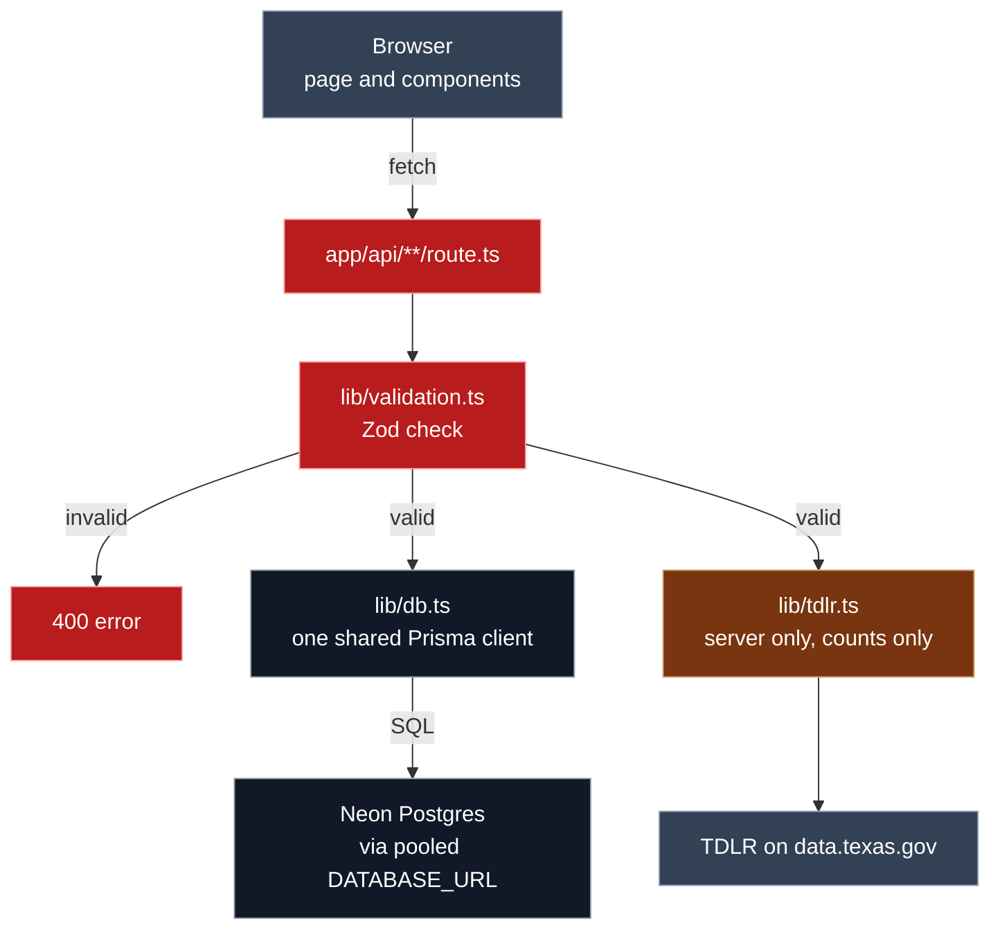

<p align="center"></p>

# Second Chance License Navigator

[](https://github.com/ClayClimate-AI/tx-license-navigator-next/actions/workflows/ci.yml)
[](https://app.netlify.com/projects/tx-license-navigator-next/deploys)

See how many people hold a Texas occupational license in a county, using live data from the Texas Department of Licensing and Regulation (TDLR), and keep a watchlist of saved searches so job seekers can track local demand before they train.

Week 5 rebuild of the Week 4 app in Next.js, adding a saved-searches watchlist stored in Neon Postgres.

**Live:** https://tx-license-navigator-next.netlify.app

## What it does

- **Search:** pick a license type and one of 13 Texas counties, get the live number of license holders there.
- **Watchlist:** save a search with a label and an optional note, see your saved searches with fresh counts, edit the label and note, or delete one.

## Privacy: counts only

The app asks TDLR for counts and nothing else. It never fetches or shows names, addresses, or license numbers. The watchlist stores only the license type, county, label, and note.

## Status

| Stage | Issue | | Status |
|---|---|---|---|
| B · Foundation | #1 | Project shell with the Week 4 look | ✅ |
| | #2 | Database ready | ✅ |
| C · Read, delete, edit | #3 | See my saved searches | ✅ |
| | #4 | Delete a saved search | ✅ |
| | #5 | Edit a saved search's label and note | ✅ |
| D · Search and save | #6 | Search a license count | ✅ |
| | #7 | Live license types from TDLR | ✅ |
| | #8 | Save a search to the watchlist | ✅ |
| E · Counts and done check | #9 | Live counts on saved cards | ✂️ cut |
| | #10 | Done check | ✅ |
| F · Deploy | #11 | Deploy to Netlify | ✅ |

## Stack

| Part | Choice |
|---|---|
| Framework | Next.js 16.4.1 (App Router, Route Handlers), React 19.3, TypeScript |
| Styling | Tailwind CSS 4 |
| Database | Neon Postgres (`dev` branch for building, `production` for the live site) |
| ORM | Prisma 7.10.0, pinned exactly (npm's `latest` tag is an 8.0 release candidate), with `@prisma/adapter-neon` |
| Validation | Zod 4 on every request body, query, and id |
| Hosting | Netlify, built from GitHub `main` on every push |
| CI | GitHub Actions: install, `prisma generate`, lint, build on push and pull request to `main` |
| Runtime | Node 22 or later (`.nvmrc`) |

## How a request flows



Saved searches go through Prisma to Neon. Counts go through `lib/tdlr.ts` to TDLR. Both paths pass the same Zod check first.

## Run it locally

1. Install Node 22 or later (`nvm use` reads `.nvmrc`).
2. `npm install`
3. Copy `.env.example` to `.env` and fill in both values from the Neon console (`dev` branch):
   - `DATABASE_URL`: the pooled connection string, used by the app
   - `DIRECT_URL`: the direct connection string, used by Prisma migrations

   `.env` is git-ignored. Never commit it.
4. `npx prisma migrate dev` creates the `SavedSearch` table on your Neon branch.
5. `npm run dev` and open http://localhost:3000.

| Script | What it does |
|---|---|
| `npm run dev` | Development server |
| `npm run build` | `prisma generate`, then `next build` (the same build Netlify runs) |
| `npm run lint` | ESLint |

## Deploy

Netlify builds from GitHub: every push to `main` runs `npm run build` and publishes to https://tx-license-navigator-next.netlify.app. The live site uses Neon's `production` branch.

1. Apply migrations to `production` once, from the laptop, with `DIRECT_URL` set for that one command (`.env` stays on `dev`):
   `DIRECT_URL="<production direct string>" npx prisma migrate deploy`
2. In Netlify (Project configuration → Environment variables), set `DATABASE_URL` (pooled) and `DIRECT_URL` (direct) to the Neon `production` strings.
3. Push to `main`. Netlify builds and publishes, and CI (`.github/workflows/ci.yml`) runs lint and build on Node 22 from `.nvmrc`. CI uses a placeholder `DATABASE_URL` and no secrets.

## API routes

| Route | Returns |
|---|---|
| `GET /api/types` | `{ types: [{ name, holders }] }`, top 50 from TDLR · 502 TDLR error · 504 after 8 s |
| `GET /api/count?type=&county=` | `{ count, queryUrl }` from TDLR · 400 bad query · 502 TDLR error · 504 after 8 s |
| `GET /api/searches` | saved searches, newest first |
| `POST /api/searches` | saves `{ licenseType, county, label, note? }` · 201 · 400 bad body · 409 already saved |
| `PATCH /api/searches/[id]` | updates label and note |
| `DELETE /api/searches/[id]` | removes one saved search |

## Project layout

```
app/          🟦 layout and page · 🟥 api/**/route.ts
components/   🟩 header, trust note, footer, and the search and watchlist UI
lib/          🟩 counties.ts · 🟥 validation.ts · ⬛ db.ts · 🟫 tdlr.ts
prisma/       ⬛ schema.prisma and migrations
docs/spec/    requirements, design, tasks
.github/      🟪 workflows/ci.yml
```

## How it's built

Work comes from GitHub issues, done in small steps through one loop: ask → review diff → accept → test → commit. Every accepted step is recorded in [`PROMPT_LOG.md`](PROMPT_LOG.md). What the app must do is in [`docs/spec/requirements.md`](docs/spec/requirements.md), and how it's built is in [`docs/spec/design.md`](docs/spec/design.md).

## Data source

TDLR All Licenses on [data.texas.gov](https://data.texas.gov/d/7358-krk7) (dataset 7358-krk7).

A student project, not an official State of Texas website. General information, not legal advice.
