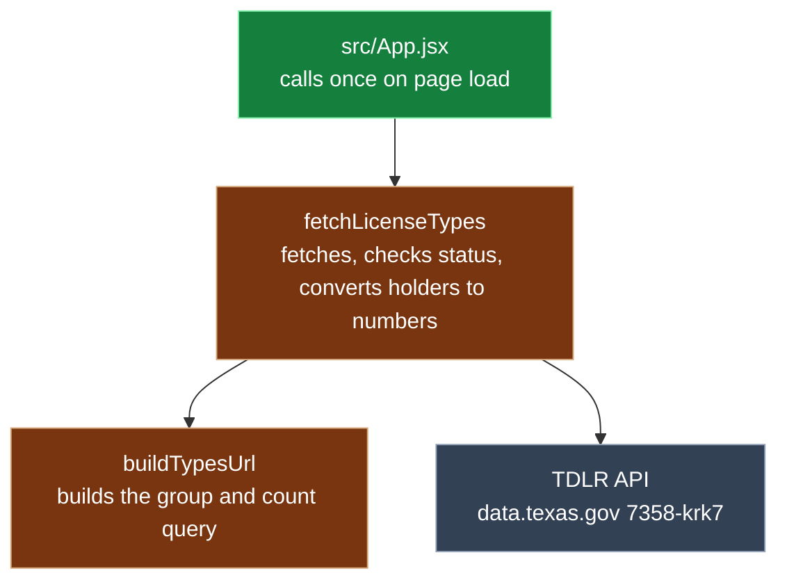

# Prompt Log format (context)

This document describes how Joseph keeps his Prompt Log. It is context only. It explains the method and the structure so an agent reading the project understands what the log looks like. It is not a build plan and it does not assign tasks.

Source of truth: the real Week 4 log, `PROMPT_LOG.md` in https://github.com/ClayClimate-AI/tx-license-navigator. Everything below marked **(seen)** is copied from that file. Anything marked **(proposed)** is new for Week 5 and still open for the grill session.

## Purpose

The log is graded evidence that Joseph directed and reviewed the agent's work instead of just trusting it. Each entry records one prompt to the agent: what was asked, what context was loaded, what changed, whether Joseph accepted it, how it was checked, the commit, and then Joseph's own reflection and plain language explanation of the change. Call graphs show how the changed files connect, so Joseph can explain the architecture.

## Overall layout (seen, in this order)

1. **Banner and title**, centered HTML:
   ```html
   <p align="center"></p>
   <h1 align="center">Prompt Log</h1>
   <p align="center"><b>TX License Navigator</b> · Week 4 · Kiro CLI · claude-opus-5.5</p>
   ```
2. `---` horizontal rule between every section.
3. **`## Legend`**: one line per layer. Each line is an emoji color square, the layer name, and the files or packages in that layer inside `<code>` tags, ending with `<br>`.
4. **`## Project info`**: a Field / Details table with One liner, Privacy, Tools.
5. **`## Entry N · Title`** sections, one per prompt.
6. After an entry, optional **`### Entry N call graph`** and optional **`### Entry N async sequence`**.
7. **`## Lesson asks`**: a Day / Details table (Day 1, Day 2, Day 3).
8. **`## Friday submit`**: a Field / Details table with "Change I will explain" and "Mistake I caught".

## Legend layers

Week 4 (seen):

```html
🟦 Entry (<code>index.html</code>, <code>src/main.jsx</code>)<br>
🟩 UI (<code>src/App.jsx</code>, <code>src/components/LicensePicker.jsx</code>, <code>src/data/counties.js</code>, <code>src/components/ResultCard.jsx</code>, <code>src/components/StatusMessage.jsx</code>, <code>react</code>, <code>react-dom</code>)<br>
🟧 Style (<code>src/index.css</code>, <code>tailwindcss</code>, <code>@tailwindcss/vite</code>)<br>
🟪 Build tools (<code>vite.config.js</code>, <code>vite</code>, <code>@vitejs/plugin-react</code>)<br>
🟨 Dependencies (<code>package.json</code>, <code>package-lock.json</code>)<br>
🟫 API (<code>src/api/tdlr.js</code>)
```

Week 5 (proposed): the same idea, with file lists updated for Next.js once the files exist, plus a **database layer**, for example:

```html
⬛ Database (<code>prisma/schema.prisma</code>, <code>@prisma/client</code>, the SQLite file)<br>
```

The exact emoji, color, and file list for the database layer are not decided. The Week 4 colors were chosen per layer, so a new one just needs to be distinct. The same emoji square is used in front of file names inside entries (for example 🟩 <code>src/App.jsx</code>), so a reader can see the layer at a glance.

## Per entry structure (seen)

Heading: `## Entry N · Short title`, for example `## Entry 2 · Task 1 scaffold`.
Under it, an italic time line: `*Oct 6 · 18:40 to 18:49 CT*`.

Then one 2 column HTML table. The first row is always the header `Field | Details`. Field names are bold. The rows used in all 7 Week 4 entries, in this order:

| Field | What goes in it (Week 4 practice) |
|---|---|
| Tool | tool and model, e.g. `Kiro CLI · claude-opus-5.5` |
| Asked | one line summary of the prompt and its scope ("Task 1 only ... Show the diff and stop") |
| Context | files loaded, as a `<ul>` list, or "same as Entry 1" |
| Changed | count of new and edited files, then a `<ul>` of files with layer emoji and (new) or (modified); pinned versions if relevant |
| Decision | accepted, rejected, or n/a (read only) |
| Verified | `<ul>` of checks, each starting with a time: `~18:03 CT · ...` or `by 18:49 CT · ...` |
| Commit | short hash in `<code>` plus the commit message, or none |
| Reflection | Joseph's first person bullets: what he learned, what he caught, what he would do differently |
| Explained | bold title line, then bullets: What it is, Why, Files (nested list), Its role in the project. Kid friendly analogies (the empty house, the recipe) |

Formatting rules seen in the file:
* Multi item cells use `<ul><li>` inside the `<td>`. Nested lists use a `<ul>` inside an `<li>`.
* File names, functions, and commands always go in `<code>` tags.
* Middle dot `·` separates parts of a line (time · check, tool · model).

**PIOF (seen in the Week 5 kit, not in Week 4):** the Week 4 log has no PIOF row. The Week 5 kit steering file added a row named "PIOF and what differed" between Commit and Reflection, written by Joseph. Whether to keep that row is an open question for the grill session.

## Call graph (seen)

* Heading `### Entry N call graph`, then a fenced `mermaid` block using `flowchart TD`.
* Node label: file or function name, then `<br/>`, then a short plain description, e.g. `H[index.html<br/>front door]:::entry`.
* Each node gets a layer class with `:::name`.
* One edge or node per line. `classDef` lines go at the end, one per line, and only for layers used in that graph.
* Class names used in Week 4 and their colors:

```
classDef run fill:#334155,color:#fff,stroke:#94a3b8
classDef entry fill:#1d4ed8,color:#fff,stroke:#93c5fd
classDef ui fill:#15803d,color:#fff,stroke:#86efac
classDef css fill:#c2410c,color:#fff,stroke:#fdba74
classDef tool fill:#7e22ce,color:#fff,stroke:#d8b4fe
classDef deps fill:#a16207,color:#fff,stroke:#fde68a
classDef api fill:#78350f,color:#fff,stroke:#d6a77a
```

`run` is used for things outside the code, like the Browser or the TDLR API. A Week 5 database class (for example `db`) is proposed, color not decided.

Naming rule (from the kit steering, matches Week 4 practice): never name a classDef `style`, `class`, `end`, `graph`, or `default`, because those are Mermaid keywords and break rendering. Keep one node, edge, or classDef per line.

## Optional sequence diagram (seen once)

Entry 3 added `### Entry N async sequence` with a `sequenceDiagram` to show async timing (a Promise returned right away, `await fetch`, `.then` and `.catch`). It is used only when order in time matters, not for every entry.

## Who writes what

From the Week 5 kit steering, consistent with how the Week 4 entries read (inferred for Week 4):
* The agent fills only facts it can check in the session and in git: Tool, Asked, Context, Changed, Decision, Verified, Commit.
* Joseph writes Reflection and Explained (and PIOF if that row is kept), and pastes them in himself.
* When Joseph asks, the agent may format his text (bullets, bold title, legend emoji, `<code>` spans) without adding, removing, or changing any words.
* The agent does not commit or push. Joseph runs git himself.

## Example entry (copied from Week 4 Entry 3, trimmed)

```html
## Entry 3 · Task 2 fetch license types

*Oct 6 · 20:27 to 20:48 CT*

<table>
  <tr><th align="left">Field</th><th align="left">Details</th></tr>
  <tr><td><b>Tool</b></td><td>Kiro CLI · claude-opus-5.5</td></tr>
  <tr><td><b>Asked</b></td><td>Task 2 only: create 🟫 <code>src/api/tdlr.js</code> with <code>buildTypesUrl()</code> and <code>fetchLicenseTypes()</code>, log the list from 🟩 <code>src/App.jsx</code>. No UI, no packages</td></tr>
  <tr><td><b>Context</b></td><td>
    <ul>
      <li>steering (4 always-on files)</li>
      <li><code>tasks.md</code></li>
      <li><code>design.md</code></li>
    </ul>
  </td></tr>
  <tr><td><b>Changed</b></td><td>
    1 new file, 1 edited
    <ul>
      <li>🟫 <code>src/api/tdlr.js</code> (new)</li>
      <li>🟩 <code>src/App.jsx</code> (modified)</li>
    </ul>
  </td></tr>
  <tr><td><b>Decision</b></td><td>accepted</td></tr>
  <tr><td><b>Verified</b></td><td>
    <ul>
      <li>~20:28 CT · <code>npm run build</code> passed</li>
    </ul>
  </td></tr>
  <tr><td><b>Commit</b></td><td>(hash) (message)</td></tr>
  <tr><td><b>Reflection</b></td><td>
    <ul>
      <li>(Joseph writes)</li>
    </ul>
  </td></tr>
  <tr><td><b>Explained</b></td><td>
    <b>Entry 3 · Task 2 fetch license types</b>
    <ul>
      <li>What it is: (Joseph writes)</li>
      <li>Why: ...</li>
      <li>Its role in the project: ...</li>
    </ul>
  </td></tr>
</table>
```



Note: the Verified, Commit, Reflection, and Explained cells above are trimmed or replaced with placeholders. Full real text is in the Week 4 repo.

## Open for the grill session

* Keep, rename, or drop the PIOF row.
* Week 5 legend layers and the database color.
* Whether Lesson asks and Friday submit sections carry over unchanged.
