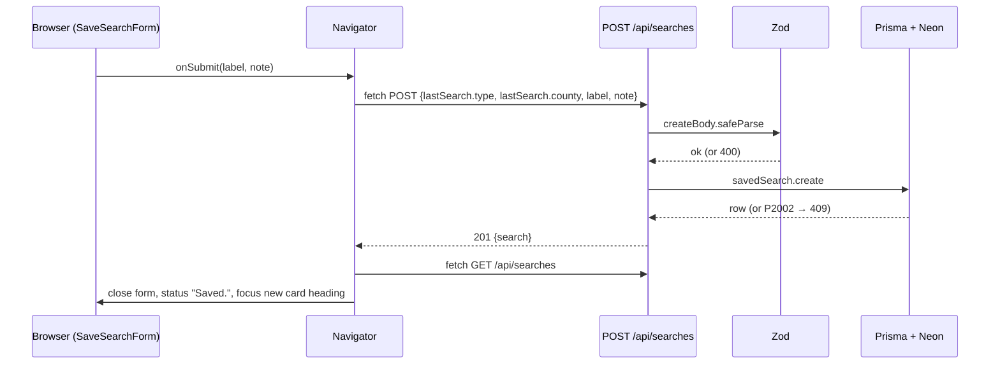

# Design

How the requirements in `requirements.md` are built. IDs in brackets (S3, C4, …) point back to them. The Week 4 look in `SOT_documents/UI.md` Part 1 applies everywhere this file is silent.

## File layout

```
app/
  layout.tsx              🟦 html shell, globals.css
  page.tsx                🟦 server component: header, intro, trust note, <Navigator/>, footer
  globals.css             🟧 Tailwind import, focus ring, tabular numbers
  api/
    types/route.ts        🟥 GET license types
    count/route.ts        🟥 GET holder count
    searches/route.ts     🟥 GET list, POST create
    searches/[id]/route.ts 🟥 PATCH edit, DELETE remove
components/               🟩
  SiteHeader.tsx  TrustNote.tsx  SiteFooter.tsx      (static, from Week 4)
  Navigator.tsx           'use client'; owns page state (like Week 4 App.jsx)
  LicensePicker.tsx  StatusMessage.tsx  ResultCard.tsx   (from Week 4)
  SaveSearchForm.tsx      create and edit mode
  SavedList.tsx           section, empty state, list error
  SavedCard.tsx           one saved search: view, editing, confirming delete; fetches its own count
lib/
  counties.ts             🟩 the 13 Week 4 counties { label, value }
  tdlr.ts                 🟫 server-only TDLR query builders and fetchers (ported from Week 4)
  db.ts                   ⬛ server-only Prisma client with the Neon adapter
  validation.ts           🟥 Zod schemas shared by the routes
prisma/
  schema.prisma           ⬛
  migrations/             ⬛ generated by prisma migrate dev
prisma.config.ts          ⬛ schema path, migrations path, DIRECT_URL
generated/prisma/         ⬛ generated client (git-ignored)
.env  .env.example
```

## State ownership

- `Navigator.tsx` holds the search state (types, selected type and county, result, `lastSearch`), the saved list, the list's load status, and the status-line message. It passes data down as props and receives events through callbacks, as in Week 4.
- `SavedCard.tsx` holds only its own UI mode (`view`, `editing`, `confirmingDelete`) and its own count state, fetched in a `useEffect` when it mounts. Cards are keyed by `id`, so refetching the list leaves existing cards and their counts alone. [R3, R4]
- After every successful save, edit, or delete, `Navigator` refetches `GET /api/searches`. The database is the one source of truth. [R5]

## Database ⬛

`prisma/schema.prisma`:

```prisma
generator client {
  provider = "prisma-client"
  output   = "../generated/prisma"
}

datasource db {
  provider = "postgresql"
}

model SavedSearch {
  id          Int      @id @default(autoincrement())
  licenseType String
  county      String   // ALL CAPS, as TDLR expects, e.g. FORT BEND
  label       String
  note        String?
  createdAt   DateTime @default(now())
  updatedAt   DateTime @updatedAt

  @@unique([licenseType, county])   // C4
}
```

- `prisma.config.ts` loads `.env` (Prisma 7 does not load it on its own), points at the schema and `prisma/migrations`, and gives the CLI `DIRECT_URL`.
- `lib/db.ts` creates one `PrismaClient` with `PrismaNeon` and `DATABASE_URL` (pooled), and reuses it across dev hot reloads via `globalThis`. It imports `server-only`.
- The build script runs `prisma generate` before `next build`, so Netlify has a client.
- Migrations: `prisma migrate dev` against Neon `dev` while building. Before the deploy, `prisma migrate deploy` is run once from the laptop with `DIRECT_URL` pointed at Neon `main`.
- The exact Prisma 7 config syntax is confirmed against the Prisma docs in the setup task, not taken from memory.

## Validation (`lib/validation.ts`, Zod 4)

| Schema | Rules |
|---|---|
| `idParam` | coerces to an integer ≥ 1. `"abc"`, `"1.5"`, `"0"` fail. [E1] |
| `countQuery` | `type`: trimmed string, 1–100 chars. `county`: one of the `lib/counties.ts` values. `break`: optional, only `"column"`. |
| `createBody` | `licenseType` as `type` above, `county` as above, `label`: trimmed, 1–80, `note`: trimmed, 0–280, empty becomes `null`. [C3] |
| `updateBody` | `label` and `note` only, same rules. Extra keys are rejected. [U2] |

## API contracts 🟥

Every error body is `{ "error": "<plain message>" }`. TDLR failures add `"status"` (TDLR's code, or `null` for timeout or no connection).

| Route | Success | Errors |
|---|---|---|
| `GET /api/types` | 200 `{ types: [{ name, holders }] }`, top 50 by holders | 502 TDLR error, 504 timeout |
| `GET /api/count?type=&county=[&break=column]` | 200 `{ count, queryUrl }` | 400 invalid query, 502 TDLR error (status 400 when `break=column`), 504 timeout [S6, S7] |
| `GET /api/searches` | 200 `{ searches: SavedSearch[] }`, `createdAt` desc [R1] | 500 |
| `POST /api/searches` | 201 `{ search }` | 400 invalid body, 409 duplicate (`P2002`), 500 |
| `PATCH /api/searches/[id]` | 200 `{ search }` | 400 invalid id or body, 404 no such id (`P2025`), 500 |
| `DELETE /api/searches/[id]` | 204, no body | 400 invalid id, 404 (`P2025`), 500 |

- Route handlers read `const { id } = await params`.
- `lib/tdlr.ts` calls TDLR with `AbortSignal.timeout(8000)` and no caching (`cache: 'no-store'`). Queries use only `license_type`, `business_county`, `count(*)`. [P1]
- `break=column` swaps `business_county` for `business_countyy`, as in Week 4.
- Error messages: 409 "You already saved this search." · 500 "We could not reach the saved searches database." · 404 "That saved search no longer exists."

## Flows

Save (C1–C4, A1–A2):



Edit and delete follow the same shape: card event → `Navigator` → PATCH or DELETE → Zod → Prisma → refetch list → status line and focus.

## UI 🟩

Page order, one column (`max-w-3xl`): header bands · h1 · intro · trust note · LicensePicker · status line · ResultCard · My saved searches · footer.

New wording (everything else keeps the Week 4 wording in `UI.md`):

| Where | Text |
|---|---|
| Result card button | "Save to watchlist" (success and empty only) [C1] |
| Save form | Label field "Label", prefilled "{type} in {county} County". Note field "Note", hint "Why I'm tracking this (optional)". Buttons "Save" and "Cancel". |
| Saved section heading | "My saved searches" |
| Empty list | "Nothing saved yet. Run a search above, then select Save to watchlist." [R2] |
| List load error | "We could not reach the saved searches database." + "Try again" |
| Card actions | "Edit" · "Delete" |
| Delete confirm | "Delete this saved search?" + "Delete" · "Keep" [D1] |
| Status line | "Saved." · "Changes saved." · "Deleted." [A1] |

Saved card look:
- White box, thin border `#C7D0DB`. Label as the card heading (h3, focusable for A2), then "{type} · {county label} County", the note if any, then the count area.
- The count area reuses the Week 4 result states at a smaller size: loading text, navy count (success), yellow empty box, pink error box with code and Try again.
- Edit mode swaps the label and note for `SaveSearchForm` in edit mode; the type, county, and count stay visible.
- Form errors (400, 409, 500) show above the form buttons in red `#A3243B` with `role="alert"`, and the typed values stay. [C4, E3]

Focus [A2]:
- Card headings get `id="saved-{id}-heading"` and `tabIndex={-1}`; after the refetch, `Navigator` focuses the new card's heading by id.
- After an edit, focus goes to that card's Edit button. After a delete, to the "My saved searches" heading. After Cancel or Keep, back to the button that opened the form.
